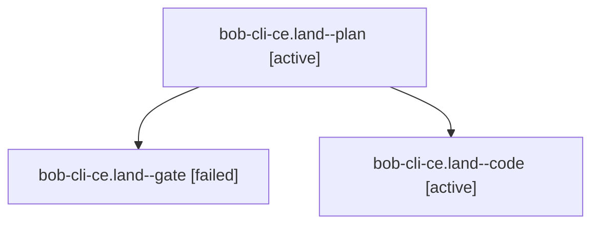

# Session: bob-cli-ce.land

[Agent Hoods](../README.md) / [bbugyi200](../users/bbugyi200/README.md) / [athena](../users/bbugyi200/machines/athena/README.md) / [bob-cli-ce](../users/bbugyi200/machines/athena/hoods/bob-cli-ce/README.md) / bob-cli-ce.land

Owner: `bbugyi200.athena` · Hood: `bob-cli-ce` · Members: 3 · Bead: [bob-cli-ce](https://github.com/bobs-org/bob-cli--beads/blob/main/pages/bob-cli-ce/README.md)

## Lineage

The diagram is an optional enhancement; the ordered table below contains the same lineage in accessible text.

| Role | Agent | State | Model / provider | Timing | Commits | Prompt | Chat |
|---|---|---|---|---|---:|---|---|
| plan | bob-cli-ce.land--plan | active | opus / claude | 2026-10-26T18:31:50.257154+00:00 | 0 | [Prompt](../agents/bbugyi200.athena.bob-cli-ce.land--plan/prompt.md) | [Chat](../agents/bbugyi200.athena.bob-cli-ce.land--plan/chat.md) |
| gate | bob-cli-ce.land--gate | failed | opus / claude | 2026-10-26T19:08:30.192937+00:00 → 2026-10-26T19:09:41.439284+00:00 | 0 | — | [Chat](../agents/bbugyi200.athena.bob-cli-ce.land--gate/chat.md) |
| code | bob-cli-ce.land--code | active | muse-spark-1.3-contributor / muse | 2026-10-26T19:10:24.035853+00:00 | 0 | — | — |

## Neighbors

| Agent | Relation | State |
|---|---|---|
| [bob-cli-ce.1](../agents/bbugyi200.athena.bob-cli-ce.1/README.md) | bob-cli-ce hood | completed |
| [bob-cli-ce.10](../agents/bbugyi200.athena.bob-cli-ce.10/README.md) | bob-cli-ce hood | completed |
| [bob-cli-ce.11](../agents/bbugyi200.athena.bob-cli-ce.11/README.md) | bob-cli-ce hood | completed |
| [bob-cli-ce.2](../agents/bbugyi200.athena.bob-cli-ce.2/README.md) | bob-cli-ce hood | completed |
| [bob-cli-ce.3](../agents/bbugyi200.athena.bob-cli-ce.3/README.md) | bob-cli-ce hood | completed |
| [bob-cli-ce.4](../agents/bbugyi200.athena.bob-cli-ce.4/README.md) | bob-cli-ce hood | completed |
| [bob-cli-ce.5](../agents/bbugyi200.athena.bob-cli-ce.5/README.md) | bob-cli-ce hood | completed |
| [bob-cli-ce.6](../agents/bbugyi200.athena.bob-cli-ce.6/README.md) | bob-cli-ce hood | completed |
| [bob-cli-ce.7](../agents/bbugyi200.athena.bob-cli-ce.7/README.md) | bob-cli-ce hood | completed |
| [bob-cli-ce.8](../agents/bbugyi200.athena.bob-cli-ce.8/README.md) | bob-cli-ce hood | completed |
| [bob-cli-ce.9](../agents/bbugyi200.athena.bob-cli-ce.9/README.md) | bob-cli-ce hood | completed |
