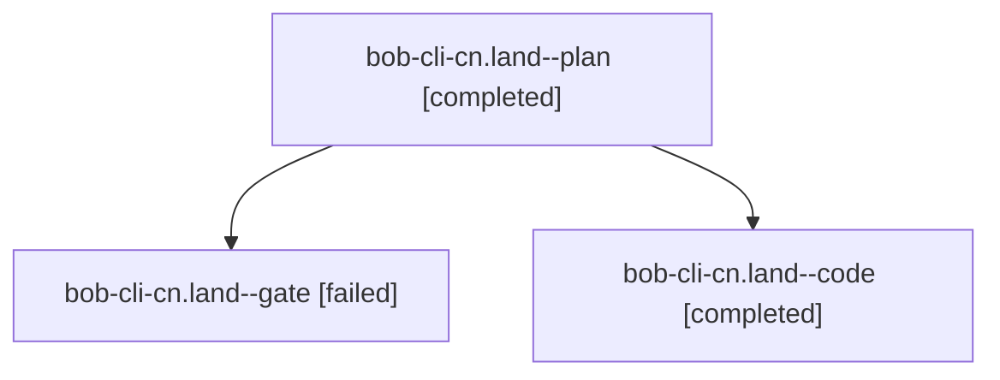

# Session: bob-cli-cn.land

[Agent Hoods](../README.md) / [bbugyi200](../users/bbugyi200/README.md) / [athena](../users/bbugyi200/machines/athena/README.md) / [bob-cli-cn](../users/bbugyi200/machines/athena/hoods/bob-cli-cn/README.md) / bob-cli-cn.land

Owner: `bbugyi200.athena` · Hood: `bob-cli-cn` · Members: 3 · Bead: [bob-cli-cn](https://github.com/bobs-org/bob-cli--beads/blob/main/pages/bob-cli-cn/README.md)

## Lineage

The diagram is an optional enhancement; the ordered table below contains the same lineage in accessible text.

| Role | Agent | State | Model / provider | Timing | Commits | Prompt | Chat |
|---|---|---|---|---|---:|---|---|
| plan | bob-cli-cn.land--plan | completed | gpt-6-astra / codex | 2026-10-26T18:44:41.122111+00:00 → 2026-10-26T19:37:30.057963+00:00 | 0 | [Prompt](../agents/bbugyi200.athena.bob-cli-cn.land--plan/prompt.md) | [Chat](../agents/bbugyi200.athena.bob-cli-cn.land--plan/chat.md) |
| gate | bob-cli-cn.land--gate | failed | gpt-6-astra / codex | 2026-10-26T19:02:36.161677+00:00 → 2026-10-26T19:03:32.006996+00:00 | 0 | — | [Chat](../agents/bbugyi200.athena.bob-cli-cn.land--gate/chat.md) |
| code | bob-cli-cn.land--code | completed | grok-4.6 / grok | 2026-10-26T19:03:47.683235+00:00 → 2026-10-26T19:37:30.057963+00:00 | [1](../agents/bbugyi200.athena.bob-cli-cn.land--code/README.md#commits) | — | [Chat](../agents/bbugyi200.athena.bob-cli-cn.land--code/chat.md) |

## Commits

| Role | Repo | Commit | Subject | Committed |
|---|---|---|---|---|
| code | bob-cli | [`777df22`](https://github.com/bobs-org/bob-cli/commit/777df22f5b8f02e59a53e0d705e794e29a96decd) | fix(stats): share the usable-day rule with typical day | 2026-10-26 15:32:03 EDT |

## Neighbors

| Agent | Relation | State |
|---|---|---|
| [bob-cli-cn.1](../agents/bbugyi200.athena.bob-cli-cn.1/README.md) | bob-cli-cn hood | completed |
| [bob-cli-cn.2](../agents/bbugyi200.athena.bob-cli-cn.2/README.md) | bob-cli-cn hood | completed |
| [bob-cli-cn.3](../agents/bbugyi200.athena.bob-cli-cn.3/README.md) | bob-cli-cn hood | completed |
