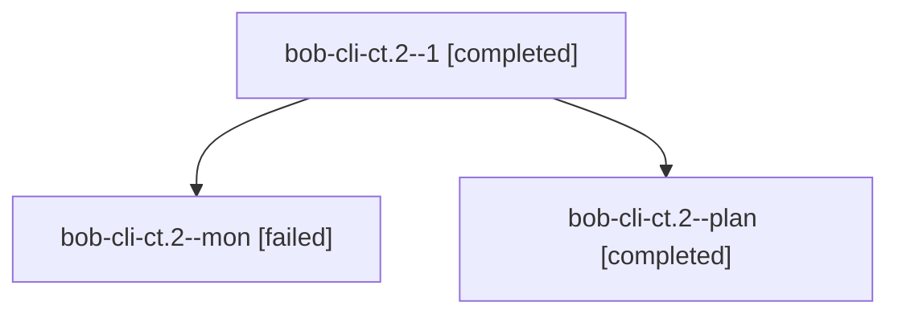

# Session: bob-cli-ct.2

[Agent Hoods](../README.md) / [bbugyi200](../users/bbugyi200/README.md) / [athena](../users/bbugyi200/machines/athena/README.md) / [bob-cli-ct](../users/bbugyi200/machines/athena/hoods/bob-cli-ct/README.md) / bob-cli-ct.2

Owner: `bbugyi200.athena` · Hood: `bob-cli-ct` · Members: 3 · Bead: [bob-cli-ct.2](https://github.com/bobs-org/bob-cli--beads/blob/main/pages/bob-cli-ct/bob-cli-ct.2.md)

## Lineage

The diagram is an optional enhancement; the ordered table below contains the same lineage in accessible text.

| Role | Agent | State | Model / provider | Timing | Commits | Prompt | Chat |
|---|---|---|---|---|---:|---|---|
| 1 | bob-cli-ct.2--1 | completed | grok-4.6 / grok | 2026-10-26T20:40:25.228264+00:00 → 2026-10-26T20:55:51.885606+00:00 | [1](../agents/bbugyi200.athena.bob-cli-ct.2--1/README.md#commits) | [Prompt](../agents/bbugyi200.athena.bob-cli-ct.2--1/prompt.md) | [Chat](../agents/bbugyi200.athena.bob-cli-ct.2--1/chat.md) |
| mon | bob-cli-ct.2--mon | failed | grok-4.6 / grok | 2026-10-26T20:34:04.418598+00:00 → 2026-10-26T20:39:30.129006+00:00 | 0 | — | [Chat](../agents/bbugyi200.athena.bob-cli-ct.2--mon/chat.md) |
| plan | bob-cli-ct.2--plan | completed | grok-4.6 / grok | 2026-10-26T20:08:19.133198+00:00 → 2026-10-26T20:34:58.906726+00:00 | 0 | [Prompt](../agents/bbugyi200.athena.bob-cli-ct.2--plan/prompt.md) | [Chat](../agents/bbugyi200.athena.bob-cli-ct.2--plan/chat.md) |

## Commits

| Role | Repo | Commit | Subject | Committed |
|---|---|---|---|---|
| 1 | bob-cli | [`82716a6`](https://github.com/bobs-org/bob-cli/commit/82716a6444e15457cbf432fd08636e2dcce0ea86) | feat(ref): add bob ref links read surface | 2026-10-26 16:53:14 EDT |

## Neighbors

| Agent | Relation | State |
|---|---|---|
| [bob-cli-ct.1](../agents/bbugyi200.athena.bob-cli-ct.1/README.md) | bob-cli-ct hood | completed |
| [bob-cli-ct.3](bbugyi200.athena.bob-cli-ct.3.md) (session · 5) | bob-cli-ct hood | active 1, completed 2, failed 2 |
| [bob-cli-ct.4](../agents/bbugyi200.athena.bob-cli-ct.4/README.md) | bob-cli-ct hood | completed |
| [bob-cli-ct.5](../agents/bbugyi200.athena.bob-cli-ct.5/README.md) | bob-cli-ct hood | active |
| [bob-cli-ct.land](../agents/bbugyi200.athena.bob-cli-ct.land/README.md) | bob-cli-ct hood | waiting |
