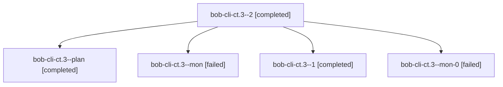

# Session: bob-cli-ct.3

[Agent Hoods](../README.md) / [bbugyi200](../users/bbugyi200/README.md) / [athena](../users/bbugyi200/machines/athena/README.md) / [bob-cli-ct](../users/bbugyi200/machines/athena/hoods/bob-cli-ct/README.md) / bob-cli-ct.3

Owner: `bbugyi200.athena` · Hood: `bob-cli-ct` · Members: 5 · Bead: [bob-cli-ct.3](https://github.com/bobs-org/bob-cli--beads/blob/main/pages/bob-cli-ct/bob-cli-ct.3.md)

## Lineage



The diagram is an optional enhancement; the ordered table below contains the same lineage in accessible text.

| Role | Agent | State | Model / provider | Timing | Commits | Prompt | Chat |
|---|---|---|---|---|---:|---|---|
| <a id="member-2"></a>2 | bob-cli-ct.3--2 | completed | gpt-6-astra / codex | 2026-10-27T01:33:08.994803+00:00 → 2026-10-27T01:38:38.665919+00:00 | [1](../agents/bbugyi200.athena.bob-cli-ct.3--2/README.md#commits) | [Prompt](../agents/bbugyi200.athena.bob-cli-ct.3--2/prompt.md) | [Chat](../agents/bbugyi200.athena.bob-cli-ct.3--2/chat.md) |
| <a id="member-plan"></a>plan | bob-cli-ct.3--plan | completed | gpt-6-astra / codex | 2026-10-27T00:33:59.895928+00:00 → 2026-10-27T00:48:33.673924+00:00 | 0 | [Prompt](../agents/bbugyi200.athena.bob-cli-ct.3--plan/prompt.md) | [Chat](../agents/bbugyi200.athena.bob-cli-ct.3--plan/chat.md) |
| <a id="member-mon"></a>mon | bob-cli-ct.3--mon | failed | gpt-6-astra / codex | 2026-10-27T00:47:43.928705+00:00 → 2026-10-27T00:56:33.814388+00:00 | 0 | — | [Chat](../agents/bbugyi200.athena.bob-cli-ct.3--mon/chat.md) |
| <a id="member-1"></a>1 | bob-cli-ct.3--1 | completed | gpt-6-astra / codex | 2026-10-27T01:12:56.132982+00:00 → 2026-10-27T01:22:11.890410+00:00 | 0 | [Prompt](../agents/bbugyi200.athena.bob-cli-ct.3--1/prompt.md) | [Chat](../agents/bbugyi200.athena.bob-cli-ct.3--1/chat.md) |
| <a id="member-mon-0"></a>mon-0 | bob-cli-ct.3--mon-0 | failed | gpt-6-astra / codex | 2026-10-27T01:20:09.506787+00:00 → 2026-10-27T01:33:01.435380+00:00 | 0 | — | [Chat](../agents/bbugyi200.athena.bob-cli-ct.3--mon-0/chat.md) |

## Commits

| Role | Repo | Commit | Subject | Committed |
|---|---|---|---|---|
| 2 | bob-cli | [`42abfa7`](https://github.com/bobs-org/bob-cli/commit/42abfa705a445647395fedea1691d885f53722b5) | feat(ref): add annotation-backed link recataloging (bob-cli-ct.3) | 2026-10-26 21:36:08 EDT |

## Variables

| Role | Variable | Value |
|---|---|---|
| 1 | `artifacts` | \[{bead: bob-cli-ct.3, kind: file, label: Complete recovered recatalog implementation and corrected help snapshot, path: /home/bryan/.sase/artifacts/agents/gh\_bobs-org\_\_bob-cli/20261026205533/recatalo… |
| plan | `artifacts` | \[{bead: bob-cli-ct.3, kind: file, label: Recovered bob-cli-ct.3 implementation before verification, path: /home/bryan/.sase/artifacts/agents/gh\_bobs-org\_\_bob-cli/20261026203229/ct3-recovery-821ee55ed… |

#### artifacts

**Role:** `1`

```yaml
- bead: bob-cli-ct.3
  kind: file
  label: Complete recovered recatalog implementation and corrected help snapshot
  path: /home/bryan/.sase/artifacts/agents/gh_bobs-org__bob-cli/20261026205533/recatalog-recovery-complete-068f0cde362c.patch
  ref: file:explicit:f5d0dfc8eb958481428715dc
  source_path: /home/bryan/.local/state/sase/workspaces/bobs-org/bob-cli/bob-cli_10/.git/recatalog-recovery-complete.patch
```

#### artifacts

**Role:** `plan`

```yaml
- bead: bob-cli-ct.3
  kind: file
  label: Recovered bob-cli-ct.3 implementation before verification
  path: /home/bryan/.sase/artifacts/agents/gh_bobs-org__bob-cli/20261026203229/ct3-recovery-821ee55edf59.patch
  ref: file:explicit:68a06d5d2a81c40e1cc9c3e1
  source_path: /home/bryan/.local/state/sase/workspaces/bobs-org/bob-cli/bob-cli_10/.git/ct3-recovery.patch
```

Values are truncated for display; see each member's agent meta.json for the full values.

## Neighbors

| Agent | Relation | State |
|---|---|---|
| [bob-cli-ct.1](../agents/bbugyi200.athena.bob-cli-ct.1/README.md) | bob-cli-ct hood | completed |
| [bob-cli-ct.2](bbugyi200.athena.bob-cli-ct.2.md) (session · 3) | bob-cli-ct hood | completed 2, failed 1 |
| [bob-cli-ct.4](../agents/bbugyi200.athena.bob-cli-ct.4/README.md) | bob-cli-ct hood | completed |
| [bob-cli-ct.5](../agents/bbugyi200.athena.bob-cli-ct.5/README.md) | bob-cli-ct hood | completed |
| [bob-cli-ct.land](../agents/bbugyi200.athena.bob-cli-ct.land/README.md) | bob-cli-ct hood | active |
