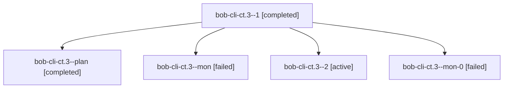

# Session: bob-cli-ct.3

[Agent Hoods](../README.md) / [bbugyi200](../users/bbugyi200/README.md) / [athena](../users/bbugyi200/machines/athena/README.md) / [bob-cli-ct](../users/bbugyi200/machines/athena/hoods/bob-cli-ct/README.md) / bob-cli-ct.3

Owner: `bbugyi200.athena` · Hood: `bob-cli-ct` · Members: 5 · Bead: [bob-cli-ct.3](https://github.com/bobs-org/bob-cli--beads/blob/main/pages/bob-cli-ct/bob-cli-ct.3.md)

## Lineage

The diagram is an optional enhancement; the ordered table below contains the same lineage in accessible text.

| Role | Agent | State | Model / provider | Timing | Commits | Prompt | Chat |
|---|---|---|---|---|---:|---|---|
| 1 | bob-cli-ct.3--1 | completed | gpt-6-luna / codex | 2026-10-26T21:31:49.957309+00:00 → 2026-10-26T21:40:18.319518+00:00 | 0 | [Prompt](../agents/bbugyi200.athena.bob-cli-ct.3--1/prompt.md) | [Chat](../agents/bbugyi200.athena.bob-cli-ct.3--1/chat.md) |
| plan | bob-cli-ct.3--plan | completed | gpt-6-luna / codex | 2026-10-26T20:56:50.677108+00:00 → 2026-10-26T21:26:32.597071+00:00 | 0 | [Prompt](../agents/bbugyi200.athena.bob-cli-ct.3--plan/prompt.md) | [Chat](../agents/bbugyi200.athena.bob-cli-ct.3--plan/chat.md) |
| mon | bob-cli-ct.3--mon | failed | gpt-6-luna / codex | 2026-10-26T21:25:32.105056+00:00 → 2026-10-26T21:31:12.186055+00:00 | 0 | — | [Chat](../agents/bbugyi200.athena.bob-cli-ct.3--mon/chat.md) |
| 2 | bob-cli-ct.3--2 | active | gpt-6-luna / codex | 20261026174607 | 0 | [Prompt](../agents/bbugyi200.athena.bob-cli-ct.3--2/prompt.md) | — |
| mon-0 | bob-cli-ct.3--mon-0 | failed | gpt-6-luna / codex | 2026-10-26T21:39:23.123490+00:00 → 2026-10-26T21:47:07.910111+00:00 | 0 | — | [Chat](../agents/bbugyi200.athena.bob-cli-ct.3--mon-0/chat.md) |

## Neighbors

| Agent | Relation | State |
|---|---|---|
| [bob-cli-ct.1](../agents/bbugyi200.athena.bob-cli-ct.1/README.md) | bob-cli-ct hood | completed |
| [bob-cli-ct.2](bbugyi200.athena.bob-cli-ct.2.md) (session · 3) | bob-cli-ct hood | completed 2, failed 1 |
| [bob-cli-ct.4](../agents/bbugyi200.athena.bob-cli-ct.4/README.md) | bob-cli-ct hood | completed |
| [bob-cli-ct.5](../agents/bbugyi200.athena.bob-cli-ct.5/README.md) | bob-cli-ct hood | active |
| [bob-cli-ct.land](../agents/bbugyi200.athena.bob-cli-ct.land/README.md) | bob-cli-ct hood | waiting |
