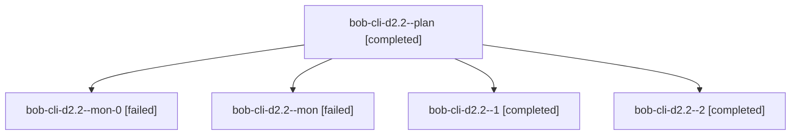

# Session: bob-cli-d2.2

[Agent Hoods](../README.md) / [bbugyi200](../users/bbugyi200/README.md) / [athena](../users/bbugyi200/machines/athena/README.md) / [bob-cli-d2](../users/bbugyi200/machines/athena/hoods/bob-cli-d2/README.md) / bob-cli-d2.2

Owner: `bbugyi200.athena` · Hood: `bob-cli-d2` · Members: 5 · Bead: [bob-cli-d2.2](https://github.com/bobs-org/bob-cli--beads/blob/main/pages/bob-cli-d2/bob-cli-d2.2.md)

## Lineage

The diagram is an optional enhancement; the ordered table below contains the same lineage in accessible text.

| Role | Agent | State | Model / provider | Timing | Commits | Prompt | Chat |
|---|---|---|---|---|---:|---|---|
| plan | bob-cli-d2.2--plan | completed | gpt-6-luna / codex | 2026-10-27T11:44:39.972356+00:00 → 2026-10-27T12:07:39.811540+00:00 | 0 | [Prompt](../agents/bbugyi200.athena.bob-cli-d2.2--plan/prompt.md) | [Chat](../agents/bbugyi200.athena.bob-cli-d2.2--plan/chat.md) |
| mon-0 | bob-cli-d2.2--mon-0 | failed | gpt-6-luna / codex | 2026-10-27T12:19:49.368100+00:00 → 2026-10-27T12:27:49.007280+00:00 | 0 | — | [Chat](../agents/bbugyi200.athena.bob-cli-d2.2--mon-0/chat.md) |
| mon | bob-cli-d2.2--mon | failed | gpt-6-luna / codex | 2026-10-27T12:07:02.075863+00:00 → 2026-10-27T12:12:41.787016+00:00 | 0 | — | [Chat](../agents/bbugyi200.athena.bob-cli-d2.2--mon/chat.md) |
| 1 | bob-cli-d2.2--1 | completed | gpt-6-luna / codex | 2026-10-27T12:13:36.004708+00:00 → 2026-10-27T12:20:33.520818+00:00 | 0 | [Prompt](../agents/bbugyi200.athena.bob-cli-d2.2--1/prompt.md) | [Chat](../agents/bbugyi200.athena.bob-cli-d2.2--1/chat.md) |
| 2 | bob-cli-d2.2--2 | completed | gpt-6-luna / codex | 2026-10-27T12:27:10.785091+00:00 → 2026-10-27T12:34:15.734823+00:00 | [1](../agents/bbugyi200.athena.bob-cli-d2.2--2/README.md#commits) | [Prompt](../agents/bbugyi200.athena.bob-cli-d2.2--2/prompt.md) | [Chat](../agents/bbugyi200.athena.bob-cli-d2.2--2/chat.md) |

## Commits

| Role | Repo | Commit | Subject | Committed |
|---|---|---|---|---|
| 2 | bob-cli | [`d38bef5`](https://github.com/bobs-org/bob-cli/commit/d38bef590c065b2bfef67745b0e83ce350707498) | feat(ref): adopt orphan saved source stores | 2026-10-27 08:32:19 EDT |

## Neighbors

| Agent | Relation | State |
|---|---|---|
| [bob-cli-d2.1](../agents/bbugyi200.athena.bob-cli-d2.1/README.md) | bob-cli-d2 hood | completed |
| [bob-cli-d2.3](../agents/bbugyi200.athena.bob-cli-d2.3/README.md) | bob-cli-d2 hood | completed |
| [bob-cli-d2.land](bbugyi200.athena.bob-cli-d2.land.md) (session · 4) | bob-cli-d2 hood | active 1, completed 2, failed 1 |
