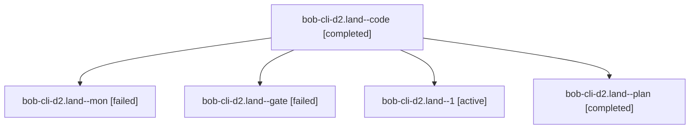

# Session: bob-cli-d2.land

[Agent Hoods](../README.md) / [bbugyi200](../users/bbugyi200/README.md) / [athena](../users/bbugyi200/machines/athena/README.md) / [bob-cli-d2](../users/bbugyi200/machines/athena/hoods/bob-cli-d2/README.md) / bob-cli-d2.land

Owner: `bbugyi200.athena` · Hood: `bob-cli-d2` · Members: 5 · Bead: [bob-cli-d2](https://github.com/bobs-org/bob-cli--beads/blob/main/pages/bob-cli-d2/README.md)

## Lineage



The diagram is an optional enhancement; the ordered table below contains the same lineage in accessible text.

| Role | Agent | State | Model / provider | Timing | Commits | Prompt | Chat |
|---|---|---|---|---|---:|---|---|
| <a id="member-code"></a>code | bob-cli-d2.land--code | completed | gpt-6-luna / codex | 2026-10-27T13:25:20.143748+00:00 → 2026-10-27T13:43:07.082917+00:00 | 0 | — | [Chat](../agents/bbugyi200.athena.bob-cli-d2.land--code/chat.md) |
| <a id="member-mon"></a>mon | bob-cli-d2.land--mon | failed | gpt-6-luna / codex | 2026-10-27T13:42:13.743146+00:00 → 2026-10-27T13:44:58.221447+00:00 | 0 | — | [Chat](../agents/bbugyi200.athena.bob-cli-d2.land--mon/chat.md) |
| <a id="member-gate"></a>gate | bob-cli-d2.land--gate | failed | gpt-6-astra / codex | 2026-10-27T13:24:32.414858+00:00 → 2026-10-27T13:24:52.570148+00:00 | 0 | — | [Chat](../agents/bbugyi200.athena.bob-cli-d2.land--gate/chat.md) |
| <a id="member-1"></a>1 | bob-cli-d2.land--1 | active | gpt-6-luna / codex | 2026-10-27T13:45:57.140803+00:00 | [1](../agents/bbugyi200.athena.bob-cli-d2.land--1/README.md#commits) | [Prompt](../agents/bbugyi200.athena.bob-cli-d2.land--1/prompt.md) | — |
| <a id="member-plan"></a>plan | bob-cli-d2.land--plan | completed | gpt-6-astra / codex | 2026-10-27T13:03:08.166798+00:00 → 2026-10-27T13:43:07.082917+00:00 | 0 | [Prompt](../agents/bbugyi200.athena.bob-cli-d2.land--plan/prompt.md) | [Chat](../agents/bbugyi200.athena.bob-cli-d2.land--plan/chat.md) |

## Commits

| Role | Repo | Commit | Subject | Committed |
|---|---|---|---|---|
| 1 | bob-cli | [`4cc0ef7`](https://github.com/bobs-org/bob-cli/commit/4cc0ef7dc131fb43570275716517de6cd9407a9b) | feat(ref): add verified saved Markdown source attachment | 2026-10-27 10:22:37 EDT |

## Variables

| Role | Variable | Value |
|---|---|---|
| 1 | `artifacts` | \[{bead: bob-cli-d2, kind: file, label: saved-Markdown refreshed 143-entry hook inventory, path: /home/bryan/.sase/artifacts/agents/gh\_bobs-org\_\_bob-cli/20261027094358/window-refreshed-757a2351658e.js… |
| plan | `artifacts` | \[{bead: bob-cli-d2, kind: markdown, label: bob-cli-d2 landing audit and remaining-work reproductions, path: /home/bryan/.sase/artifacts/agents/gh\_bobs-org\_\_bob-cli/20261027074356/bob-cli-d2-land-audi… |

#### artifacts

**Role:** `1`

```yaml
- bead: bob-cli-d2
  kind: file
  label: saved-Markdown refreshed 143-entry hook inventory
  path: /home/bryan/.sase/artifacts/agents/gh_bobs-org__bob-cli/20261027094358/window-refreshed-757a2351658e.json
  ref: file:explicit:189960637c2c461f1b41e91b
  source_path: /tmp/bob-cli-d2-land/inventory/window-refreshed.json
- bead: bob-cli-d2
  kind: file
  label: saved-Markdown attach-source dry-run results and stop gate
  path: /home/bryan/.sase/artifacts/agents/gh_bobs-org__bob-cli/20261027094358/verification-results-71388ba535a7.json
  ref: file:explicit:65cf00f6aef47b5c575e10e2
  source_path: /tmp/bob-cli-d2-land/inventory/verification-results.json
- bead: bob-cli-d2
  kind: markdown
  label: saved-Markdown landing results and blocker
  path: /home/bryan/.sase/artifacts/agents/gh_bobs-org__bob-cli/20261027094358/landing-results-7dec42db0955.md
  ref: file:explicit:a56b38495295a784e55ac0a0
  source_path: /tmp/bob-cli-d2-land/inventory/landing-results.md
```

#### artifacts

**Role:** `plan`

```yaml
- bead: bob-cli-d2
  kind: markdown
  label: bob-cli-d2 landing audit and remaining-work reproductions
  path: /home/bryan/.sase/artifacts/agents/gh_bobs-org__bob-cli/20261027074356/bob-cli-d2-land-audit-9f8d9f281752.md
  ref: file:explicit:c61a26370b705cae1446a6ed
  source_path: /tmp/bob-cli-d2-land-audit.md
```

Values are truncated for display; see each member's agent meta.json for the full values.

## Neighbors

| Agent | Relation | State |
|---|---|---|
| [bob-cli-d2.1](../agents/bbugyi200.athena.bob-cli-d2.1/README.md) | bob-cli-d2 hood | completed |
| [bob-cli-d2.2](bbugyi200.athena.bob-cli-d2.2.md) (session · 5) | bob-cli-d2 hood | completed 3, failed 2 |
| [bob-cli-d2.3](../agents/bbugyi200.athena.bob-cli-d2.3/README.md) | bob-cli-d2 hood | completed |
