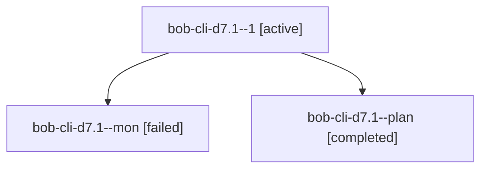

# Session: bob-cli-d7.1

[Agent Hoods](../README.md) / [bbugyi200](../users/bbugyi200/README.md) / [athena](../users/bbugyi200/machines/athena/README.md) / [bob-cli-d7](../users/bbugyi200/machines/athena/hoods/bob-cli-d7/README.md) / bob-cli-d7.1

Owner: `bbugyi200.athena` · Hood: `bob-cli-d7` · Members: 3 · Bead: [bob-cli-d7.1](https://github.com/bobs-org/bob-cli--beads/blob/main/pages/bob-cli-d7/bob-cli-d7.1.md)

## Lineage

The diagram is an optional enhancement; the ordered table below contains the same lineage in accessible text.

| Role | Agent | State | Model / provider | Timing | Commits | Prompt | Chat |
|---|---|---|---|---|---:|---|---|
| 1 | bob-cli-d7.1--1 | active | gpt-6-luna / codex | 2026-10-27T19:15:16.535994+00:00 | 0 | [Prompt](../agents/bbugyi200.athena.bob-cli-d7.1--1/prompt.md) | — |
| mon | bob-cli-d7.1--mon | failed | gpt-6-luna / codex | 2026-10-27T19:06:45.897391+00:00 → 2026-10-27T19:13:53.045962+00:00 | 0 | — | [Chat](../agents/bbugyi200.athena.bob-cli-d7.1--mon/chat.md) |
| plan | bob-cli-d7.1--plan | completed | gpt-6-luna / codex | 2026-10-27T18:57:55.549640+00:00 → 2026-10-27T19:07:51.439571+00:00 | 0 | [Prompt](../agents/bbugyi200.athena.bob-cli-d7.1--plan/prompt.md) | [Chat](../agents/bbugyi200.athena.bob-cli-d7.1--plan/chat.md) |

## Neighbors

| Agent | Relation | State |
|---|---|---|
| [bob-cli-d7.2](../agents/bbugyi200.athena.bob-cli-d7.2/README.md) | bob-cli-d7 hood | active |
| [bob-cli-d7.3](../agents/bbugyi200.athena.bob-cli-d7.3/README.md) | bob-cli-d7 hood | active |
| [bob-cli-d7.4](bbugyi200.athena.bob-cli-d7.4.md) (session · 2) | bob-cli-d7 hood | active 1, completed 1 |
| [bob-cli-d7.land](../agents/bbugyi200.athena.bob-cli-d7.land/README.md) | bob-cli-d7 hood | waiting |
