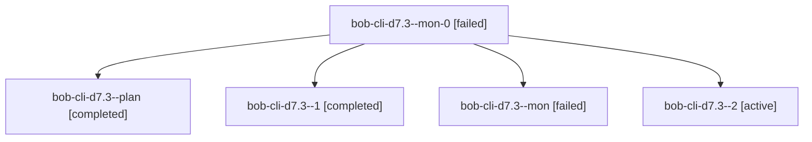

# Session: bob-cli-d7.3

[Agent Hoods](../README.md) / [bbugyi200](../users/bbugyi200/README.md) / [athena](../users/bbugyi200/machines/athena/README.md) / [bob-cli-d7](../users/bbugyi200/machines/athena/hoods/bob-cli-d7/README.md) / bob-cli-d7.3

Owner: `bbugyi200.athena` · Hood: `bob-cli-d7` · Members: 5 · Bead: [bob-cli-d7.3](https://github.com/bobs-org/bob-cli--beads/blob/main/pages/bob-cli-d7/bob-cli-d7.3.md)

## Lineage

The diagram is an optional enhancement; the ordered table below contains the same lineage in accessible text.

| Role | Agent | State | Model / provider | Timing | Commits | Prompt | Chat |
|---|---|---|---|---|---:|---|---|
| mon-0 | bob-cli-d7.3--mon-0 | failed | gpt-6-luna / codex | 2026-10-27T19:31:57.860117+00:00 → 2026-10-27T19:39:14.286162+00:00 | 0 | — | [Chat](../agents/bbugyi200.athena.bob-cli-d7.3--mon-0/chat.md) |
| plan | bob-cli-d7.3--plan | completed | gpt-6-luna / codex | 2026-10-27T18:58:26.673424+00:00 → 2026-10-27T19:19:41.815599+00:00 | 0 | [Prompt](../agents/bbugyi200.athena.bob-cli-d7.3--plan/prompt.md) | [Chat](../agents/bbugyi200.athena.bob-cli-d7.3--plan/chat.md) |
| 1 | bob-cli-d7.3--1 | completed | gpt-6-luna / codex | 2026-10-27T19:29:11.231638+00:00 → 2026-10-27T19:32:56.721526+00:00 | 0 | [Prompt](../agents/bbugyi200.athena.bob-cli-d7.3--1/prompt.md) | [Chat](../agents/bbugyi200.athena.bob-cli-d7.3--1/chat.md) |
| mon | bob-cli-d7.3--mon | failed | gpt-6-luna / codex | 2026-10-27T19:19:03.971702+00:00 → 2026-10-27T19:27:46.878942+00:00 | 0 | — | [Chat](../agents/bbugyi200.athena.bob-cli-d7.3--mon/chat.md) |
| 2 | bob-cli-d7.3--2 | active | gpt-6-luna / codex | 2026-10-27T19:40:25.616180+00:00 | [1](../agents/bbugyi200.athena.bob-cli-d7.3--2/README.md#commits) | [Prompt](../agents/bbugyi200.athena.bob-cli-d7.3--2/prompt.md) | — |

## Commits

| Role | Repo | Commit | Subject | Committed |
|---|---|---|---|---|
| 2 | bob-cli | [`f00854b`](https://github.com/bobs-org/bob-cli/commit/f00854be21c20a101dbe4404f98d178fef0f6740) | test(completion): make PTY drivers tolerate load | 2026-10-27 15:50:57 EDT |

## Neighbors

| Agent | Relation | State |
|---|---|---|
| [bob-cli-d7.1](bbugyi200.athena.bob-cli-d7.1.md) (session · 3) | bob-cli-d7 hood | completed 2, failed 1 |
| [bob-cli-d7.2](../agents/bbugyi200.athena.bob-cli-d7.2/README.md) | bob-cli-d7 hood | completed |
| [bob-cli-d7.4](bbugyi200.athena.bob-cli-d7.4.md) (session · 3) | bob-cli-d7 hood | completed 2, failed 1 |
| [bob-cli-d7.land](../agents/bbugyi200.athena.bob-cli-d7.land/README.md) | bob-cli-d7 hood | waiting |
