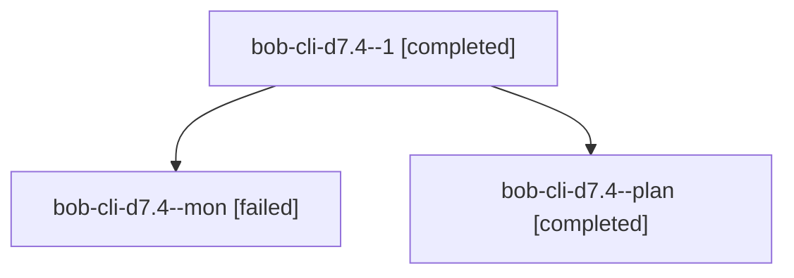

# Session: bob-cli-d7.4

[Agent Hoods](../README.md) / [bbugyi200](../users/bbugyi200/README.md) / [athena](../users/bbugyi200/machines/athena/README.md) / [bob-cli-d7](../users/bbugyi200/machines/athena/hoods/bob-cli-d7/README.md) / bob-cli-d7.4

Owner: `bbugyi200.athena` · Hood: `bob-cli-d7` · Members: 3 · Bead: [bob-cli-d7.4](https://github.com/bobs-org/bob-cli--beads/blob/main/pages/bob-cli-d7/bob-cli-d7.4.md)

## Lineage

The diagram is an optional enhancement; the ordered table below contains the same lineage in accessible text.

| Role | Agent | State | Model / provider | Timing | Commits | Prompt | Chat |
|---|---|---|---|---|---:|---|---|
| 1 | bob-cli-d7.4--1 | completed | grok-4.6 / grok | 2026-10-27T19:19:14.690533+00:00 → 2026-10-27T19:33:06.797055+00:00 | [1](../agents/bbugyi200.athena.bob-cli-d7.4--1/README.md#commits) | [Prompt](../agents/bbugyi200.athena.bob-cli-d7.4--1/prompt.md) | [Chat](../agents/bbugyi200.athena.bob-cli-d7.4--1/chat.md) |
| mon | bob-cli-d7.4--mon | failed | grok-4.6 / grok | 2026-10-27T19:12:00.757912+00:00 → 2026-10-27T19:18:11.251630+00:00 | 0 | — | [Chat](../agents/bbugyi200.athena.bob-cli-d7.4--mon/chat.md) |
| plan | bob-cli-d7.4--plan | completed | grok-4.6 / grok | 2026-10-27T18:58:44.446683+00:00 → 2026-10-27T19:13:25.654364+00:00 | 0 | [Prompt](../agents/bbugyi200.athena.bob-cli-d7.4--plan/prompt.md) | [Chat](../agents/bbugyi200.athena.bob-cli-d7.4--plan/chat.md) |

## Commits

| Role | Repo | Commit | Subject | Committed |
|---|---|---|---|---|
| 1 | bob-cli | [`afaacab`](https://github.com/bobs-org/bob-cli/commit/afaacab0416a7c7cd2aa2f5bd9e0a5667fe7cf02) | docs(memory): record the nine-tier walk and parent-residence refs | 2026-10-27 15:31:37 EDT |

## Neighbors

| Agent | Relation | State |
|---|---|---|
| [bob-cli-d7.1](bbugyi200.athena.bob-cli-d7.1.md) (session · 3) | bob-cli-d7 hood | completed 2, failed 1 |
| [bob-cli-d7.2](../agents/bbugyi200.athena.bob-cli-d7.2/README.md) | bob-cli-d7 hood | completed |
| [bob-cli-d7.3](bbugyi200.athena.bob-cli-d7.3.md) (session · 5) | bob-cli-d7 hood | active 1, completed 2, failed 2 |
| [bob-cli-d7.land](../agents/bbugyi200.athena.bob-cli-d7.land/README.md) | bob-cli-d7 hood | waiting |
