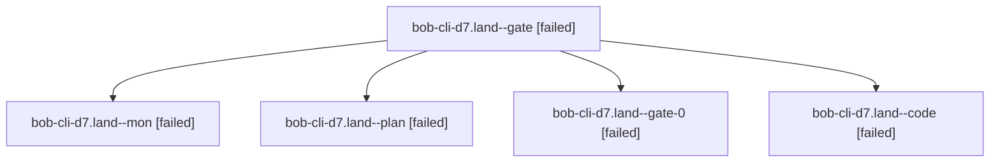

# Session: bob-cli-d7.land

[Agent Hoods](../README.md) / [bbugyi200](../users/bbugyi200/README.md) / [athena](../users/bbugyi200/machines/athena/README.md) / [bob-cli-d7](../users/bbugyi200/machines/athena/hoods/bob-cli-d7/README.md) / bob-cli-d7.land

Owner: `bbugyi200.athena` · Hood: `bob-cli-d7` · Members: 5 · Bead: [bob-cli-d7](https://github.com/bobs-org/bob-cli--beads/blob/main/pages/bob-cli-d7/README.md)

## Lineage



The diagram is an optional enhancement; the ordered table below contains the same lineage in accessible text.

| Role | Agent | State | Model / provider | Timing | Commits | Prompt | Chat |
|---|---|---|---|---|---:|---|---|
| <a id="member-gate"></a>gate | bob-cli-d7.land--gate | failed | gpt-6-astra / codex | 2026-10-27T20:04:53.182627+00:00 → 2026-10-27T20:05:32.603685+00:00 | 0 | — | [Chat](../agents/bbugyi200.athena.bob-cli-d7.land--gate/chat.md) |
| <a id="member-mon"></a>mon | bob-cli-d7.land--mon | failed | muse-spark-1.3-contributor / muse | 2026-10-27T20:30:12.576651+00:00 → 2026-10-27T20:34:10.619660+00:00 | 0 | — | [Chat](../agents/bbugyi200.athena.bob-cli-d7.land--mon/chat.md) |
| <a id="member-plan"></a>plan | bob-cli-d7.land--plan | failed | gpt-6-astra / codex | 2026-10-27T19:54:23.653640+00:00 → 2026-10-27T20:30:15.148083+00:00 | 0 | [Prompt](../agents/bbugyi200.athena.bob-cli-d7.land--plan/prompt.md) | [Chat](../agents/bbugyi200.athena.bob-cli-d7.land--plan/chat.md) |
| <a id="member-gate-0"></a>gate-0 | bob-cli-d7.land--gate-0 | failed | muse-spark-1.3-contributor / muse | 2026-10-27T20:29:14.462691+00:00 → 2026-10-27T20:30:13.309366+00:00 | 0 | — | [Chat](../agents/bbugyi200.athena.bob-cli-d7.land--gate-0/chat.md) |
| <a id="member-code"></a>code | bob-cli-d7.land--code | failed | muse-spark-1.3-contributor / muse | 2026-10-27T20:06:26.058560+00:00 → 2026-10-27T20:30:15.148083+00:00 | 0 | — | [Chat](../agents/bbugyi200.athena.bob-cli-d7.land--code/chat.md) |

## Variables

| Role | Variable | Value |
|---|---|---|
| plan | `artifacts` | \[{bead: bob-cli-d7, kind: markdown, label: bob-cli-d7.4 proposed stale walk order at f00854be, path: /home/bryan/.sase/artifacts/agents/gh\_bobs-org\_\_bob-cli/20261027145609/vault-format-13f15c280547.m… |

#### artifacts

**Role:** `plan`

```yaml
- bead: bob-cli-d7
  kind: markdown
  label: bob-cli-d7.4 proposed stale walk order at f00854be
  path: /home/bryan/.sase/artifacts/agents/gh_bobs-org__bob-cli/20261027145609/vault-format-13f15c280547.md
  ref: file:explicit:362600ca13c4854b1fed2c18
  source_path: /home/bryan/.local/state/sase/workspaces/bobs-org/bob-cli/bob-cli_10/docs/reference/vault-format.md
```

Values are truncated for display; see each member's agent meta.json for the full values.

## Neighbors

| Agent | Relation | State |
|---|---|---|
| [bob-cli-d7.1](bbugyi200.athena.bob-cli-d7.1.md) (session · 3) | bob-cli-d7 hood | completed 2, failed 1 |
| [bob-cli-d7.2](../agents/bbugyi200.athena.bob-cli-d7.2/README.md) | bob-cli-d7 hood | completed |
| [bob-cli-d7.3](bbugyi200.athena.bob-cli-d7.3.md) (session · 5) | bob-cli-d7 hood | completed 3, failed 2 |
| [bob-cli-d7.4](bbugyi200.athena.bob-cli-d7.4.md) (session · 3) | bob-cli-d7 hood | completed 2, failed 1 |
