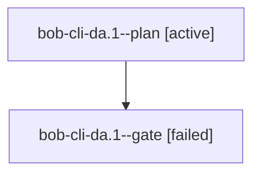

# Session: bob-cli-da.1

[Agent Hoods](../README.md) / [bbugyi200](../users/bbugyi200/README.md) / [athena](../users/bbugyi200/machines/athena/README.md) / [bob-cli-da](../users/bbugyi200/machines/athena/hoods/bob-cli-da/README.md) / bob-cli-da.1

Owner: `bbugyi200.athena` · Hood: `bob-cli-da` · Members: 2 · Bead: [bob-cli-da.1](https://github.com/bobs-org/bob-cli--beads/blob/main/pages/bob-cli-da/bob-cli-da.1.md)

## Lineage

The diagram is an optional enhancement; the ordered table below contains the same lineage in accessible text.

| Role | Agent | State | Model / provider | Timing | Commits | Prompt | Chat |
|---|---|---|---|---|---:|---|---|
| plan | bob-cli-da.1--plan | active | gpt-6-astra / codex | 2026-10-27T20:34:20.592259+00:00 | 0 | [Prompt](../agents/bbugyi200.athena.bob-cli-da.1--plan/prompt.md) | [Chat](../agents/bbugyi200.athena.bob-cli-da.1--plan/chat.md) |
| gate | bob-cli-da.1--gate | failed | gpt-6-astra / codex | 2026-10-27T20:39:41.296035+00:00 → 2026-10-27T20:40:18.313406+00:00 | 0 | — | [Chat](../agents/bbugyi200.athena.bob-cli-da.1--gate/chat.md) |

## Neighbors

| Agent | Relation | State |
|---|---|---|
| [bob-cli-da.2](bbugyi200.athena.bob-cli-da.2.md) (session · 2) | bob-cli-da hood | active 2 |
| [bob-cli-da.3](../agents/bbugyi200.athena.bob-cli-da.3/README.md) | bob-cli-da hood | active |
| [bob-cli-da.4](../agents/bbugyi200.athena.bob-cli-da.4/README.md) | bob-cli-da hood | active |
| [bob-cli-da.land](../agents/bbugyi200.athena.bob-cli-da.land/README.md) | bob-cli-da hood | waiting |
