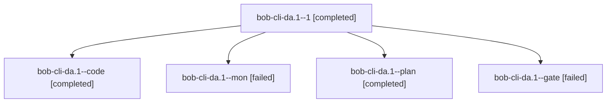

# Session: bob-cli-da.1

[Agent Hoods](../README.md) / [bbugyi200](../users/bbugyi200/README.md) / [athena](../users/bbugyi200/machines/athena/README.md) / [bob-cli-da](../users/bbugyi200/machines/athena/hoods/bob-cli-da/README.md) / bob-cli-da.1

Owner: `bbugyi200.athena` · Hood: `bob-cli-da` · Members: 5 · Bead: [bob-cli-da.1](https://github.com/bobs-org/bob-cli--beads/blob/main/pages/bob-cli-da/bob-cli-da.1.md)

## Lineage

The diagram is an optional enhancement; the ordered table below contains the same lineage in accessible text.

| Role | Agent | State | Model / provider | Timing | Commits | Prompt | Chat |
|---|---|---|---|---|---:|---|---|
| 1 | bob-cli-da.1--1 | completed | grok-4.6 / grok | 2026-10-27T21:03:49.708456+00:00 → 2026-10-27T21:10:50.541872+00:00 | 0 | [Prompt](../agents/bbugyi200.athena.bob-cli-da.1--1/prompt.md) | [Chat](../agents/bbugyi200.athena.bob-cli-da.1--1/chat.md) |
| code | bob-cli-da.1--code | completed | grok-4.6 / grok | 2026-10-27T20:40:34.147440+00:00 → 2026-10-27T20:52:05.785590+00:00 | 0 | — | [Chat](../agents/bbugyi200.athena.bob-cli-da.1--code/chat.md) |
| mon | bob-cli-da.1--mon | failed | grok-4.6 / grok | 2026-10-27T20:51:24.871163+00:00 → 2026-10-27T21:02:21.700207+00:00 | 0 | — | [Chat](../agents/bbugyi200.athena.bob-cli-da.1--mon/chat.md) |
| plan | bob-cli-da.1--plan | completed | gpt-6-astra / codex | 2026-10-27T20:34:20.592259+00:00 → 2026-10-27T20:52:05.785590+00:00 | 0 | [Prompt](../agents/bbugyi200.athena.bob-cli-da.1--plan/prompt.md) | [Chat](../agents/bbugyi200.athena.bob-cli-da.1--plan/chat.md) |
| gate | bob-cli-da.1--gate | failed | gpt-6-astra / codex | 2026-10-27T20:39:41.296035+00:00 → 2026-10-27T20:40:18.313406+00:00 | 0 | — | [Chat](../agents/bbugyi200.athena.bob-cli-da.1--gate/chat.md) |

## Neighbors

| Agent | Relation | State |
|---|---|---|
| [bob-cli-da.2](bbugyi200.athena.bob-cli-da.2.md) (session · 7) | bob-cli-da hood | completed 4, failed 3 |
| [bob-cli-da.3](../agents/bbugyi200.athena.bob-cli-da.3/README.md) | bob-cli-da hood | completed |
| [bob-cli-da.4](bbugyi200.athena.bob-cli-da.4.md) (session · 3) | bob-cli-da hood | failed 3 |
| [bob-cli-da.4.1.1](../agents/bbugyi200.athena.bob-cli-da.4.1.1/README.md) | bob-cli-da hood | completed |
| [bob-cli-da.4.1.2](bbugyi200.athena.bob-cli-da.4.1.2.md) (session · 3) | bob-cli-da hood | active 1, completed 1, failed 1 |
| [bob-cli-da.4.1.land](../agents/bbugyi200.athena.bob-cli-da.4.1.land/README.md) | bob-cli-da hood | waiting |
| [bob-cli-da.land](../agents/bbugyi200.athena.bob-cli-da.land/README.md) | bob-cli-da hood | waiting |
