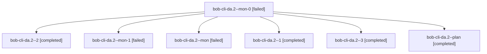

# Session: bob-cli-da.2

[Agent Hoods](../README.md) / [bbugyi200](../users/bbugyi200/README.md) / [athena](../users/bbugyi200/machines/athena/README.md) / [bob-cli-da](../users/bbugyi200/machines/athena/hoods/bob-cli-da/README.md) / bob-cli-da.2

Owner: `bbugyi200.athena` · Hood: `bob-cli-da` · Members: 7 · Bead: [bob-cli-da.2](https://github.com/bobs-org/bob-cli--beads/blob/main/pages/bob-cli-da/bob-cli-da.2.md)

## Lineage

The diagram is an optional enhancement; the ordered table below contains the same lineage in accessible text.

| Role | Agent | State | Model / provider | Timing | Commits | Prompt | Chat |
|---|---|---|---|---|---:|---|---|
| mon-0 | bob-cli-da.2--mon-0 | failed | grok-4.6 / grok | 2026-10-27T20:51:07.105760+00:00 → 2026-10-27T20:54:11.925213+00:00 | 0 | — | [Chat](../agents/bbugyi200.athena.bob-cli-da.2--mon-0/chat.md) |
| 2 | bob-cli-da.2--2 | completed | grok-4.6 / grok | 2026-10-27T20:55:39.152531+00:00 → 2026-10-27T21:06:55.247078+00:00 | 0 | [Prompt](../agents/bbugyi200.athena.bob-cli-da.2--2/prompt.md) | [Chat](../agents/bbugyi200.athena.bob-cli-da.2--2/chat.md) |
| mon-1 | bob-cli-da.2--mon-1 | failed | grok-4.6 / grok | 2026-10-27T21:06:00.937784+00:00 → 2026-10-27T21:13:54.428335+00:00 | 0 | — | [Chat](../agents/bbugyi200.athena.bob-cli-da.2--mon-1/chat.md) |
| mon | bob-cli-da.2--mon | failed | gpt-6-luna / codex | 2026-10-27T20:39:00.153467+00:00 → 2026-10-27T20:43:08.712370+00:00 | 0 | — | [Chat](../agents/bbugyi200.athena.bob-cli-da.2--mon/chat.md) |
| 1 | bob-cli-da.2--1 | completed | grok-4.6 / grok | 2026-10-27T20:45:10.538725+00:00 → 2026-10-27T20:52:07.045343+00:00 | 0 | [Prompt](../agents/bbugyi200.athena.bob-cli-da.2--1/prompt.md) | [Chat](../agents/bbugyi200.athena.bob-cli-da.2--1/chat.md) |
| 3 | bob-cli-da.2--3 | completed | grok-4.6 / grok | 2026-10-27T21:15:24.774206+00:00 → 2026-10-27T21:23:17.617629+00:00 | [1](../agents/bbugyi200.athena.bob-cli-da.2--3/README.md#commits) | [Prompt](../agents/bbugyi200.athena.bob-cli-da.2--3/prompt.md) | [Chat](../agents/bbugyi200.athena.bob-cli-da.2--3/chat.md) |
| plan | bob-cli-da.2--plan | completed | gpt-6-luna / codex | 2026-10-27T20:34:04.049827+00:00 → 2026-10-27T20:40:30.015394+00:00 | 0 | [Prompt](../agents/bbugyi200.athena.bob-cli-da.2--plan/prompt.md) | [Chat](../agents/bbugyi200.athena.bob-cli-da.2--plan/chat.md) |

## Commits

| Role | Repo | Commit | Subject | Committed |
|---|---|---|---|---|
| 3 | bob-cli | [`6b0a30b`](https://github.com/bobs-org/bob-cli/commit/6b0a30bf7b6d18d568f8006088041848d046f976) | fix(web-ref): keep language-mermaid through Defuddle extraction | 2026-10-27 17:20:52 EDT |

## Neighbors

| Agent | Relation | State |
|---|---|---|
| [bob-cli-da.1](bbugyi200.athena.bob-cli-da.1.md) (session · 5) | bob-cli-da hood | completed 3, failed 2 |
| [bob-cli-da.3](../agents/bbugyi200.athena.bob-cli-da.3/README.md) | bob-cli-da hood | completed |
| [bob-cli-da.4](bbugyi200.athena.bob-cli-da.4.md) (session · 3) | bob-cli-da hood | failed 3 |
| [bob-cli-da.4.1.1](../agents/bbugyi200.athena.bob-cli-da.4.1.1/README.md) | bob-cli-da hood | completed |
| [bob-cli-da.4.1.2](bbugyi200.athena.bob-cli-da.4.1.2.md) (session · 3) | bob-cli-da hood | completed 2, failed 1 |
| [bob-cli-da.4.1.land](bbugyi200.athena.bob-cli-da.4.1.land.md) (session · 5) | bob-cli-da hood | active 1, completed 2, failed 2 |
| [bob-cli-da.land](../agents/bbugyi200.athena.bob-cli-da.land/README.md) | bob-cli-da hood | active |
