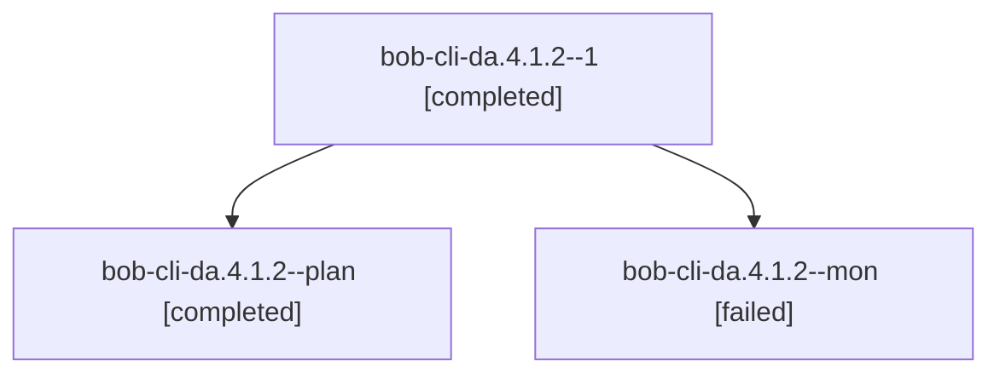

# Session: bob-cli-da.4.1.2

[Agent Hoods](../README.md) / [bbugyi200](../users/bbugyi200/README.md) / [athena](../users/bbugyi200/machines/athena/README.md) / [bob-cli-da](../users/bbugyi200/machines/athena/hoods/bob-cli-da/README.md) / bob-cli-da.4.1.2

Owner: `bbugyi200.athena` · Hood: `bob-cli-da` · Members: 3 · Bead: [bob-cli-da.4.1.2](https://github.com/bobs-org/bob-cli--beads/blob/main/pages/bob-cli-da/bob-cli-da.4.1.2.md)

## Lineage

The diagram is an optional enhancement; the ordered table below contains the same lineage in accessible text.

| Role | Agent | State | Model / provider | Timing | Commits | Prompt | Chat |
|---|---|---|---|---|---:|---|---|
| 1 | bob-cli-da.4.1.2--1 | completed | grok-4.6 / grok | 2026-10-27T21:47:55.582415+00:00 → 2026-10-27T22:01:12.374455+00:00 | [1](../agents/bbugyi200.athena.bob-cli-da.4.1.2--1/README.md#commits) | [Prompt](../agents/bbugyi200.athena.bob-cli-da.4.1.2--1/prompt.md) | [Chat](../agents/bbugyi200.athena.bob-cli-da.4.1.2--1/chat.md) |
| plan | bob-cli-da.4.1.2--plan | completed | grok-4.6 / grok | 2026-10-27T21:16:42.220717+00:00 → 2026-10-27T21:41:16.075512+00:00 | 0 | [Prompt](../agents/bbugyi200.athena.bob-cli-da.4.1.2--plan/prompt.md) | [Chat](../agents/bbugyi200.athena.bob-cli-da.4.1.2--plan/chat.md) |
| mon | bob-cli-da.4.1.2--mon | failed | grok-4.6 / grok | 2026-10-27T21:40:26.523355+00:00 → 2026-10-27T21:46:44.342374+00:00 | 0 | — | [Chat](../agents/bbugyi200.athena.bob-cli-da.4.1.2--mon/chat.md) |

## Commits

| Role | Repo | Commit | Subject | Committed |
|---|---|---|---|---|
| 1 | bob-cli | [`3cc6351`](https://github.com/bobs-org/bob-cli/commit/3cc6351158e074791330ad539761ad9dbcadd2f6) | feat(release): integrate bob-obsidian-assets with the daily train | 2026-10-27 17:59:20 EDT |

## Neighbors

| Agent | Relation | State |
|---|---|---|
| [bob-cli-da.4](bbugyi200.athena.bob-cli-da.4.md) (session · 3) | ancestor | failed 3 |
| [bob-cli-da.4.1.1](../agents/bbugyi200.athena.bob-cli-da.4.1.1/README.md) | bob-cli-da.4.1 hood | completed |
| [bob-cli-da.4.1.land](bbugyi200.athena.bob-cli-da.4.1.land.md) (session · 5) | bob-cli-da.4.1 hood | active 1, completed 2, failed 2 |
| [bob-cli-da.1](bbugyi200.athena.bob-cli-da.1.md) (session · 5) | bob-cli-da hood | completed 3, failed 2 |
| [bob-cli-da.2](bbugyi200.athena.bob-cli-da.2.md) (session · 7) | bob-cli-da hood | completed 4, failed 3 |
| [bob-cli-da.3](../agents/bbugyi200.athena.bob-cli-da.3/README.md) | bob-cli-da hood | completed |
| [bob-cli-da.land](../agents/bbugyi200.athena.bob-cli-da.land/README.md) | bob-cli-da hood | active |
