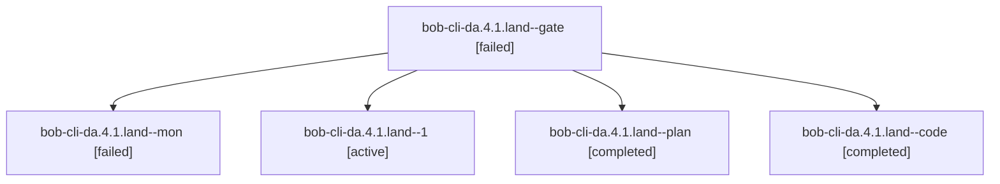

# Session: bob-cli-da.4.1.land

[Agent Hoods](../README.md) / [bbugyi200](../users/bbugyi200/README.md) / [athena](../users/bbugyi200/machines/athena/README.md) / [bob-cli-da](../users/bbugyi200/machines/athena/hoods/bob-cli-da/README.md) / bob-cli-da.4.1.land

Owner: `bbugyi200.athena` · Hood: `bob-cli-da` · Members: 5 · Bead: [bob-cli-da.4.1](https://github.com/bobs-org/bob-cli--beads/blob/main/pages/bob-cli-da/bob-cli-da.4.1.md)

## Lineage

The diagram is an optional enhancement; the ordered table below contains the same lineage in accessible text.

| Role | Agent | State | Model / provider | Timing | Commits | Prompt | Chat |
|---|---|---|---|---|---:|---|---|
| gate | bob-cli-da.4.1.land--gate | failed | gpt-6-astra / codex | 2026-10-27T22:12:16.387432+00:00 → 2026-10-27T22:12:57.971337+00:00 | 0 | — | [Chat](../agents/bbugyi200.athena.bob-cli-da.4.1.land--gate/chat.md) |
| mon | bob-cli-da.4.1.land--mon | failed | gpt-6-luna / codex | 2026-10-27T22:29:36.504868+00:00 → 2026-10-27T22:32:41.971338+00:00 | 0 | — | [Chat](../agents/bbugyi200.athena.bob-cli-da.4.1.land--mon/chat.md) |
| 1 | bob-cli-da.4.1.land--1 | active | gpt-6-luna / codex | 2026-10-27T22:33:50.892425+00:00 | [1](../agents/bbugyi200.athena.bob-cli-da.4.1.land--1/README.md#commits) | [Prompt](../agents/bbugyi200.athena.bob-cli-da.4.1.land--1/prompt.md) | — |
| plan | bob-cli-da.4.1.land--plan | completed | gpt-6-astra / codex | 2026-10-27T22:02:09.746910+00:00 → 2026-10-27T22:30:57.115434+00:00 | 0 | [Prompt](../agents/bbugyi200.athena.bob-cli-da.4.1.land--plan/prompt.md) | [Chat](../agents/bbugyi200.athena.bob-cli-da.4.1.land--plan/chat.md) |
| code | bob-cli-da.4.1.land--code | completed | gpt-6-luna / codex | 2026-10-27T22:13:51.305361+00:00 → 2026-10-27T22:30:57.115434+00:00 | 0 | — | [Chat](../agents/bbugyi200.athena.bob-cli-da.4.1.land--code/chat.md) |

## Commits

| Role | Repo | Commit | Subject | Committed |
|---|---|---|---|---|
| 1 | bob-cli | [`232d68c`](https://github.com/bobs-org/bob-cli/commit/232d68c0058bed3d83af0f714901bd2067ad039f) | test(release): cover split package checks and clarify release docs | 2026-10-27 18:42:58 EDT |

## Neighbors

| Agent | Relation | State |
|---|---|---|
| [bob-cli-da.4](bbugyi200.athena.bob-cli-da.4.md) (session · 3) | ancestor | failed 3 |
| [bob-cli-da.4.1.1](../agents/bbugyi200.athena.bob-cli-da.4.1.1/README.md) | bob-cli-da.4.1 hood | completed |
| [bob-cli-da.4.1.2](bbugyi200.athena.bob-cli-da.4.1.2.md) (session · 3) | bob-cli-da.4.1 hood | completed 2, failed 1 |
| [bob-cli-da.1](bbugyi200.athena.bob-cli-da.1.md) (session · 5) | bob-cli-da hood | completed 3, failed 2 |
| [bob-cli-da.2](bbugyi200.athena.bob-cli-da.2.md) (session · 7) | bob-cli-da hood | completed 4, failed 3 |
| [bob-cli-da.3](../agents/bbugyi200.athena.bob-cli-da.3/README.md) | bob-cli-da hood | completed |
| [bob-cli-da.land](../agents/bbugyi200.athena.bob-cli-da.land/README.md) | bob-cli-da hood | active |
