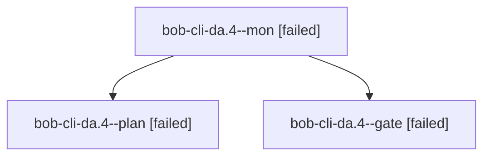

# Session: bob-cli-da.4

[Agent Hoods](../README.md) / [bbugyi200](../users/bbugyi200/README.md) / [athena](../users/bbugyi200/machines/athena/README.md) / [bob-cli-da](../users/bbugyi200/machines/athena/hoods/bob-cli-da/README.md) / bob-cli-da.4

Owner: `bbugyi200.athena` · Hood: `bob-cli-da` · Members: 3 · Bead: [bob-cli-da.4](https://github.com/bobs-org/bob-cli--beads/blob/main/pages/bob-cli-da/bob-cli-da.4.md)

## Lineage

The diagram is an optional enhancement; the ordered table below contains the same lineage in accessible text.

| Role | Agent | State | Model / provider | Timing | Commits | Prompt | Chat |
|---|---|---|---|---|---:|---|---|
| mon | bob-cli-da.4--mon | failed | gpt-6-astra / codex | 2026-10-27T20:43:40.132347+00:00 → 2026-10-27T20:46:18.699159+00:00 | 0 | — | [Chat](../agents/bbugyi200.athena.bob-cli-da.4--mon/chat.md) |
| plan | bob-cli-da.4--plan | failed | gpt-6-astra / codex | 2026-10-27T20:35:49.170026+00:00 → 2026-10-27T20:43:50.977317+00:00 | 0 | [Prompt](../agents/bbugyi200.athena.bob-cli-da.4--plan/prompt.md) | [Chat](../agents/bbugyi200.athena.bob-cli-da.4--plan/chat.md) |
| gate | bob-cli-da.4--gate | failed | gpt-6-astra / codex | 2026-10-27T20:42:44.498414+00:00 → 2026-10-27T20:43:40.727006+00:00 | 0 | — | [Chat](../agents/bbugyi200.athena.bob-cli-da.4--gate/chat.md) |

## Neighbors

| Agent | Relation | State |
|---|---|---|
| [bob-cli-da.4.1.1](../agents/bbugyi200.athena.bob-cli-da.4.1.1/README.md) | descendant | completed |
| [bob-cli-da.4.1.2](../agents/bbugyi200.athena.bob-cli-da.4.1.2/README.md) | descendant | active |
| [bob-cli-da.4.1.land](../agents/bbugyi200.athena.bob-cli-da.4.1.land/README.md) | descendant | waiting |
| [bob-cli-da.1](bbugyi200.athena.bob-cli-da.1.md) (session · 5) | bob-cli-da hood | completed 3, failed 2 |
| [bob-cli-da.2](bbugyi200.athena.bob-cli-da.2.md) (session · 7) | bob-cli-da hood | active 1, completed 3, failed 3 |
| [bob-cli-da.3](../agents/bbugyi200.athena.bob-cli-da.3/README.md) | bob-cli-da hood | completed |
| [bob-cli-da.land](../agents/bbugyi200.athena.bob-cli-da.land/README.md) | bob-cli-da hood | waiting |
