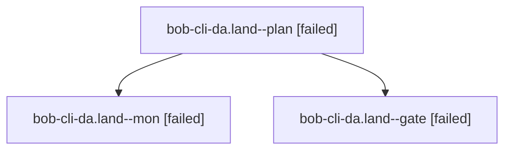

# Session: bob-cli-da.land

[Agent Hoods](../README.md) / [bbugyi200](../users/bbugyi200/README.md) / [athena](../users/bbugyi200/machines/athena/README.md) / [bob-cli-da](../users/bbugyi200/machines/athena/hoods/bob-cli-da/README.md) / bob-cli-da.land

Owner: `bbugyi200.athena` · Hood: `bob-cli-da` · Members: 3 · Bead: [bob-cli-da](https://github.com/bobs-org/bob-cli--beads/blob/main/pages/bob-cli-da/README.md)

## Lineage

The diagram is an optional enhancement; the ordered table below contains the same lineage in accessible text.

| Role | Agent | State | Model / provider | Timing | Commits | Prompt | Chat |
|---|---|---|---|---|---:|---|---|
| plan | bob-cli-da.land--plan | failed | gpt-6-astra / codex | 2026-10-27T22:41:53.932322+00:00 → 2026-10-27T22:53:18.554897+00:00 | 0 | [Prompt](../agents/bbugyi200.athena.bob-cli-da.land--plan/prompt.md) | [Chat](../agents/bbugyi200.athena.bob-cli-da.land--plan/chat.md) |
| mon | bob-cli-da.land--mon | failed | gpt-6-astra / codex | 2026-10-27T22:53:06.351982+00:00 → 2026-10-27T22:55:56.991544+00:00 | 0 | — | [Chat](../agents/bbugyi200.athena.bob-cli-da.land--mon/chat.md) |
| gate | bob-cli-da.land--gate | failed | gpt-6-astra / codex | 2026-10-27T22:52:17.444483+00:00 → 2026-10-27T22:53:07.018301+00:00 | 0 | — | [Chat](../agents/bbugyi200.athena.bob-cli-da.land--gate/chat.md) |

## Neighbors

| Agent | Relation | State |
|---|---|---|
| [bob-cli-da.1](bbugyi200.athena.bob-cli-da.1.md) (session · 5) | bob-cli-da hood | completed 3, failed 2 |
| [bob-cli-da.2](bbugyi200.athena.bob-cli-da.2.md) (session · 7) | bob-cli-da hood | completed 4, failed 3 |
| [bob-cli-da.3](../agents/bbugyi200.athena.bob-cli-da.3/README.md) | bob-cli-da hood | completed |
| [bob-cli-da.4](bbugyi200.athena.bob-cli-da.4.md) (session · 3) | bob-cli-da hood | failed 3 |
| [bob-cli-da.4.1.1](../agents/bbugyi200.athena.bob-cli-da.4.1.1/README.md) | bob-cli-da hood | completed |
| [bob-cli-da.4.1.2](bbugyi200.athena.bob-cli-da.4.1.2.md) (session · 3) | bob-cli-da hood | completed 2, failed 1 |
| [bob-cli-da.4.1.land](bbugyi200.athena.bob-cli-da.4.1.land.md) (session · 5) | bob-cli-da hood | completed 3, failed 2 |
