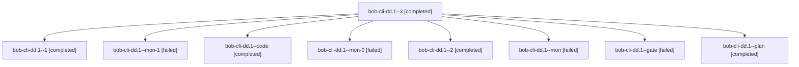

# Session: bob-cli-dd.1

[Agent Hoods](../README.md) / [bbugyi200](../users/bbugyi200/README.md) / [athena](../users/bbugyi200/machines/athena/README.md) / [bob-cli-dd](../users/bbugyi200/machines/athena/hoods/bob-cli-dd/README.md) / bob-cli-dd.1

Owner: `bbugyi200.athena` · Hood: `bob-cli-dd` · Members: 9 · Bead: [bob-cli-dd.1](https://github.com/bobs-org/bob-cli--beads/blob/main/pages/bob-cli-dd/bob-cli-dd.1.md)

## Lineage

The diagram is an optional enhancement; the ordered table below contains the same lineage in accessible text.

| Role | Agent | State | Model / provider | Timing | Commits | Prompt | Chat |
|---|---|---|---|---|---:|---|---|
| 3 | bob-cli-dd.1--3 | completed | muse-spark-1.3-contributor / muse | 2026-10-28T00:14:35.026648+00:00 → 2026-10-28T00:19:50.966789+00:00 | 0 | [Prompt](../agents/bbugyi200.athena.bob-cli-dd.1--3/prompt.md) | [Chat](../agents/bbugyi200.athena.bob-cli-dd.1--3/chat.md) |
| 1 | bob-cli-dd.1--1 | completed | muse-spark-1.3-contributor / muse | 2026-10-27T23:31:23.976048+00:00 → 2026-10-27T23:47:06.291890+00:00 | 0 | [Prompt](../agents/bbugyi200.athena.bob-cli-dd.1--1/prompt.md) | [Chat](../agents/bbugyi200.athena.bob-cli-dd.1--1/chat.md) |
| mon-1 | bob-cli-dd.1--mon-1 | failed | muse-spark-1.3-contributor / muse | 2026-10-27T23:53:45.607097+00:00 → 2026-10-28T00:12:46.310398+00:00 | 0 | — | [Chat](../agents/bbugyi200.athena.bob-cli-dd.1--mon-1/chat.md) |
| code | bob-cli-dd.1--code | completed | muse-spark-1.3-contributor / muse | 2026-10-27T23:02:28.560626+00:00 → 2026-10-27T23:25:37.487860+00:00 | 0 | — | [Chat](../agents/bbugyi200.athena.bob-cli-dd.1--code/chat.md) |
| mon-0 | bob-cli-dd.1--mon-0 | failed | muse-spark-1.3-contributor / muse | 2026-10-27T23:45:35.839576+00:00 → 2026-10-27T23:48:31.792361+00:00 | 0 | — | [Chat](../agents/bbugyi200.athena.bob-cli-dd.1--mon-0/chat.md) |
| 2 | bob-cli-dd.1--2 | completed | muse-spark-1.3-contributor / muse | 2026-10-27T23:50:08.925152+00:00 → 2026-10-27T23:54:44.568342+00:00 | 0 | [Prompt](../agents/bbugyi200.athena.bob-cli-dd.1--2/prompt.md) | [Chat](../agents/bbugyi200.athena.bob-cli-dd.1--2/chat.md) |
| mon | bob-cli-dd.1--mon | failed | muse-spark-1.3-contributor / muse | 2026-10-27T23:24:34.327619+00:00 → 2026-10-27T23:29:57.749856+00:00 | 0 | — | [Chat](../agents/bbugyi200.athena.bob-cli-dd.1--mon/chat.md) |
| gate | bob-cli-dd.1--gate | failed | gpt-6-astra / codex | 2026-10-27T23:01:12.215554+00:00 → 2026-10-27T23:01:56.034905+00:00 | 0 | — | [Chat](../agents/bbugyi200.athena.bob-cli-dd.1--gate/chat.md) |
| plan | bob-cli-dd.1--plan | completed | gpt-6-astra / codex | 2026-10-27T22:56:30.890931+00:00 → 2026-10-27T23:25:37.487860+00:00 | 0 | [Prompt](../agents/bbugyi200.athena.bob-cli-dd.1--plan/prompt.md) | [Chat](../agents/bbugyi200.athena.bob-cli-dd.1--plan/chat.md) |

## Neighbors

| Agent | Relation | State |
|---|---|---|
| [bob-cli-dd.2](../agents/bbugyi200.athena.bob-cli-dd.2/README.md) | bob-cli-dd hood | completed |
| [bob-cli-dd.3](../agents/bbugyi200.athena.bob-cli-dd.3/README.md) | bob-cli-dd hood | completed |
| [bob-cli-dd.land](bbugyi200.athena.bob-cli-dd.land.md) (session · 11) | bob-cli-dd hood | completed 4, failed 7 |
