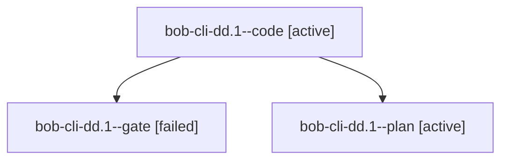

# Session: bob-cli-dd.1

[Agent Hoods](../README.md) / [bbugyi200](../users/bbugyi200/README.md) / [athena](../users/bbugyi200/machines/athena/README.md) / [bob-cli-dd](../users/bbugyi200/machines/athena/hoods/bob-cli-dd/README.md) / bob-cli-dd.1

Owner: `bbugyi200.athena` · Hood: `bob-cli-dd` · Members: 3 · Bead: [bob-cli-dd.1](https://github.com/bobs-org/bob-cli--beads/blob/main/pages/bob-cli-dd/bob-cli-dd.1.md)

## Lineage

The diagram is an optional enhancement; the ordered table below contains the same lineage in accessible text.

| Role | Agent | State | Model / provider | Timing | Commits | Prompt | Chat |
|---|---|---|---|---|---:|---|---|
| code | bob-cli-dd.1--code | active | muse-spark-1.3-contributor / muse | 2026-10-27T23:02:28.560626+00:00 | 0 | — | — |
| gate | bob-cli-dd.1--gate | failed | gpt-6-astra / codex | 2026-10-27T23:01:12.215554+00:00 → 2026-10-27T23:01:56.034905+00:00 | 0 | — | [Chat](../agents/bbugyi200.athena.bob-cli-dd.1--gate/chat.md) |
| plan | bob-cli-dd.1--plan | active | gpt-6-astra / codex | 2026-10-27T22:56:30.890931+00:00 | 0 | [Prompt](../agents/bbugyi200.athena.bob-cli-dd.1--plan/prompt.md) | [Chat](../agents/bbugyi200.athena.bob-cli-dd.1--plan/chat.md) |

## Neighbors

| Agent | Relation | State |
|---|---|---|
| [bob-cli-dd.2](../agents/bbugyi200.athena.bob-cli-dd.2/README.md) | bob-cli-dd hood | completed |
| [bob-cli-dd.3](../agents/bbugyi200.athena.bob-cli-dd.3/README.md) | bob-cli-dd hood | active |
| [bob-cli-dd.land](../agents/bbugyi200.athena.bob-cli-dd.land/README.md) | bob-cli-dd hood | waiting |
