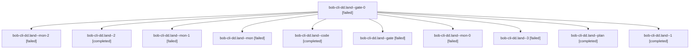

# Session: bob-cli-dd.land

[Agent Hoods](../README.md) / [bbugyi200](../users/bbugyi200/README.md) / [athena](../users/bbugyi200/machines/athena/README.md) / [bob-cli-dd](../users/bbugyi200/machines/athena/hoods/bob-cli-dd/README.md) / bob-cli-dd.land

Owner: `bbugyi200.athena` · Hood: `bob-cli-dd` · Members: 11 · Bead: [bob-cli-dd](https://github.com/bobs-org/bob-cli--beads/blob/main/pages/bob-cli-dd/README.md)

## Lineage



The diagram is an optional enhancement; the ordered table below contains the same lineage in accessible text.

| Role | Agent | State | Model / provider | Timing | Commits | Prompt | Chat |
|---|---|---|---|---|---:|---|---|
| <a id="member-gate-0"></a>gate-0 | bob-cli-dd.land--gate-0 | failed | grok-4.6 / grok | 2026-10-28T01:23:01.451159+00:00 → 2026-10-28T01:24:38.905830+00:00 | 0 | — | [Chat](../agents/bbugyi200.athena.bob-cli-dd.land--gate-0/chat.md) |
| <a id="member-mon-2"></a>mon-2 | bob-cli-dd.land--mon-2 | failed | grok-4.6 / grok | 2026-10-28T01:24:37.929334+00:00 → 2026-10-28T01:29:00.139153+00:00 | 0 | — | [Chat](../agents/bbugyi200.athena.bob-cli-dd.land--mon-2/chat.md) |
| <a id="member-2"></a>2 | bob-cli-dd.land--2 | completed | gpt-6-luna / codex | 2026-10-28T01:00:54.561555+00:00 → 2026-10-28T01:08:11.046073+00:00 | 0 | [Prompt](../agents/bbugyi200.athena.bob-cli-dd.land--2/prompt.md) | [Chat](../agents/bbugyi200.athena.bob-cli-dd.land--2/chat.md) |
| <a id="member-mon-1"></a>mon-1 | bob-cli-dd.land--mon-1 | failed | gpt-6-luna / codex | 2026-10-28T01:07:13.368222+00:00 → 2026-10-28T01:09:49.374927+00:00 | 0 | — | [Chat](../agents/bbugyi200.athena.bob-cli-dd.land--mon-1/chat.md) |
| <a id="member-mon"></a>mon | bob-cli-dd.land--mon | failed | gpt-6-luna / codex | 2026-10-28T00:43:05.836438+00:00 → 2026-10-28T00:47:00.540821+00:00 | 0 | — | [Chat](../agents/bbugyi200.athena.bob-cli-dd.land--mon/chat.md) |
| <a id="member-code"></a>code | bob-cli-dd.land--code | completed | gpt-6-luna / codex | 2026-10-28T00:38:56.392316+00:00 → 2026-10-28T00:44:08.778488+00:00 | 0 | — | [Chat](../agents/bbugyi200.athena.bob-cli-dd.land--code/chat.md) |
| <a id="member-gate"></a>gate | bob-cli-dd.land--gate | failed | gpt-6-astra / codex | 2026-10-28T00:37:54.865474+00:00 → 2026-10-28T00:38:02.099811+00:00 | 0 | — | [Chat](../agents/bbugyi200.athena.bob-cli-dd.land--gate/chat.md) |
| <a id="member-mon-0"></a>mon-0 | bob-cli-dd.land--mon-0 | failed | gpt-6-luna / codex | 2026-10-28T00:52:56.623423+00:00 → 2026-10-28T00:59:47.189434+00:00 | 0 | — | [Chat](../agents/bbugyi200.athena.bob-cli-dd.land--mon-0/chat.md) |
| <a id="member-3"></a>3 | bob-cli-dd.land--3 | failed | grok-4.6 / grok | 2026-10-28T01:11:15.654872+00:00 → 2026-10-28T01:24:53.950728+00:00 | 0 | [Prompt](../agents/bbugyi200.athena.bob-cli-dd.land--3/prompt.md) | [Chat](../agents/bbugyi200.athena.bob-cli-dd.land--3/chat.md) |
| <a id="member-plan"></a>plan | bob-cli-dd.land--plan | completed | gpt-6-astra / codex | 2026-10-28T00:20:49.525608+00:00 → 2026-10-28T00:44:08.778488+00:00 | 0 | [Prompt](../agents/bbugyi200.athena.bob-cli-dd.land--plan/prompt.md) | [Chat](../agents/bbugyi200.athena.bob-cli-dd.land--plan/chat.md) |
| <a id="member-1"></a>1 | bob-cli-dd.land--1 | completed | gpt-6-luna / codex | 2026-10-28T00:48:11.652554+00:00 → 2026-10-28T00:53:30.727343+00:00 | 0 | [Prompt](../agents/bbugyi200.athena.bob-cli-dd.land--1/prompt.md) | [Chat](../agents/bbugyi200.athena.bob-cli-dd.land--1/chat.md) |

## Variables

| Role | Variable | Value |
|---|---|---|
| plan | `artifacts` | \[{bead: bob-cli-dd, kind: markdown, label: bob-cli-dd landing audit and trailing-whitespace rename reproduction, path: /home/bryan/.sase/artifacts/agents/gh\_bobs-org\_\_bob-cli/20261027185455/bob-dd-la… |

#### artifacts

**Role:** `plan`

```yaml
- bead: bob-cli-dd
  kind: markdown
  label: bob-cli-dd landing audit and trailing-whitespace rename reproduction
  path: /home/bryan/.sase/artifacts/agents/gh_bobs-org__bob-cli/20261027185455/bob-dd-landing-audit-aab70c46b9c4.md
  ref: file:explicit:fa4ace51d80102d46ddc2d50
  source_path: /tmp/bob-dd-landing-audit.md
```

Values are truncated for display; see each member's agent meta.json for the full values.

## Neighbors

| Agent | Relation | State |
|---|---|---|
| [bob-cli-dd.1](bbugyi200.athena.bob-cli-dd.1.md) (session · 9) | bob-cli-dd hood | completed 5, failed 4 |
| [bob-cli-dd.2](../agents/bbugyi200.athena.bob-cli-dd.2/README.md) | bob-cli-dd hood | completed |
| [bob-cli-dd.3](../agents/bbugyi200.athena.bob-cli-dd.3/README.md) | bob-cli-dd hood | completed |
