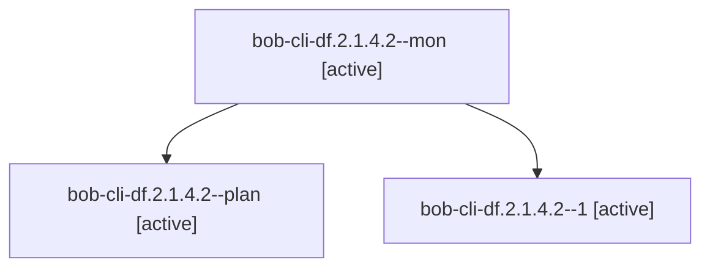

# Session: bob-cli-df.2.1.4.2

[Agent Hoods](../README.md) / [bbugyi200](../users/bbugyi200/README.md) / [athena](../users/bbugyi200/machines/athena/README.md) / [bob-cli-df](../users/bbugyi200/machines/athena/hoods/bob-cli-df/README.md) / bob-cli-df.2.1.4.2

Owner: `bbugyi200.athena` · Hood: `bob-cli-df` · Members: 3 · Bead: [bob-cli-df.2.1.4.2](https://github.com/bobs-org/bob-cli--beads/blob/main/pages/bob-cli-df/bob-cli-df.2.1.4.2.md)

## Lineage

The diagram is an optional enhancement; the ordered table below contains the same lineage in accessible text.

| Role | Agent | State | Model / provider | Timing | Commits | Prompt | Chat |
|---|---|---|---|---|---:|---|---|
| mon | bob-cli-df.2.1.4.2--mon | active | muse-spark-1.3-contributor / muse | 2026-10-28T07:38:42.859858+00:00 | 0 | — | [Chat](../agents/bbugyi200.athena.bob-cli-df.2.1.4.2--mon/chat.md) |
| plan | bob-cli-df.2.1.4.2--plan | active | muse-spark-1.3-contributor / muse | 2026-10-28T07:22:55.363124+00:00 | 0 | [Prompt](../agents/bbugyi200.athena.bob-cli-df.2.1.4.2--plan/prompt.md) | [Chat](../agents/bbugyi200.athena.bob-cli-df.2.1.4.2--plan/chat.md) |
| 1 | bob-cli-df.2.1.4.2--1 | active | muse-spark-1.3-contributor / muse | 2026-10-28T07:53:10.182739+00:00 | 0 | [Prompt](../agents/bbugyi200.athena.bob-cli-df.2.1.4.2--1/prompt.md) | [Chat](../agents/bbugyi200.athena.bob-cli-df.2.1.4.2--1/chat.md) |

## Neighbors

| Agent | Relation | State |
|---|---|---|
| [bob-cli-df.2](bbugyi200.athena.bob-cli-df.2.md) (session · 3) | ancestor | failed 3 |
| [bob-cli-df.2.1.4.1](bbugyi200.athena.bob-cli-df.2.1.4.1.md) (session · 11) | bob-cli-df.2.1.4 hood | active 11 |
| [bob-cli-df.2.1.4.3.1](../agents/bbugyi200.athena.bob-cli-df.2.1.4.3.1/README.md) | bob-cli-df.2.1.4 hood | completed |
| [bob-cli-df.2.1.4.3.2](bbugyi200.athena.bob-cli-df.2.1.4.3.2.md) (session · 5) | bob-cli-df.2.1.4 hood | active 1, completed 2, failed 2 |
| [bob-cli-df.2.1.4.3.land](../agents/bbugyi200.athena.bob-cli-df.2.1.4.3.land/README.md) | bob-cli-df.2.1.4 hood | waiting |
| [bob-cli-df.2.1.4.land](bbugyi200.athena.bob-cli-df.2.1.4.land.md) (session · 3) | bob-cli-df.2.1.4 hood | active 3 |
| [bob-cli-df.2.1.1](../agents/bbugyi200.athena.bob-cli-df.2.1.1/README.md) | bob-cli-df.2.1 hood | active |
| [bob-cli-df.2.1.2](../agents/bbugyi200.athena.bob-cli-df.2.1.2/README.md) | bob-cli-df.2.1 hood | active |
| [bob-cli-df.2.1.3](bbugyi200.athena.bob-cli-df.2.1.3.md) (session · 9) | bob-cli-df.2.1 hood | active 9 |
| [bob-cli-df.2.1.land](bbugyi200.athena.bob-cli-df.2.1.land.md) (session · 3) | bob-cli-df.2.1 hood | active 3 |
| [bob-cli-df.1](../agents/bbugyi200.athena.bob-cli-df.1/README.md) | bob-cli-df hood | completed |
| [bob-cli-df.3](../agents/bbugyi200.athena.bob-cli-df.3/README.md) | bob-cli-df hood | completed |
| [bob-cli-df.4](bbugyi200.athena.bob-cli-df.4.md) (session · 3) | bob-cli-df hood | failed 3 |
| [bob-cli-df.4.1.1](bbugyi200.athena.bob-cli-df.4.1.1.md) (session · 3) | bob-cli-df hood | active 3 |
| [bob-cli-df.4.1.2](bbugyi200.athena.bob-cli-df.4.1.2.md) (session · 3) | bob-cli-df hood | active 3 |
| [bob-cli-df.4.1.3](../agents/bbugyi200.athena.bob-cli-df.4.1.3/README.md) | bob-cli-df hood | active |
| [bob-cli-df.4.1.4](bbugyi200.athena.bob-cli-df.4.1.4.md) (session · 3) | bob-cli-df hood | active 3 |
| [bob-cli-df.4.1.land](bbugyi200.athena.bob-cli-df.4.1.land.md) (session · 3) | bob-cli-df hood | active 2, completed 1 |
| [bob-cli-df.land](../agents/bbugyi200.athena.bob-cli-df.land/README.md) | bob-cli-df hood | waiting |
