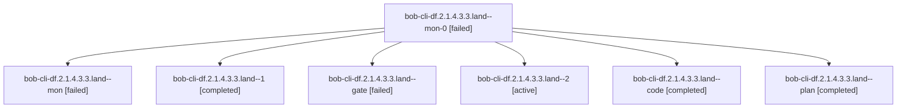

# Session: bob-cli-df.2.1.4.3.3.land

[Agent Hoods](../README.md) / [bbugyi200](../users/bbugyi200/README.md) / [athena](../users/bbugyi200/machines/athena/README.md) / [bob-cli-df](../users/bbugyi200/machines/athena/hoods/bob-cli-df/README.md) / bob-cli-df.2.1.4.3.3.land

Owner: `bbugyi200.athena` · Hood: `bob-cli-df` · Members: 7 · Bead: [bob-cli-df.2.1.4.3.3](https://github.com/bobs-org/bob-cli--beads/blob/main/pages/bob-cli-df/bob-cli-df.2.1.4.3.3.md)

## Lineage



The diagram is an optional enhancement; the ordered table below contains the same lineage in accessible text.

| Role | Agent | State | Model / provider | Timing | Commits | Prompt | Chat |
|---|---|---|---|---|---:|---|---|
| <a id="member-mon-0"></a>mon-0 | bob-cli-df.2.1.4.3.3.land--mon-0 | failed | gpt-6-luna / codex | 2026-10-28T13:54:30.530701+00:00 → 2026-10-28T14:22:40.663689+00:00 | 0 | — | [Chat](../agents/bbugyi200.athena.bob-cli-df.2.1.4.3.3.land--mon-0/chat.md) |
| <a id="member-mon"></a>mon | bob-cli-df.2.1.4.3.3.land--mon | failed | gpt-6-luna / codex | 2026-10-28T13:36:07.396716+00:00 → 2026-10-28T13:38:45.688311+00:00 | 0 | — | [Chat](../agents/bbugyi200.athena.bob-cli-df.2.1.4.3.3.land--mon/chat.md) |
| <a id="member-1"></a>1 | bob-cli-df.2.1.4.3.3.land--1 | completed | gpt-6-luna / codex | 2026-10-28T13:40:51.587666+00:00 → 2026-10-28T13:55:05.819171+00:00 | 0 | [Prompt](../agents/bbugyi200.athena.bob-cli-df.2.1.4.3.3.land--1/prompt.md) | [Chat](../agents/bbugyi200.athena.bob-cli-df.2.1.4.3.3.land--1/chat.md) |
| <a id="member-gate"></a>gate | bob-cli-df.2.1.4.3.3.land--gate | failed | opus / claude | 2026-10-28T13:29:51.315071+00:00 → 2026-10-28T13:30:58.546441+00:00 | 0 | — | [Chat](../agents/bbugyi200.athena.bob-cli-df.2.1.4.3.3.land--gate/chat.md) |
| <a id="member-2"></a>2 | bob-cli-df.2.1.4.3.3.land--2 | active | muse-spark-1.3-contributor / muse | 2026-10-28T14:25:32.584736+00:00 | 0 | [Prompt](../agents/bbugyi200.athena.bob-cli-df.2.1.4.3.3.land--2/prompt.md) | — |
| <a id="member-code"></a>code | bob-cli-df.2.1.4.3.3.land--code | completed | gpt-6-luna / codex | 2026-10-28T13:31:32.743245+00:00 → 2026-10-28T13:37:21.206195+00:00 | 0 | — | [Chat](../agents/bbugyi200.athena.bob-cli-df.2.1.4.3.3.land--code/chat.md) |
| <a id="member-plan"></a>plan | bob-cli-df.2.1.4.3.3.land--plan | completed | opus / claude | 2026-10-28T13:16:13.146137+00:00 → 2026-10-28T13:37:21.206195+00:00 | 0 | [Prompt](../agents/bbugyi200.athena.bob-cli-df.2.1.4.3.3.land--plan/prompt.md) | [Chat](../agents/bbugyi200.athena.bob-cli-df.2.1.4.3.3.land--plan/chat.md) |

## Variables

| Role | Variable | Value |
|---|---|---|
| plan | `artifacts` | \[{bead: bob-cli-df.2.1.4.3.3, kind: file, label: Uncommitted sase diff left by bob-cli-df.2.1.4.3.3.2--1 (core pin 49870f00, quarantine path fixes, tests) on base 49ebcc5eba, path: /home/bryan/.sase/… |

#### artifacts

**Role:** `plan`

```yaml
- bead: bob-cli-df.2.1.4.3.3
  kind: file
  label: Uncommitted sase diff left by bob-cli-df.2.1.4.3.3.2--1 (core pin 49870f00, quarantine path fixes, tests) on base 49ebcc5eba
  path: /home/bryan/.sase/artifacts/agents/gh_bobs-org__bob-cli/20261028091411/phase2-cd8b3b17b5d4.patch
  ref: file:explicit:ab5d6c3294bc3abbcfb7bf7b
  source_path: /tmp/land-df21433/phase2.patch
- bead: bob-cli-df.2.1.4.3.3
  kind: file
  label: Finalizer context/baseline/result for bob-cli-df.2.1.4.3.3.2--1 showing opened repos in baseline but no repository obligations
  path: /home/bryan/.sase/artifacts/agents/gh_bobs-org__bob-cli/20261028091411/phase2_finalizer_evidence-97cd2619379c.json
  ref: file:explicit:e79819a22e42975e194405f7
  source_path: /tmp/land-df21433/phase2_finalizer_evidence.json
```

Values are truncated for display; see each member's agent meta.json for the full values.

## Neighbors

| Agent | Relation | State |
|---|---|---|
| [bob-cli-df.2](bbugyi200.athena.bob-cli-df.2.md) (session · 3) | ancestor | failed 3 |
| [bob-cli-df.2.1.4.3.3.1](bbugyi200.athena.bob-cli-df.2.1.4.3.3.1.md) (session · 7) | bob-cli-df.2.1.4.3.3 hood | completed 4, failed 3 |
| [bob-cli-df.2.1.4.3.3.2](bbugyi200.athena.bob-cli-df.2.1.4.3.3.2.md) (session · 3) | bob-cli-df.2.1.4.3.3 hood | completed 2, failed 1 |
| [bob-cli-df.2.1.4.3.1](../agents/bbugyi200.athena.bob-cli-df.2.1.4.3.1/README.md) | bob-cli-df.2.1.4.3 hood | completed |
| [bob-cli-df.2.1.4.3.2](bbugyi200.athena.bob-cli-df.2.1.4.3.2.md) (session · 5) | bob-cli-df.2.1.4.3 hood | completed 3, failed 2 |
| [bob-cli-df.2.1.4.3.land](../agents/bbugyi200.athena.bob-cli-df.2.1.4.3.land/README.md) | bob-cli-df.2.1.4.3 hood | completed |
| [bob-cli-df.2.1.4.1](bbugyi200.athena.bob-cli-df.2.1.4.1.md) (session · 11) | bob-cli-df.2.1.4 hood | active 11 |
| [bob-cli-df.2.1.4.2](bbugyi200.athena.bob-cli-df.2.1.4.2.md) (session · 3) | bob-cli-df.2.1.4 hood | active 3 |
| [bob-cli-df.2.1.4.land](bbugyi200.athena.bob-cli-df.2.1.4.land.md) (session · 3) | bob-cli-df.2.1.4 hood | active 3 |
| [bob-cli-df.2.1.1](../agents/bbugyi200.athena.bob-cli-df.2.1.1/README.md) | bob-cli-df.2.1 hood | active |
| [bob-cli-df.2.1.2](../agents/bbugyi200.athena.bob-cli-df.2.1.2/README.md) | bob-cli-df.2.1 hood | active |
| [bob-cli-df.2.1.3](bbugyi200.athena.bob-cli-df.2.1.3.md) (session · 9) | bob-cli-df.2.1 hood | active 9 |
| [bob-cli-df.2.1.land](bbugyi200.athena.bob-cli-df.2.1.land.md) (session · 3) | bob-cli-df.2.1 hood | active 3 |
| [bob-cli-df.1](../agents/bbugyi200.athena.bob-cli-df.1/README.md) | bob-cli-df hood | completed |
| [bob-cli-df.3](../agents/bbugyi200.athena.bob-cli-df.3/README.md) | bob-cli-df hood | completed |
| [bob-cli-df.4](bbugyi200.athena.bob-cli-df.4.md) (session · 3) | bob-cli-df hood | failed 3 |
| [bob-cli-df.4.1.1](bbugyi200.athena.bob-cli-df.4.1.1.md) (session · 3) | bob-cli-df hood | active 3 |
| [bob-cli-df.4.1.2](bbugyi200.athena.bob-cli-df.4.1.2.md) (session · 3) | bob-cli-df hood | active 3 |
| [bob-cli-df.4.1.3](../agents/bbugyi200.athena.bob-cli-df.4.1.3/README.md) | bob-cli-df hood | active |
| [bob-cli-df.4.1.4](bbugyi200.athena.bob-cli-df.4.1.4.md) (session · 3) | bob-cli-df hood | active 3 |
| [bob-cli-df.4.1.land](bbugyi200.athena.bob-cli-df.4.1.land.md) (session · 3) | bob-cli-df hood | active 2, completed 1 |
| [bob-cli-df.land](../agents/bbugyi200.athena.bob-cli-df.land/README.md) | bob-cli-df hood | active |
