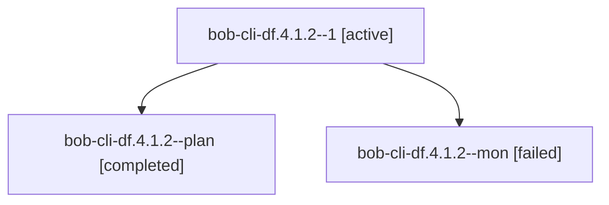

# Session: bob-cli-df.4.1.2

[Agent Hoods](../README.md) / [bbugyi200](../users/bbugyi200/README.md) / [athena](../users/bbugyi200/machines/athena/README.md) / [bob-cli-df](../users/bbugyi200/machines/athena/hoods/bob-cli-df/README.md) / bob-cli-df.4.1.2

Owner: `bbugyi200.athena` · Hood: `bob-cli-df` · Members: 3 · Bead: [bob-cli-df.4.1.2](https://github.com/bobs-org/bob-cli--beads/blob/main/pages/bob-cli-df/bob-cli-df.4.1.2.md)

## Lineage

The diagram is an optional enhancement; the ordered table below contains the same lineage in accessible text.

| Role | Agent | State | Model / provider | Timing | Commits | Prompt | Chat |
|---|---|---|---|---|---:|---|---|
| 1 | bob-cli-df.4.1.2--1 | active | gpt-6-luna / codex | 2026-10-28T02:50:01.315058+00:00 | 0 | [Prompt](../agents/bbugyi200.athena.bob-cli-df.4.1.2--1/prompt.md) | — |
| plan | bob-cli-df.4.1.2--plan | completed | gpt-6-luna / codex | 2026-10-28T02:29:26.170259+00:00 → 2026-10-28T02:42:59.076651+00:00 | 0 | [Prompt](../agents/bbugyi200.athena.bob-cli-df.4.1.2--plan/prompt.md) | [Chat](../agents/bbugyi200.athena.bob-cli-df.4.1.2--plan/chat.md) |
| mon | bob-cli-df.4.1.2--mon | failed | gpt-6-luna / codex | 2026-10-28T02:42:07.702866+00:00 → 2026-10-28T02:48:39.181606+00:00 | 0 | — | [Chat](../agents/bbugyi200.athena.bob-cli-df.4.1.2--mon/chat.md) |

## Neighbors

| Agent | Relation | State |
|---|---|---|
| [bob-cli-df.4](bbugyi200.athena.bob-cli-df.4.md) (session · 3) | ancestor | failed 3 |
| [bob-cli-df.4.1.1](bbugyi200.athena.bob-cli-df.4.1.1.md) (session · 3) | bob-cli-df.4.1 hood | completed 2, failed 1 |
| [bob-cli-df.4.1.3](../agents/bbugyi200.athena.bob-cli-df.4.1.3/README.md) | bob-cli-df.4.1 hood | completed |
| [bob-cli-df.4.1.4](../agents/bbugyi200.athena.bob-cli-df.4.1.4/README.md) | bob-cli-df.4.1 hood | waiting |
| [bob-cli-df.4.1.land](../agents/bbugyi200.athena.bob-cli-df.4.1.land/README.md) | bob-cli-df.4.1 hood | waiting |
| [bob-cli-df.1](../agents/bbugyi200.athena.bob-cli-df.1/README.md) | bob-cli-df hood | completed |
| [bob-cli-df.2](bbugyi200.athena.bob-cli-df.2.md) (session · 3) | bob-cli-df hood | failed 3 |
| [bob-cli-df.2.1.1](../agents/bbugyi200.athena.bob-cli-df.2.1.1/README.md) | bob-cli-df hood | completed |
| [bob-cli-df.2.1.2](../agents/bbugyi200.athena.bob-cli-df.2.1.2/README.md) | bob-cli-df hood | active |
| [bob-cli-df.2.1.3](../agents/bbugyi200.athena.bob-cli-df.2.1.3/README.md) | bob-cli-df hood | waiting |
| [bob-cli-df.2.1.land](../agents/bbugyi200.athena.bob-cli-df.2.1.land/README.md) | bob-cli-df hood | waiting |
| [bob-cli-df.3](../agents/bbugyi200.athena.bob-cli-df.3/README.md) | bob-cli-df hood | completed |
| [bob-cli-df.land](../agents/bbugyi200.athena.bob-cli-df.land/README.md) | bob-cli-df hood | waiting |
