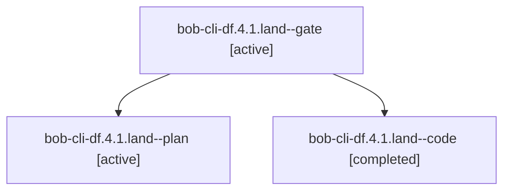

# Session: bob-cli-df.4.1.land

[Agent Hoods](../README.md) / [bbugyi200](../users/bbugyi200/README.md) / [athena](../users/bbugyi200/machines/athena/README.md) / [bob-cli-df](../users/bbugyi200/machines/athena/hoods/bob-cli-df/README.md) / bob-cli-df.4.1.land

Owner: `bbugyi200.athena` · Hood: `bob-cli-df` · Members: 3 · Bead: [bob-cli-df.4.1](https://github.com/bobs-org/bob-cli--beads/blob/main/pages/bob-cli-df/bob-cli-df.4.1.md)

## Lineage



The diagram is an optional enhancement; the ordered table below contains the same lineage in accessible text.

| Role | Agent | State | Model / provider | Timing | Commits | Prompt | Chat |
|---|---|---|---|---|---:|---|---|
| <a id="member-gate"></a>gate | bob-cli-df.4.1.land--gate | active | gpt-6-astra / codex | 2026-10-28T03:57:52.862323+00:00 | 0 | — | [Chat](../agents/bbugyi200.athena.bob-cli-df.4.1.land--gate/chat.md) |
| <a id="member-plan"></a>plan | bob-cli-df.4.1.land--plan | active | gpt-6-astra / codex | 2026-10-28T03:41:37.196302+00:00 | 0 | [Prompt](../agents/bbugyi200.athena.bob-cli-df.4.1.land--plan/prompt.md) | [Chat](../agents/bbugyi200.athena.bob-cli-df.4.1.land--plan/chat.md) |
| <a id="member-code"></a>code | bob-cli-df.4.1.land--code | completed | grok-4.6 / grok | 2026-10-28T03:59:29.028412+00:00 → 2026-10-28T04:43:01.649158+00:00 | 0 | — | [Chat](../agents/bbugyi200.athena.bob-cli-df.4.1.land--code/chat.md) |

## Variables

| Role | Variable | Value |
|---|---|---|
| plan | `artifacts` | \[{bead: bob-cli-df.4.1, kind: markdown, label: bob-cli-df.4.1 landing gaps and follow-up dispositions, path: /home/bryan/.sase/artifacts/agents/gh\_bobs-org\_\_bob-cli/20261027214101/sase\_df41\_landing\_e… |

#### artifacts

**Role:** `plan`

```yaml
- bead: bob-cli-df.4.1
  kind: markdown
  label: bob-cli-df.4.1 landing gaps and follow-up dispositions
  path: /home/bryan/.sase/artifacts/agents/gh_bobs-org__bob-cli/20261027214101/sase_df41_landing_evidence-9f25e15909a7.md
  ref: file:explicit:40409c9e03e43f92b43cbaf8
```

Values are truncated for display; see each member's agent meta.json for the full values.

## Neighbors

| Agent | Relation | State |
|---|---|---|
| [bob-cli-df.4](bbugyi200.athena.bob-cli-df.4.md) (session · 3) | ancestor | failed 3 |
| [bob-cli-df.4.1.1](bbugyi200.athena.bob-cli-df.4.1.1.md) (session · 3) | bob-cli-df.4.1 hood | active 3 |
| [bob-cli-df.4.1.2](bbugyi200.athena.bob-cli-df.4.1.2.md) (session · 3) | bob-cli-df.4.1 hood | active 3 |
| [bob-cli-df.4.1.3](../agents/bbugyi200.athena.bob-cli-df.4.1.3/README.md) | bob-cli-df.4.1 hood | active |
| [bob-cli-df.4.1.4](bbugyi200.athena.bob-cli-df.4.1.4.md) (session · 3) | bob-cli-df.4.1 hood | active 3 |
| [bob-cli-df.1](../agents/bbugyi200.athena.bob-cli-df.1/README.md) | bob-cli-df hood | completed |
| [bob-cli-df.2](bbugyi200.athena.bob-cli-df.2.md) (session · 3) | bob-cli-df hood | failed 3 |
| [bob-cli-df.2.1.1](../agents/bbugyi200.athena.bob-cli-df.2.1.1/README.md) | bob-cli-df hood | active |
| [bob-cli-df.2.1.2](../agents/bbugyi200.athena.bob-cli-df.2.1.2/README.md) | bob-cli-df hood | active |
| [bob-cli-df.2.1.3](bbugyi200.athena.bob-cli-df.2.1.3.md) (session · 9) | bob-cli-df hood | active 9 |
| [bob-cli-df.2.1.4.1](bbugyi200.athena.bob-cli-df.2.1.4.1.md) (session · 11) | bob-cli-df hood | active 11 |
| [bob-cli-df.2.1.4.2](bbugyi200.athena.bob-cli-df.2.1.4.2.md) (session · 3) | bob-cli-df hood | active 3 |
| [bob-cli-df.2.1.4.3.1](../agents/bbugyi200.athena.bob-cli-df.2.1.4.3.1/README.md) | bob-cli-df hood | completed |
| [bob-cli-df.2.1.4.3.2](bbugyi200.athena.bob-cli-df.2.1.4.3.2.md) (session · 5) | bob-cli-df hood | completed 3, failed 2 |
| [bob-cli-df.2.1.4.3.3.1](bbugyi200.athena.bob-cli-df.2.1.4.3.3.1.md) (session · 7) | bob-cli-df hood | active 1, completed 3, failed 3 |
| [bob-cli-df.2.1.4.3.3.2](../agents/bbugyi200.athena.bob-cli-df.2.1.4.3.3.2/README.md) | bob-cli-df hood | waiting |
| [bob-cli-df.2.1.4.3.3.land](../agents/bbugyi200.athena.bob-cli-df.2.1.4.3.3.land/README.md) | bob-cli-df hood | waiting |
| [bob-cli-df.2.1.4.3.land](../agents/bbugyi200.athena.bob-cli-df.2.1.4.3.land/README.md) | bob-cli-df hood | completed |
| [bob-cli-df.2.1.4.land](bbugyi200.athena.bob-cli-df.2.1.4.land.md) (session · 3) | bob-cli-df hood | active 3 |
| [bob-cli-df.2.1.land](bbugyi200.athena.bob-cli-df.2.1.land.md) (session · 3) | bob-cli-df hood | active 3 |
| [bob-cli-df.3](../agents/bbugyi200.athena.bob-cli-df.3/README.md) | bob-cli-df hood | completed |
| [bob-cli-df.land](../agents/bbugyi200.athena.bob-cli-df.land/README.md) | bob-cli-df hood | waiting |
