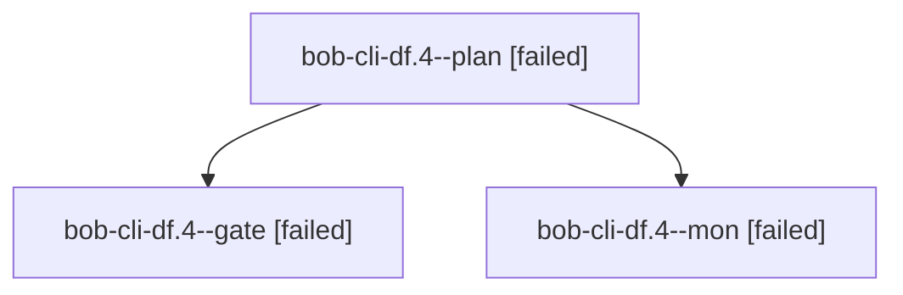

# Session: bob-cli-df.4

[Agent Hoods](../README.md) / [bbugyi200](../users/bbugyi200/README.md) / [athena](../users/bbugyi200/machines/athena/README.md) / [bob-cli-df](../users/bbugyi200/machines/athena/hoods/bob-cli-df/README.md) / bob-cli-df.4

Owner: `bbugyi200.athena` · Hood: `bob-cli-df` · Members: 3 · Bead: [bob-cli-df.4](https://github.com/bobs-org/bob-cli--beads/blob/main/pages/bob-cli-df/bob-cli-df.4.md)

## Lineage

The diagram is an optional enhancement; the ordered table below contains the same lineage in accessible text.

| Role | Agent | State | Model / provider | Timing | Commits | Prompt | Chat |
|---|---|---|---|---|---:|---|---|
| plan | bob-cli-df.4--plan | failed | gpt-6-astra / codex | 2026-10-28T01:30:31.519758+00:00 → 2026-10-28T01:39:26.038538+00:00 | 0 | [Prompt](../agents/bbugyi200.athena.bob-cli-df.4--plan/prompt.md) | [Chat](../agents/bbugyi200.athena.bob-cli-df.4--plan/chat.md) |
| gate | bob-cli-df.4--gate | failed | gpt-6-astra / codex | 2026-10-28T01:38:33.984870+00:00 → 2026-10-28T01:39:14.903975+00:00 | 0 | — | [Chat](../agents/bbugyi200.athena.bob-cli-df.4--gate/chat.md) |
| mon | bob-cli-df.4--mon | failed | gpt-6-astra / codex | 2026-10-28T01:39:14.003765+00:00 → 2026-10-28T01:43:13.629803+00:00 | 0 | — | [Chat](../agents/bbugyi200.athena.bob-cli-df.4--mon/chat.md) |

## Neighbors

| Agent | Relation | State |
|---|---|---|
| [bob-cli-df.4.1.1](bbugyi200.athena.bob-cli-df.4.1.1.md) (session · 3) | descendant | completed 2, failed 1 |
| [bob-cli-df.4.1.2](bbugyi200.athena.bob-cli-df.4.1.2.md) (session · 3) | descendant | completed 2, failed 1 |
| [bob-cli-df.4.1.3](../agents/bbugyi200.athena.bob-cli-df.4.1.3/README.md) | descendant | completed |
| [bob-cli-df.4.1.4](bbugyi200.athena.bob-cli-df.4.1.4.md) (session · 3) | descendant | completed 2, failed 1 |
| [bob-cli-df.4.1.land](bbugyi200.athena.bob-cli-df.4.1.land.md) (session · 3) | descendant | active 2, failed 1 |
| [bob-cli-df.1](../agents/bbugyi200.athena.bob-cli-df.1/README.md) | bob-cli-df hood | completed |
| [bob-cli-df.2](bbugyi200.athena.bob-cli-df.2.md) (session · 3) | bob-cli-df hood | failed 3 |
| [bob-cli-df.2.1.1](../agents/bbugyi200.athena.bob-cli-df.2.1.1/README.md) | bob-cli-df hood | completed |
| [bob-cli-df.2.1.2](../agents/bbugyi200.athena.bob-cli-df.2.1.2/README.md) | bob-cli-df hood | completed |
| [bob-cli-df.2.1.3](bbugyi200.athena.bob-cli-df.2.1.3.md) (session · 3) | bob-cli-df hood | active 1, completed 1, failed 1 |
| [bob-cli-df.2.1.land](../agents/bbugyi200.athena.bob-cli-df.2.1.land/README.md) | bob-cli-df hood | waiting |
| [bob-cli-df.3](../agents/bbugyi200.athena.bob-cli-df.3/README.md) | bob-cli-df hood | completed |
| [bob-cli-df.land](../agents/bbugyi200.athena.bob-cli-df.land/README.md) | bob-cli-df hood | waiting |
