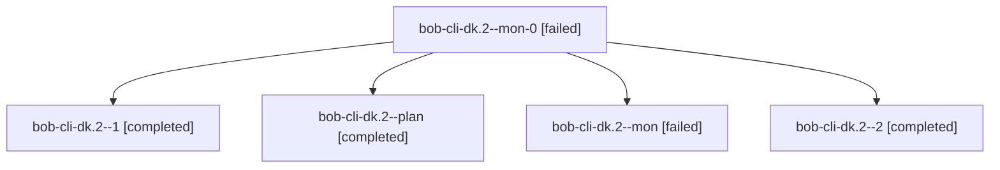

# Session: bob-cli-dk.2

[Agent Hoods](../README.md) / [bbugyi200](../users/bbugyi200/README.md) / [athena](../users/bbugyi200/machines/athena/README.md) / [bob-cli-dk](../users/bbugyi200/machines/athena/hoods/bob-cli-dk/README.md) / bob-cli-dk.2

Owner: `bbugyi200.athena` · Hood: `bob-cli-dk` · Members: 5 · Bead: [bob-cli-dk.2](https://github.com/bobs-org/bob-cli--beads/blob/main/pages/bob-cli-dk/bob-cli-dk.2.md)

## Lineage

The diagram is an optional enhancement; the ordered table below contains the same lineage in accessible text.

| Role | Agent | State | Model / provider | Timing | Commits | Prompt | Chat |
|---|---|---|---|---|---:|---|---|
| mon-0 | bob-cli-dk.2--mon-0 | failed | grok-4.6 / grok | 2026-10-28T13:17:29.305214+00:00 → 2026-10-28T13:24:28.848529+00:00 | 0 | — | [Chat](../agents/bbugyi200.athena.bob-cli-dk.2--mon-0/chat.md) |
| 1 | bob-cli-dk.2--1 | completed | grok-4.6 / grok | 2026-10-28T13:08:01.710337+00:00 → 2026-10-28T13:18:06.900798+00:00 | 0 | [Prompt](../agents/bbugyi200.athena.bob-cli-dk.2--1/prompt.md) | [Chat](../agents/bbugyi200.athena.bob-cli-dk.2--1/chat.md) |
| plan | bob-cli-dk.2--plan | completed | grok-4.6 / grok | 2026-10-28T12:22:58.501822+00:00 → 2026-10-28T13:02:27.455841+00:00 | 0 | [Prompt](../agents/bbugyi200.athena.bob-cli-dk.2--plan/prompt.md) | [Chat](../agents/bbugyi200.athena.bob-cli-dk.2--plan/chat.md) |
| mon | bob-cli-dk.2--mon | failed | grok-4.6 / grok | 2026-10-28T13:01:48.482439+00:00 → 2026-10-28T13:06:15.536323+00:00 | 0 | — | [Chat](../agents/bbugyi200.athena.bob-cli-dk.2--mon/chat.md) |
| 2 | bob-cli-dk.2--2 | completed | grok-4.6 / grok | 2026-10-28T13:26:24.800988+00:00 → 2026-10-28T13:52:14.704486+00:00 | [1](../agents/bbugyi200.athena.bob-cli-dk.2--2/README.md#commits) | [Prompt](../agents/bbugyi200.athena.bob-cli-dk.2--2/prompt.md) | [Chat](../agents/bbugyi200.athena.bob-cli-dk.2--2/chat.md) |

## Commits

| Role | Repo | Commit | Subject | Committed |
|---|---|---|---|---|
| 2 | bob-cli | [`084a285`](https://github.com/bobs-org/bob-cli/commit/084a2852b121a153852a5c045b3b5ac5385ea89c) | feat(themes): scope Recent to configured themes and warn on unconfigured names | 2026-10-28 09:49:09 EDT |

## Neighbors

| Agent | Relation | State |
|---|---|---|
| [bob-cli-dk.1](../agents/bbugyi200.athena.bob-cli-dk.1/README.md) | bob-cli-dk hood | completed |
| [bob-cli-dk.3](../agents/bbugyi200.athena.bob-cli-dk.3/README.md) | bob-cli-dk hood | completed |
| [bob-cli-dk.4](../agents/bbugyi200.athena.bob-cli-dk.4/README.md) | bob-cli-dk hood | completed |
| [bob-cli-dk.5](../agents/bbugyi200.athena.bob-cli-dk.5/README.md) | bob-cli-dk hood | completed |
| [bob-cli-dk.land](../agents/bbugyi200.athena.bob-cli-dk.land/README.md) | bob-cli-dk hood | active |
