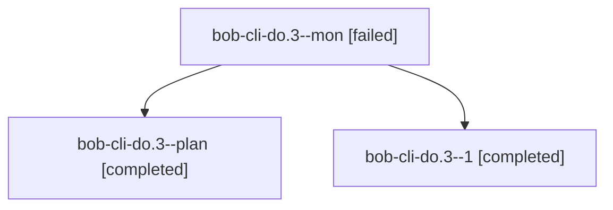

# Session: bob-cli-do.3

[Agent Hoods](../README.md) / [bbugyi200](../users/bbugyi200/README.md) / [athena](../users/bbugyi200/machines/athena/README.md) / [bob-cli-do](../users/bbugyi200/machines/athena/hoods/bob-cli-do/README.md) / bob-cli-do.3

Owner: `bbugyi200.athena` · Hood: `bob-cli-do` · Members: 3 · Bead: [bob-cli-do.3](https://github.com/bobs-org/bob-cli--beads/blob/main/pages/bob-cli-do/bob-cli-do.3.md)

## Lineage

The diagram is an optional enhancement; the ordered table below contains the same lineage in accessible text.

| Role | Agent | State | Model / provider | Timing | Commits | Prompt | Chat |
|---|---|---|---|---|---:|---|---|
| mon | bob-cli-do.3--mon | failed | grok-4.6 / grok | 2026-10-28T15:19:21.503551+00:00 → 2026-10-28T15:24:04.396040+00:00 | 0 | — | [Chat](../agents/bbugyi200.athena.bob-cli-do.3--mon/chat.md) |
| plan | bob-cli-do.3--plan | completed | grok-4.6 / grok | 2026-10-28T14:50:47.910761+00:00 → 2026-10-28T15:20:21.518068+00:00 | 0 | [Prompt](../agents/bbugyi200.athena.bob-cli-do.3--plan/prompt.md) | [Chat](../agents/bbugyi200.athena.bob-cli-do.3--plan/chat.md) |
| 1 | bob-cli-do.3--1 | completed | grok-4.6 / grok | 2026-10-28T15:25:53.986423+00:00 → 2026-10-28T15:40:34.823337+00:00 | [1](../agents/bbugyi200.athena.bob-cli-do.3--1/README.md#commits) | [Prompt](../agents/bbugyi200.athena.bob-cli-do.3--1/prompt.md) | [Chat](../agents/bbugyi200.athena.bob-cli-do.3--1/chat.md) |

## Commits

| Role | Repo | Commit | Subject | Committed |
|---|---|---|---|---|
| 1 | bob-cli | [`16f3da4`](https://github.com/bobs-org/bob-cli/commit/16f3da48ac167002d29c7b0e1119fc4b0a97a125) | feat(vault-sync): quarantine displaced-plus-foreign-identity note clobbers | 2026-10-28 11:38:07 EDT |

## Neighbors

| Agent | Relation | State |
|---|---|---|
| [bob-cli-do.1](../agents/bbugyi200.athena.bob-cli-do.1/README.md) | bob-cli-do hood | completed |
| [bob-cli-do.2](../agents/bbugyi200.athena.bob-cli-do.2/README.md) | bob-cli-do hood | completed |
| [bob-cli-do.4](../agents/bbugyi200.athena.bob-cli-do.4/README.md) | bob-cli-do hood | active |
| [bob-cli-do.land](../agents/bbugyi200.athena.bob-cli-do.land/README.md) | bob-cli-do hood | waiting |
