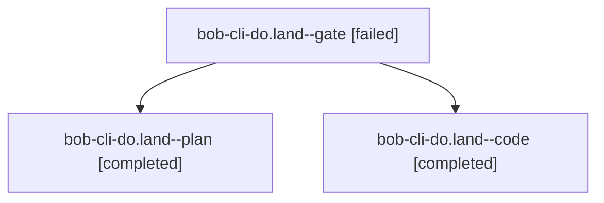

# Session: bob-cli-do.land

[Agent Hoods](../README.md) / [bbugyi200](../users/bbugyi200/README.md) / [athena](../users/bbugyi200/machines/athena/README.md) / [bob-cli-do](../users/bbugyi200/machines/athena/hoods/bob-cli-do/README.md) / bob-cli-do.land

Owner: `bbugyi200.athena` · Hood: `bob-cli-do` · Members: 3 · Bead: [bob-cli-do](https://github.com/bobs-org/bob-cli--beads/blob/main/pages/bob-cli-do/README.md)

## Lineage



The diagram is an optional enhancement; the ordered table below contains the same lineage in accessible text.

| Role | Agent | State | Model / provider | Timing | Commits | Prompt | Chat |
|---|---|---|---|---|---:|---|---|
| <a id="member-gate"></a>gate | bob-cli-do.land--gate | failed | gpt-6-astra / codex | 2026-10-28T17:50:39.725715+00:00 → 2026-10-28T17:52:04.473816+00:00 | 0 | — | [Chat](../agents/bbugyi200.athena.bob-cli-do.land--gate/chat.md) |
| <a id="member-plan"></a>plan | bob-cli-do.land--plan | completed | gpt-6-astra / codex | 2026-10-28T17:34:40.121867+00:00 → 2026-10-28T18:13:20.533787+00:00 | 0 | [Prompt](../agents/bbugyi200.athena.bob-cli-do.land--plan/prompt.md) | [Chat](../agents/bbugyi200.athena.bob-cli-do.land--plan/chat.md) |
| <a id="member-code"></a>code | bob-cli-do.land--code | completed | muse-spark-1.3-contributor / muse | 2026-10-28T17:52:37.673666+00:00 → 2026-10-28T18:13:20.533787+00:00 | [1](../agents/bbugyi200.athena.bob-cli-do.land--code/README.md#commits) | — | [Chat](../agents/bbugyi200.athena.bob-cli-do.land--code/chat.md) |

## Commits

| Role | Repo | Commit | Subject | Committed |
|---|---|---|---|---|
| code | bob-cli | [`792cc24`](https://github.com/bobs-org/bob-cli/commit/792cc2436f43136a228d53cb8ddb4b7110178d92) | fix(vault-sync): complete clobber-guard closeout quarantine | 2026-10-28 14:11:17 EDT |

## Variables

| Role | Variable | Value |
|---|---|---|
| plan | `artifacts` | \[{bead: bob-cli-do, kind: file, label: bob-cli-do landing clobber reproducer, path: /home/bryan/.sase/artifacts/agents/gh\_bobs-org\_\_bob-cli/20261028104758/repro\_clobber-89308d73062f.py, ref: file:exp… |

#### artifacts

**Role:** `plan`

```yaml
- bead: bob-cli-do
  kind: file
  label: bob-cli-do landing clobber reproducer
  path: /home/bryan/.sase/artifacts/agents/gh_bobs-org__bob-cli/20261028104758/repro_clobber-89308d73062f.py
  ref: file:explicit:bc73ed9db0392b2a41b250e4
  source_path: /home/bryan/.local/state/sase/workspaces/bobs-org/bob-cli/bob-cli_12/target/land-audit/repro_clobber.py
- bead: bob-cli-do
  kind: file
  label: bob-cli-do landing clobber reproduction results
  path: /home/bryan/.sase/artifacts/agents/gh_bobs-org__bob-cli/20261028104758/repro_clobber-577d82092c62.json
  ref: file:explicit:8ba8616a472fa4e32615c8d9
  source_path: /home/bryan/.local/state/sase/workspaces/bobs-org/bob-cli/bob-cli_12/target/land-audit/repro_clobber.json
- bead: bob-cli-do
  kind: file
  label: bob-cli-do false-positive recovery redetection
  path: /home/bryan/.sase/artifacts/agents/gh_bobs-org__bob-cli/20261028104758/runbook_repro-cc24cd1e566e.txt
  ref: file:explicit:d761a43e46d85b01f4fe2c1d
  source_path: /home/bryan/.local/state/sase/workspaces/bobs-org/bob-cli/bob-cli_12/target/land-audit/runbook_repro.txt
```

Values are truncated for display; see each member's agent meta.json for the full values.

## Neighbors

| Agent | Relation | State |
|---|---|---|
| [bob-cli-do.1](../agents/bbugyi200.athena.bob-cli-do.1/README.md) | bob-cli-do hood | completed |
| [bob-cli-do.2](../agents/bbugyi200.athena.bob-cli-do.2/README.md) | bob-cli-do hood | completed |
| [bob-cli-do.3](bbugyi200.athena.bob-cli-do.3.md) (session · 3) | bob-cli-do hood | completed 2, failed 1 |
| [bob-cli-do.4](../agents/bbugyi200.athena.bob-cli-do.4/README.md) | bob-cli-do hood | completed |
