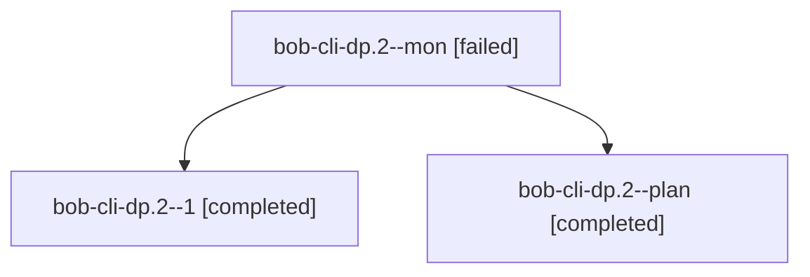

# Session: bob-cli-dp.2

[Agent Hoods](../README.md) / [bbugyi200](../users/bbugyi200/README.md) / [athena](../users/bbugyi200/machines/athena/README.md) / [bob-cli-dp](../users/bbugyi200/machines/athena/hoods/bob-cli-dp/README.md) / bob-cli-dp.2

Owner: `bbugyi200.athena` · Hood: `bob-cli-dp` · Members: 3 · Bead: [bob-cli-dp.2](https://github.com/bobs-org/bob-cli--beads/blob/main/pages/bob-cli-dp/bob-cli-dp.2.md)

## Lineage

The diagram is an optional enhancement; the ordered table below contains the same lineage in accessible text.

| Role | Agent | State | Model / provider | Timing | Commits | Prompt | Chat |
|---|---|---|---|---|---:|---|---|
| mon | bob-cli-dp.2--mon | failed | grok-4.6 / grok | 2026-10-28T16:04:23.884642+00:00 → 2026-10-28T16:11:12.049099+00:00 | 0 | — | [Chat](../agents/bbugyi200.athena.bob-cli-dp.2--mon/chat.md) |
| 1 | bob-cli-dp.2--1 | completed | grok-4.6 / grok | 2026-10-28T16:12:57.562053+00:00 → 2026-10-28T16:33:30.516776+00:00 | 0 | [Prompt](../agents/bbugyi200.athena.bob-cli-dp.2--1/prompt.md) | [Chat](../agents/bbugyi200.athena.bob-cli-dp.2--1/chat.md) |
| plan | bob-cli-dp.2--plan | completed | grok-4.6 / grok | 2026-10-28T15:27:28.931473+00:00 → 2026-10-28T16:05:59.864541+00:00 | 0 | [Prompt](../agents/bbugyi200.athena.bob-cli-dp.2--plan/prompt.md) | [Chat](../agents/bbugyi200.athena.bob-cli-dp.2--plan/chat.md) |

## Neighbors

| Agent | Relation | State |
|---|---|---|
| [bob-cli-dp.1](../agents/bbugyi200.athena.bob-cli-dp.1/README.md) | bob-cli-dp hood | failed |
| [bob-cli-dp.3](../agents/bbugyi200.athena.bob-cli-dp.3/README.md) | bob-cli-dp hood | completed |
| [bob-cli-dp.4](bbugyi200.athena.bob-cli-dp.4.md) (session · 7) | bob-cli-dp hood | active 1, completed 3, failed 3 |
| [bob-cli-dp.land](../agents/bbugyi200.athena.bob-cli-dp.land/README.md) | bob-cli-dp hood | waiting |
