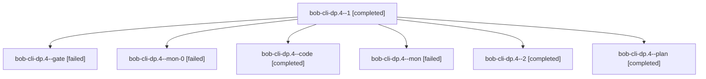

# Session: bob-cli-dp.4

[Agent Hoods](../README.md) / [bbugyi200](../users/bbugyi200/README.md) / [athena](../users/bbugyi200/machines/athena/README.md) / [bob-cli-dp](../users/bbugyi200/machines/athena/hoods/bob-cli-dp/README.md) / bob-cli-dp.4

Owner: `bbugyi200.athena` · Hood: `bob-cli-dp` · Members: 7 · Bead: [bob-cli-dp.4](https://github.com/bobs-org/bob-cli--beads/blob/main/pages/bob-cli-dp/bob-cli-dp.4.md)

## Lineage

The diagram is an optional enhancement; the ordered table below contains the same lineage in accessible text.

| Role | Agent | State | Model / provider | Timing | Commits | Prompt | Chat |
|---|---|---|---|---|---:|---|---|
| 1 | bob-cli-dp.4--1 | completed | gpt-6-luna / codex | 2026-10-28T15:51:56.553035+00:00 → 2026-10-28T16:39:42.152007+00:00 | 0 | [Prompt](../agents/bbugyi200.athena.bob-cli-dp.4--1/prompt.md) | [Chat](../agents/bbugyi200.athena.bob-cli-dp.4--1/chat.md) |
| gate | bob-cli-dp.4--gate | failed | gpt-6-astra / codex | 2026-10-28T15:34:28.087289+00:00 → 2026-10-28T15:35:51.480759+00:00 | 0 | — | [Chat](../agents/bbugyi200.athena.bob-cli-dp.4--gate/chat.md) |
| mon-0 | bob-cli-dp.4--mon-0 | failed | gpt-6-luna / codex | 2026-10-28T16:39:00.961084+00:00 → 2026-10-28T16:41:15.418442+00:00 | 0 | — | [Chat](../agents/bbugyi200.athena.bob-cli-dp.4--mon-0/chat.md) |
| code | bob-cli-dp.4--code | completed | gpt-6-luna / codex | 2026-10-28T15:36:32.593975+00:00 → 2026-10-28T15:48:50.461763+00:00 | 0 | — | [Chat](../agents/bbugyi200.athena.bob-cli-dp.4--code/chat.md) |
| mon | bob-cli-dp.4--mon | failed | gpt-6-luna / codex | 2026-10-28T15:47:29.948160+00:00 → 2026-10-28T15:50:00.477588+00:00 | 0 | — | [Chat](../agents/bbugyi200.athena.bob-cli-dp.4--mon/chat.md) |
| 2 | bob-cli-dp.4--2 | completed | gpt-6-luna / codex | 2026-10-28T16:42:44.917738+00:00 → 2026-10-28T16:48:23.836023+00:00 | 0 | [Prompt](../agents/bbugyi200.athena.bob-cli-dp.4--2/prompt.md) | [Chat](../agents/bbugyi200.athena.bob-cli-dp.4--2/chat.md) |
| plan | bob-cli-dp.4--plan | completed | gpt-6-astra / codex | 2026-10-28T15:28:45.904175+00:00 → 2026-10-28T15:48:50.461763+00:00 | 0 | [Prompt](../agents/bbugyi200.athena.bob-cli-dp.4--plan/prompt.md) | [Chat](../agents/bbugyi200.athena.bob-cli-dp.4--plan/chat.md) |

## Neighbors

| Agent | Relation | State |
|---|---|---|
| [bob-cli-dp.1](bbugyi200.athena.bob-cli-dp.1.md) (session · 3) | bob-cli-dp hood | completed 2, failed 1 |
| [bob-cli-dp.1](../agents/bbugyi200.athena.bob-cli-dp.1/README.md) | bob-cli-dp hood | failed |
| [bob-cli-dp.2](bbugyi200.athena.bob-cli-dp.2.md) (session · 3) | bob-cli-dp hood | completed 2, failed 1 |
| [bob-cli-dp.3](../agents/bbugyi200.athena.bob-cli-dp.3/README.md) | bob-cli-dp hood | completed |
| [bob-cli-dp.land](bbugyi200.athena.bob-cli-dp.land.md) (session · 5) | bob-cli-dp hood | failed 5 |
