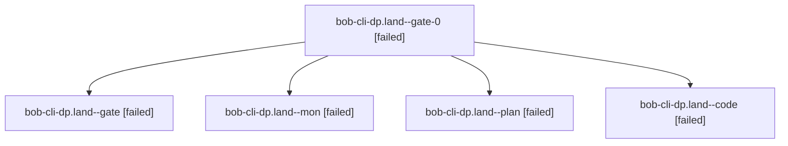

# Session: bob-cli-dp.land

[Agent Hoods](../README.md) / [bbugyi200](../users/bbugyi200/README.md) / [athena](../users/bbugyi200/machines/athena/README.md) / [bob-cli-dp](../users/bbugyi200/machines/athena/hoods/bob-cli-dp/README.md) / bob-cli-dp.land

Owner: `bbugyi200.athena` · Hood: `bob-cli-dp` · Members: 5 · Bead: [bob-cli-dp](https://github.com/bobs-org/bob-cli--beads/blob/main/pages/bob-cli-dp/README.md)

## Lineage

The diagram is an optional enhancement; the ordered table below contains the same lineage in accessible text.

| Role | Agent | State | Model / provider | Timing | Commits | Prompt | Chat |
|---|---|---|---|---|---:|---|---|
| gate-0 | bob-cli-dp.land--gate-0 | failed | grok-4.6 / grok | 2026-10-28T19:33:59.231782+00:00 → 2026-10-28T19:35:19.795952+00:00 | 0 | — | [Chat](../agents/bbugyi200.athena.bob-cli-dp.land--gate-0/chat.md) |
| gate | bob-cli-dp.land--gate | failed | gpt-6-astra / codex | 2026-10-28T18:29:34.763807+00:00 → 2026-10-28T18:31:06.110305+00:00 | 0 | — | [Chat](../agents/bbugyi200.athena.bob-cli-dp.land--gate/chat.md) |
| mon | bob-cli-dp.land--mon | failed | grok-4.6 / grok | 2026-10-28T19:35:17.946961+00:00 → 2026-10-28T19:38:54.681697+00:00 | 0 | — | [Chat](../agents/bbugyi200.athena.bob-cli-dp.land--mon/chat.md) |
| plan | bob-cli-dp.land--plan | failed | gpt-6-astra / codex | 2026-10-28T18:15:41.701129+00:00 → 2026-10-28T19:35:21.431352+00:00 | 0 | [Prompt](../agents/bbugyi200.athena.bob-cli-dp.land--plan/prompt.md) | [Chat](../agents/bbugyi200.athena.bob-cli-dp.land--plan/chat.md) |
| code | bob-cli-dp.land--code | failed | grok-4.6 / grok | 2026-10-28T18:31:24.747512+00:00 → 2026-10-28T19:35:21.431352+00:00 | 0 | — | [Chat](../agents/bbugyi200.athena.bob-cli-dp.land--code/chat.md) |

## Neighbors

| Agent | Relation | State |
|---|---|---|
| [bob-cli-dp.1](bbugyi200.athena.bob-cli-dp.1.md) (session · 3) | bob-cli-dp hood | completed 2, failed 1 |
| [bob-cli-dp.1](../agents/bbugyi200.athena.bob-cli-dp.1/README.md) | bob-cli-dp hood | failed |
| [bob-cli-dp.2](bbugyi200.athena.bob-cli-dp.2.md) (session · 3) | bob-cli-dp hood | completed 2, failed 1 |
| [bob-cli-dp.3](../agents/bbugyi200.athena.bob-cli-dp.3/README.md) | bob-cli-dp hood | completed |
| [bob-cli-dp.4](bbugyi200.athena.bob-cli-dp.4.md) (session · 7) | bob-cli-dp hood | completed 4, failed 3 |
