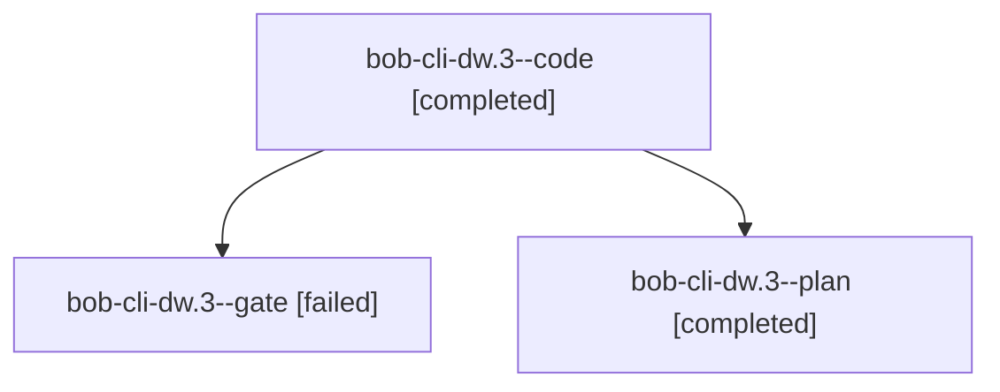

# Session: bob-cli-dw.3

[Agent Hoods](../README.md) / [bbugyi200](../users/bbugyi200/README.md) / [athena](../users/bbugyi200/machines/athena/README.md) / [bob-cli-dw](../users/bbugyi200/machines/athena/hoods/bob-cli-dw/README.md) / bob-cli-dw.3

Owner: `bbugyi200.athena` · Hood: `bob-cli-dw` · Members: 3 · Bead: [bob-cli-dw.3](https://github.com/bobs-org/bob-cli--beads/blob/main/pages/bob-cli-dw/bob-cli-dw.3.md)

## Lineage

The diagram is an optional enhancement; the ordered table below contains the same lineage in accessible text.

| Role | Agent | State | Model / provider | Timing | Commits | Prompt | Chat |
|---|---|---|---|---|---:|---|---|
| code | bob-cli-dw.3--code | completed | muse-spark-1.3-contributor / muse | 2026-10-28T19:45:55.329345+00:00 → 2026-10-28T19:50:17.126337+00:00 | 0 | — | [Chat](../agents/bbugyi200.athena.bob-cli-dw.3--code/chat.md) |
| gate | bob-cli-dw.3--gate | failed | gpt-6-astra / codex | 2026-10-28T19:44:03.446115+00:00 → 2026-10-28T19:45:21.542476+00:00 | 0 | — | [Chat](../agents/bbugyi200.athena.bob-cli-dw.3--gate/chat.md) |
| plan | bob-cli-dw.3--plan | completed | gpt-6-astra / codex | 2026-10-28T19:39:44.818474+00:00 → 2026-10-28T19:50:17.126337+00:00 | 0 | [Prompt](../agents/bbugyi200.athena.bob-cli-dw.3--plan/prompt.md) | [Chat](../agents/bbugyi200.athena.bob-cli-dw.3--plan/chat.md) |

## Neighbors

| Agent | Relation | State |
|---|---|---|
| [bob-cli-dw.1](../agents/bbugyi200.athena.bob-cli-dw.1/README.md) | bob-cli-dw hood | active |
| [bob-cli-dw.2](../agents/bbugyi200.athena.bob-cli-dw.2/README.md) | bob-cli-dw hood | active |
| [bob-cli-dw.4](../agents/bbugyi200.athena.bob-cli-dw.4/README.md) | bob-cli-dw hood | active |
| [bob-cli-dw.5](bbugyi200.athena.bob-cli-dw.5.md) (session · 2) | bob-cli-dw hood | active 1, completed 1 |
| [bob-cli-dw.land](../agents/bbugyi200.athena.bob-cli-dw.land/README.md) | bob-cli-dw hood | waiting |
