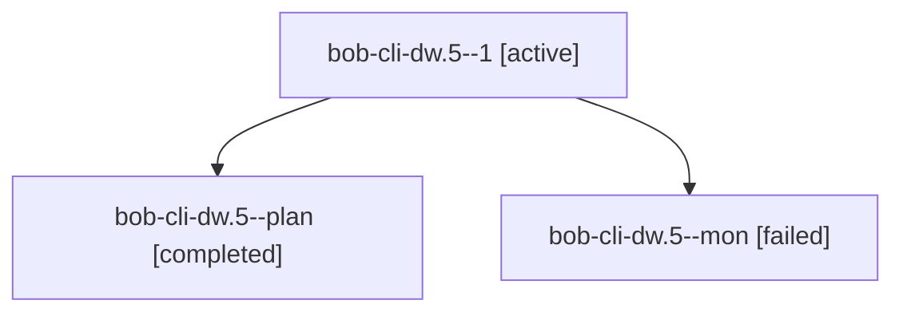

# Session: bob-cli-dw.5

[Agent Hoods](../README.md) / [bbugyi200](../users/bbugyi200/README.md) / [athena](../users/bbugyi200/machines/athena/README.md) / [bob-cli-dw](../users/bbugyi200/machines/athena/hoods/bob-cli-dw/README.md) / bob-cli-dw.5

Owner: `bbugyi200.athena` · Hood: `bob-cli-dw` · Members: 3 · Bead: [bob-cli-dw.5](https://github.com/bobs-org/bob-cli--beads/blob/main/pages/bob-cli-dw/bob-cli-dw.5.md)

## Lineage

The diagram is an optional enhancement; the ordered table below contains the same lineage in accessible text.

| Role | Agent | State | Model / provider | Timing | Commits | Prompt | Chat |
|---|---|---|---|---|---:|---|---|
| 1 | bob-cli-dw.5--1 | active | grok-4.6 / grok | 20261028155454 | 0 | [Prompt](../agents/bbugyi200.athena.bob-cli-dw.5--1/prompt.md) | — |
| plan | bob-cli-dw.5--plan | completed | grok-4.6 / grok | 2026-10-28T19:40:44.025058+00:00 → 2026-10-28T19:49:35.262447+00:00 | 0 | [Prompt](../agents/bbugyi200.athena.bob-cli-dw.5--plan/prompt.md) | [Chat](../agents/bbugyi200.athena.bob-cli-dw.5--plan/chat.md) |
| mon | bob-cli-dw.5--mon | failed | grok-4.6 / grok | 2026-10-28T19:47:36.996359+00:00 → 2026-10-28T19:55:54.679533+00:00 | 0 | — | [Chat](../agents/bbugyi200.athena.bob-cli-dw.5--mon/chat.md) |

## Neighbors

| Agent | Relation | State |
|---|---|---|
| [bob-cli-dw.1](../agents/bbugyi200.athena.bob-cli-dw.1/README.md) | bob-cli-dw hood | active |
| [bob-cli-dw.2](../agents/bbugyi200.athena.bob-cli-dw.2/README.md) | bob-cli-dw hood | active |
| [bob-cli-dw.3](bbugyi200.athena.bob-cli-dw.3.md) (session · 3) | bob-cli-dw hood | completed 2, failed 1 |
| [bob-cli-dw.4](../agents/bbugyi200.athena.bob-cli-dw.4/README.md) | bob-cli-dw hood | completed |
| [bob-cli-dw.land](../agents/bbugyi200.athena.bob-cli-dw.land/README.md) | bob-cli-dw hood | waiting |
