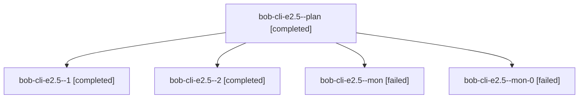

# Session: bob-cli-e2.5

[Agent Hoods](../README.md) / [bbugyi200](../users/bbugyi200/README.md) / [athena](../users/bbugyi200/machines/athena/README.md) / [bob-cli-e2](../users/bbugyi200/machines/athena/hoods/bob-cli-e2/README.md) / bob-cli-e2.5

Owner: `bbugyi200.athena` · Hood: `bob-cli-e2` · Members: 5 · Bead: [bob-cli-e2.5](https://github.com/bobs-org/bob-cli--beads/blob/main/pages/bob-cli-e2/bob-cli-e2.5.md)

## Lineage

The diagram is an optional enhancement; the ordered table below contains the same lineage in accessible text.

| Role | Agent | State | Model / provider | Timing | Commits | Prompt | Chat |
|---|---|---|---|---|---:|---|---|
| plan | bob-cli-e2.5--plan | completed | gpt-6-luna / codex | 2026-10-29T04:42:21.587972+00:00 → 2026-10-29T05:04:57.607054+00:00 | 0 | [Prompt](../agents/bbugyi200.athena.bob-cli-e2.5--plan/prompt.md) | [Chat](../agents/bbugyi200.athena.bob-cli-e2.5--plan/chat.md) |
| 1 | bob-cli-e2.5--1 | completed | gpt-6-luna / codex | 2026-10-29T05:11:37.999920+00:00 → 2026-10-29T05:15:19.727907+00:00 | 0 | [Prompt](../agents/bbugyi200.athena.bob-cli-e2.5--1/prompt.md) | [Chat](../agents/bbugyi200.athena.bob-cli-e2.5--1/chat.md) |
| 2 | bob-cli-e2.5--2 | completed | gpt-6-luna / codex | 2026-10-29T05:18:56.355744+00:00 → 2026-10-29T05:31:43.268880+00:00 | [1](../agents/bbugyi200.athena.bob-cli-e2.5--2/README.md#commits) | [Prompt](../agents/bbugyi200.athena.bob-cli-e2.5--2/prompt.md) | [Chat](../agents/bbugyi200.athena.bob-cli-e2.5--2/chat.md) |
| mon | bob-cli-e2.5--mon | failed | gpt-6-luna / codex | 2026-10-29T05:04:03.117381+00:00 → 2026-10-29T05:08:36.247777+00:00 | 0 | — | [Chat](../agents/bbugyi200.athena.bob-cli-e2.5--mon/chat.md) |
| mon-0 | bob-cli-e2.5--mon-0 | failed | gpt-6-luna / codex | 2026-10-29T05:14:33.826113+00:00 → 2026-10-29T05:16:57.422428+00:00 | 0 | — | — |

## Commits

| Role | Repo | Commit | Subject | Committed |
|---|---|---|---|---|
| 2 | bob-cli | [`48da763`](https://github.com/bobs-org/bob-cli/commit/48da7636e7eed1f32161fa039aa99b80b614b015) | docs: regenerate root parent glossary | 2026-10-29 01:28:29 EDT |

## Neighbors

| Agent | Relation | State |
|---|---|---|
| [bob-cli-e2.1](../agents/bbugyi200.athena.bob-cli-e2.1/README.md) | bob-cli-e2 hood | completed |
| [bob-cli-e2.2](../agents/bbugyi200.athena.bob-cli-e2.2/README.md) | bob-cli-e2 hood | completed |
| [bob-cli-e2.3](../agents/bbugyi200.athena.bob-cli-e2.3/README.md) | bob-cli-e2 hood | completed |
| [bob-cli-e2.4](../agents/bbugyi200.athena.bob-cli-e2.4/README.md) | bob-cli-e2 hood | completed |
| [bob-cli-e2.land](bbugyi200.athena.bob-cli-e2.land.md) (session · 5) | bob-cli-e2 hood | active 1, completed 2, failed 2 |
