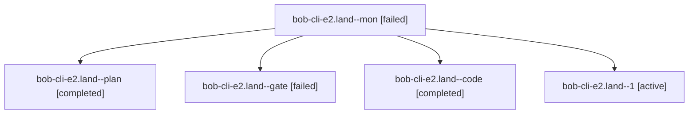

# Session: bob-cli-e2.land

[Agent Hoods](../README.md) / [bbugyi200](../users/bbugyi200/README.md) / [athena](../users/bbugyi200/machines/athena/README.md) / [bob-cli-e2](../users/bbugyi200/machines/athena/hoods/bob-cli-e2/README.md) / bob-cli-e2.land

Owner: `bbugyi200.athena` · Hood: `bob-cli-e2` · Members: 5 · Bead: [bob-cli-e2](https://github.com/bobs-org/bob-cli--beads/blob/main/pages/bob-cli-e2/README.md)

## Lineage

The diagram is an optional enhancement; the ordered table below contains the same lineage in accessible text.

| Role | Agent | State | Model / provider | Timing | Commits | Prompt | Chat |
|---|---|---|---|---|---:|---|---|
| mon | bob-cli-e2.land--mon | failed | grok-4.6 / grok | 2026-10-29T06:15:08.281066+00:00 → 2026-10-29T06:18:27.599766+00:00 | 0 | — | [Chat](../agents/bbugyi200.athena.bob-cli-e2.land--mon/chat.md) |
| plan | bob-cli-e2.land--plan | completed | opus / claude | 2026-10-29T05:33:37.425771+00:00 → 2026-10-29T06:16:44.190126+00:00 | 0 | [Prompt](../agents/bbugyi200.athena.bob-cli-e2.land--plan/prompt.md) | [Chat](../agents/bbugyi200.athena.bob-cli-e2.land--plan/chat.md) |
| gate | bob-cli-e2.land--gate | failed | opus / claude | 2026-10-29T05:59:22.688598+00:00 → 2026-10-29T06:01:01.744583+00:00 | 0 | — | [Chat](../agents/bbugyi200.athena.bob-cli-e2.land--gate/chat.md) |
| code | bob-cli-e2.land--code | completed | grok-4.6 / grok | 2026-10-29T06:01:21.595371+00:00 → 2026-10-29T06:16:44.190126+00:00 | 0 | — | [Chat](../agents/bbugyi200.athena.bob-cli-e2.land--code/chat.md) |
| 1 | bob-cli-e2.land--1 | active | grok-4.6 / grok | 2026-10-29T06:20:38.853794+00:00 | [1](../agents/bbugyi200.athena.bob-cli-e2.land--1/README.md#commits) | [Prompt](../agents/bbugyi200.athena.bob-cli-e2.land--1/prompt.md) | — |

## Commits

| Role | Repo | Commit | Subject | Committed |
|---|---|---|---|---|
| 1 | bob-cli | [`808189c`](https://github.com/bobs-org/bob-cli/commit/808189caa8b338a25dd36dc38ae458fdc026a9c8) | fix(homes): accept spaced root names and keys per R11 | 2026-10-29 02:36:00 EDT |

## Neighbors

| Agent | Relation | State |
|---|---|---|
| [bob-cli-e2.1](../agents/bbugyi200.athena.bob-cli-e2.1/README.md) | bob-cli-e2 hood | completed |
| [bob-cli-e2.2](../agents/bbugyi200.athena.bob-cli-e2.2/README.md) | bob-cli-e2 hood | completed |
| [bob-cli-e2.3](../agents/bbugyi200.athena.bob-cli-e2.3/README.md) | bob-cli-e2 hood | completed |
| [bob-cli-e2.4](../agents/bbugyi200.athena.bob-cli-e2.4/README.md) | bob-cli-e2 hood | completed |
| [bob-cli-e2.5](bbugyi200.athena.bob-cli-e2.5.md) (session · 5) | bob-cli-e2 hood | completed 3, failed 2 |
