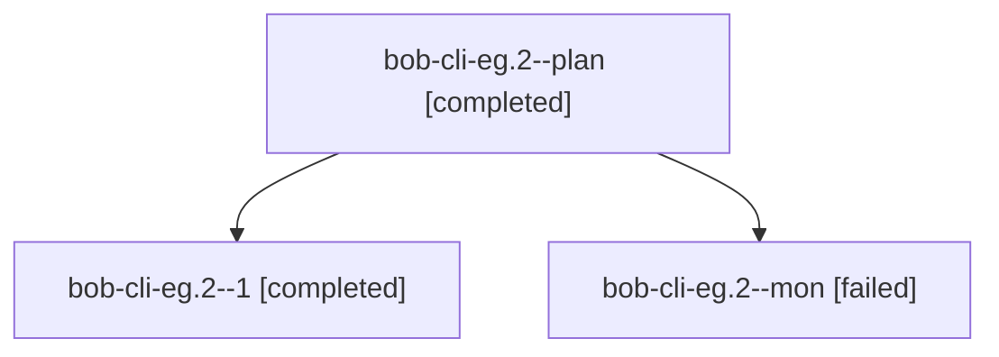

# Session: bob-cli-eg.2

[Agent Hoods](../README.md) / [bbugyi200](../users/bbugyi200/README.md) / [athena](../users/bbugyi200/machines/athena/README.md) / [bob-cli-eg](../users/bbugyi200/machines/athena/hoods/bob-cli-eg/README.md) / bob-cli-eg.2

Owner: `bbugyi200.athena` · Hood: `bob-cli-eg` · Members: 3 · Bead: [bob-cli-eg.2](https://github.com/bobs-org/bob-cli--beads/blob/main/pages/bob-cli-eg/bob-cli-eg.2.md)

## Lineage

The diagram is an optional enhancement; the ordered table below contains the same lineage in accessible text.

| Role | Agent | State | Model / provider | Timing | Commits | Prompt | Chat |
|---|---|---|---|---|---:|---|---|
| plan | bob-cli-eg.2--plan | completed | grok-4.6 / grok | 2026-10-30T14:15:05.951338+00:00 → 2026-10-30T14:49:22.490334+00:00 | 0 | [Prompt](../agents/bbugyi200.athena.bob-cli-eg.2--plan/prompt.md) | [Chat](../agents/bbugyi200.athena.bob-cli-eg.2--plan/chat.md) |
| 1 | bob-cli-eg.2--1 | completed | grok-4.6 / grok | 2026-10-30T14:59:47.977523+00:00 → 2026-10-30T15:17:56.138130+00:00 | [1](../agents/bbugyi200.athena.bob-cli-eg.2--1/README.md#commits) | [Prompt](../agents/bbugyi200.athena.bob-cli-eg.2--1/prompt.md) | [Chat](../agents/bbugyi200.athena.bob-cli-eg.2--1/chat.md) |
| mon | bob-cli-eg.2--mon | failed | grok-4.6 / grok | 2026-10-30T14:49:15.923493+00:00 → 2026-10-30T14:56:35.834256+00:00 | 0 | — | [Chat](../agents/bbugyi200.athena.bob-cli-eg.2--mon/chat.md) |

## Commits

| Role | Repo | Commit | Subject | Committed |
|---|---|---|---|---|
| 1 | bob-cli | [`00c44ab`](https://github.com/bobs-org/bob-cli/commit/00c44ab4b481ecc00f4a882ae873a6fc6d28fde6) | feat(gcal): bob-owned login sign-in with browser and paste flows | 2026-10-30 11:17:32 EDT |

## Neighbors

| Agent | Relation | State |
|---|---|---|
| [bob-cli-eg.1](../agents/bbugyi200.athena.bob-cli-eg.1/README.md) | bob-cli-eg hood | completed |
| [bob-cli-eg.3](bbugyi200.athena.bob-cli-eg.3.md) (session · 3) | bob-cli-eg hood | completed 2, failed 1 |
| [bob-cli-eg.4](../agents/bbugyi200.athena.bob-cli-eg.4/README.md) | bob-cli-eg hood | completed |
| [bob-cli-eg.land](bbugyi200.athena.bob-cli-eg.land.md) (session · 3) | bob-cli-eg hood | active 2, failed 1 |
