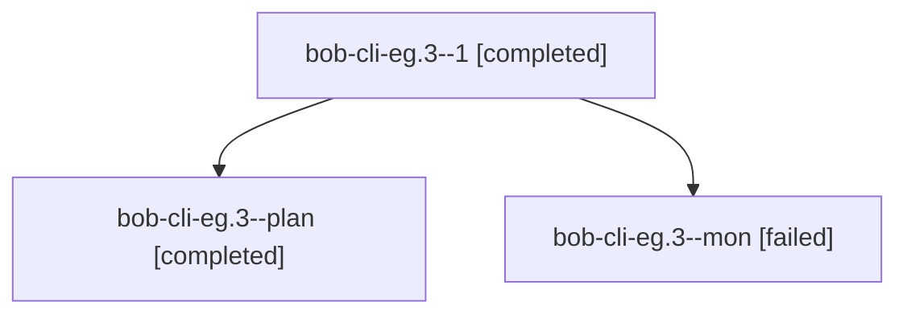

# Session: bob-cli-eg.3

[Agent Hoods](../README.md) / [bbugyi200](../users/bbugyi200/README.md) / [athena](../users/bbugyi200/machines/athena/README.md) / [bob-cli-eg](../users/bbugyi200/machines/athena/hoods/bob-cli-eg/README.md) / bob-cli-eg.3

Owner: `bbugyi200.athena` · Hood: `bob-cli-eg` · Members: 3 · Bead: [bob-cli-eg.3](https://github.com/bobs-org/bob-cli--beads/blob/main/pages/bob-cli-eg/bob-cli-eg.3.md)

## Lineage

The diagram is an optional enhancement; the ordered table below contains the same lineage in accessible text.

| Role | Agent | State | Model / provider | Timing | Commits | Prompt | Chat |
|---|---|---|---|---|---:|---|---|
| 1 | bob-cli-eg.3--1 | completed | gpt-6-luna / codex | 2026-10-30T15:59:45.637113+00:00 → 2026-10-30T16:15:45.956455+00:00 | [1](../agents/bbugyi200.athena.bob-cli-eg.3--1/README.md#commits) | [Prompt](../agents/bbugyi200.athena.bob-cli-eg.3--1/prompt.md) | [Chat](../agents/bbugyi200.athena.bob-cli-eg.3--1/chat.md) |
| plan | bob-cli-eg.3--plan | completed | gpt-6-luna / codex | 2026-10-30T15:29:14.417252+00:00 → 2026-10-30T15:53:50.053147+00:00 | 0 | [Prompt](../agents/bbugyi200.athena.bob-cli-eg.3--plan/prompt.md) | [Chat](../agents/bbugyi200.athena.bob-cli-eg.3--plan/chat.md) |
| mon | bob-cli-eg.3--mon | failed | gpt-6-luna / codex | 2026-10-30T15:53:39.774825+00:00 → 2026-10-30T15:57:09.035397+00:00 | 0 | — | [Chat](../agents/bbugyi200.athena.bob-cli-eg.3--mon/chat.md) |

## Commits

| Role | Repo | Commit | Subject | Committed |
|---|---|---|---|---|
| 1 | bob-cli | [`18d3f97`](https://github.com/bobs-org/bob-cli/commit/18d3f97a36059ae331d4529f380c847e3dcab5d1) | feat(gcal): guide Calendar login setup and recovery | 2026-10-30 12:15:22 EDT |

## Neighbors

| Agent | Relation | State |
|---|---|---|
| [bob-cli-eg.1](../agents/bbugyi200.athena.bob-cli-eg.1/README.md) | bob-cli-eg hood | completed |
| [bob-cli-eg.2](bbugyi200.athena.bob-cli-eg.2.md) (session · 3) | bob-cli-eg hood | completed 2, failed 1 |
| [bob-cli-eg.4](../agents/bbugyi200.athena.bob-cli-eg.4/README.md) | bob-cli-eg hood | completed |
| [bob-cli-eg.land](../agents/bbugyi200.athena.bob-cli-eg.land/README.md) | bob-cli-eg hood | waiting |
