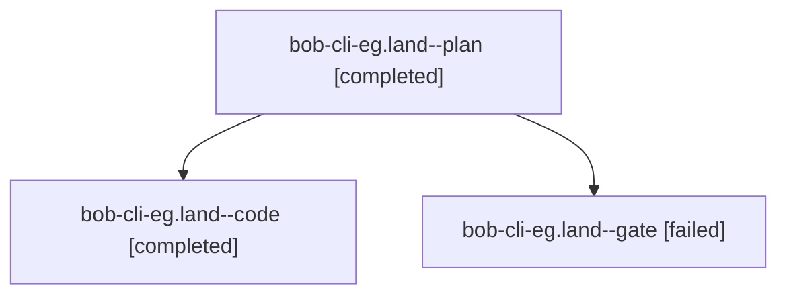

# Session: bob-cli-eg.land

[Agent Hoods](../README.md) / [bbugyi200](../users/bbugyi200/README.md) / [athena](../users/bbugyi200/machines/athena/README.md) / [bob-cli-eg](../users/bbugyi200/machines/athena/hoods/bob-cli-eg/README.md) / bob-cli-eg.land

Owner: `bbugyi200.athena` · Hood: `bob-cli-eg` · Members: 3 · Bead: [bob-cli-eg](https://github.com/bobs-org/bob-cli--beads/blob/main/pages/bob-cli-eg/README.md)

## Lineage

The diagram is an optional enhancement; the ordered table below contains the same lineage in accessible text.

| Role | Agent | State | Model / provider | Timing | Commits | Prompt | Chat |
|---|---|---|---|---|---:|---|---|
| plan | bob-cli-eg.land--plan | completed | gpt-6-astra / codex | 2026-10-30T16:36:15.541615+00:00 → 2026-10-30T17:42:29.566214+00:00 | 0 | [Prompt](../agents/bbugyi200.athena.bob-cli-eg.land--plan/prompt.md) | [Chat](../agents/bbugyi200.athena.bob-cli-eg.land--plan/chat.md) |
| code | bob-cli-eg.land--code | completed | grok-4.6 / grok | 2026-10-30T16:53:38.883613+00:00 → 2026-10-30T17:42:29.566214+00:00 | [1](../agents/bbugyi200.athena.bob-cli-eg.land--code/README.md#commits) | — | [Chat](../agents/bbugyi200.athena.bob-cli-eg.land--code/chat.md) |
| gate | bob-cli-eg.land--gate | failed | gpt-6-astra / codex | 2026-10-30T16:50:37.873799+00:00 → 2026-10-30T16:52:50.915109+00:00 | 0 | — | [Chat](../agents/bbugyi200.athena.bob-cli-eg.land--gate/chat.md) |

## Commits

| Role | Repo | Commit | Subject | Committed |
|---|---|---|---|---|
| code | bob-cli | [`f7642c7`](https://github.com/bobs-org/bob-cli/commit/f7642c7a5bad190d7e2d94fb6a9a426c84e96d99) | feat(gcal): match real gog OAuth and finish guided login | 2026-10-30 13:41:38 EDT |

## Neighbors

| Agent | Relation | State |
|---|---|---|
| [bob-cli-eg.1](../agents/bbugyi200.athena.bob-cli-eg.1/README.md) | bob-cli-eg hood | completed |
| [bob-cli-eg.2](bbugyi200.athena.bob-cli-eg.2.md) (session · 3) | bob-cli-eg hood | completed 2, failed 1 |
| [bob-cli-eg.3](bbugyi200.athena.bob-cli-eg.3.md) (session · 3) | bob-cli-eg hood | completed 2, failed 1 |
| [bob-cli-eg.4](../agents/bbugyi200.athena.bob-cli-eg.4/README.md) | bob-cli-eg hood | completed |
