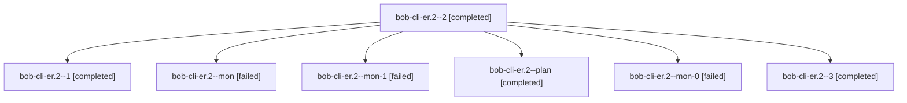

# Session: bob-cli-er.2

[Agent Hoods](../README.md) / [bbugyi200](../users/bbugyi200/README.md) / [athena](../users/bbugyi200/machines/athena/README.md) / [bob-cli-er](../users/bbugyi200/machines/athena/hoods/bob-cli-er/README.md) / bob-cli-er.2

Owner: `bbugyi200.athena` · Hood: `bob-cli-er` · Members: 7 · Bead: [bob-cli-er.2](https://github.com/bobs-org/bob-cli--beads/blob/main/pages/bob-cli-er/bob-cli-er.2.md)

## Lineage

The diagram is an optional enhancement; the ordered table below contains the same lineage in accessible text.

| Role | Agent | State | Model / provider | Timing | Commits | Prompt | Chat |
|---|---|---|---|---|---:|---|---|
| 2 | bob-cli-er.2--2 | completed | gpt-6-luna / codex | 2026-10-30T22:12:57.808854+00:00 → 2026-10-30T22:15:46.578706+00:00 | 0 | [Prompt](../agents/bbugyi200.athena.bob-cli-er.2--2/prompt.md) | [Chat](../agents/bbugyi200.athena.bob-cli-er.2--2/chat.md) |
| 1 | bob-cli-er.2--1 | completed | gpt-6-luna / codex | 2026-10-30T22:05:30.100247+00:00 → 2026-10-30T22:09:02.348472+00:00 | 0 | [Prompt](../agents/bbugyi200.athena.bob-cli-er.2--1/prompt.md) | [Chat](../agents/bbugyi200.athena.bob-cli-er.2--1/chat.md) |
| mon | bob-cli-er.2--mon | failed | gpt-6-luna / codex | 2026-10-30T22:01:11.806896+00:00 → 2026-10-30T22:03:06.438906+00:00 | 0 | — | [Chat](../agents/bbugyi200.athena.bob-cli-er.2--mon/chat.md) |
| mon-1 | bob-cli-er.2--mon-1 | failed | gpt-6-luna / codex | 2026-10-30T22:15:37.902337+00:00 → 2026-10-30T22:18:12.951001+00:00 | 0 | — | [Chat](../agents/bbugyi200.athena.bob-cli-er.2--mon-1/chat.md) |
| plan | bob-cli-er.2--plan | completed | gpt-6-luna / codex | 2026-10-30T21:52:18.300256+00:00 → 2026-10-30T22:01:19.820911+00:00 | 0 | [Prompt](../agents/bbugyi200.athena.bob-cli-er.2--plan/prompt.md) | [Chat](../agents/bbugyi200.athena.bob-cli-er.2--plan/chat.md) |
| mon-0 | bob-cli-er.2--mon-0 | failed | gpt-6-luna / codex | 2026-10-30T22:08:55.082427+00:00 → 2026-10-30T22:10:36.982267+00:00 | 0 | — | [Chat](../agents/bbugyi200.athena.bob-cli-er.2--mon-0/chat.md) |
| 3 | bob-cli-er.2--3 | completed | muse-spark-1.3-contributor / muse | 2026-10-30T22:20:58.242243+00:00 → 2026-10-30T22:37:26.775366+00:00 | 0 | [Prompt](../agents/bbugyi200.athena.bob-cli-er.2--3/prompt.md) | — |

## Neighbors

| Agent | Relation | State |
|---|---|---|
| [bob-cli-er.1](../agents/bbugyi200.athena.bob-cli-er.1/README.md) | bob-cli-er hood | completed |
| [bob-cli-er.3](../agents/bbugyi200.athena.bob-cli-er.3/README.md) | bob-cli-er hood | completed |
| [bob-cli-er.4](bbugyi200.athena.bob-cli-er.4.md) (session · 3) | bob-cli-er hood | completed 2, failed 1 |
| [bob-cli-er.land](../agents/bbugyi200.athena.bob-cli-er.land/README.md) | bob-cli-er hood | waiting |
