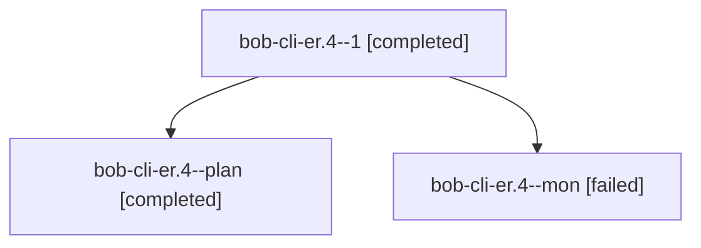

# Session: bob-cli-er.4

[Agent Hoods](../README.md) / [bbugyi200](../users/bbugyi200/README.md) / [athena](../users/bbugyi200/machines/athena/README.md) / [bob-cli-er](../users/bbugyi200/machines/athena/hoods/bob-cli-er/README.md) / bob-cli-er.4

Owner: `bbugyi200.athena` · Hood: `bob-cli-er` · Members: 3 · Bead: [bob-cli-er.4](https://github.com/bobs-org/bob-cli--beads/blob/main/pages/bob-cli-er/bob-cli-er.4.md)

## Lineage

The diagram is an optional enhancement; the ordered table below contains the same lineage in accessible text.

| Role | Agent | State | Model / provider | Timing | Commits | Prompt | Chat |
|---|---|---|---|---|---:|---|---|
| 1 | bob-cli-er.4--1 | completed | gpt-6-luna / codex | 2026-10-31T00:03:09.908732+00:00 → 2026-10-31T00:10:54.908605+00:00 | [1](../agents/bbugyi200.athena.bob-cli-er.4--1/README.md#commits) | [Prompt](../agents/bbugyi200.athena.bob-cli-er.4--1/prompt.md) | [Chat](../agents/bbugyi200.athena.bob-cli-er.4--1/chat.md) |
| plan | bob-cli-er.4--plan | completed | gpt-6-luna / codex | 2026-10-30T23:19:28.351393+00:00 → 2026-10-30T23:27:35.493995+00:00 | 0 | [Prompt](../agents/bbugyi200.athena.bob-cli-er.4--plan/prompt.md) | [Chat](../agents/bbugyi200.athena.bob-cli-er.4--plan/chat.md) |
| mon | bob-cli-er.4--mon | failed | gpt-6-luna / codex | 2026-10-30T23:27:18.225676+00:00 → 2026-10-30T23:35:03.807772+00:00 | 0 | — | — |

## Commits

| Role | Repo | Commit | Subject | Committed |
|---|---|---|---|---|
| 1 | bob-cli | [`3965f74`](https://github.com/bobs-org/bob-cli/commit/3965f749a22f1bccd12f1c03afed80bb739d29f3) | docs: document command mode sequences in guide | 2026-10-30 20:10:17 EDT |

## Neighbors

| Agent | Relation | State |
|---|---|---|
| [bob-cli-er.1](../agents/bbugyi200.athena.bob-cli-er.1/README.md) | bob-cli-er hood | completed |
| [bob-cli-er.2](bbugyi200.athena.bob-cli-er.2.md) (session · 7) | bob-cli-er hood | completed 4, failed 3 |
| [bob-cli-er.3](../agents/bbugyi200.athena.bob-cli-er.3/README.md) | bob-cli-er hood | completed |
| [bob-cli-er.land](../agents/bbugyi200.athena.bob-cli-er.land/README.md) | bob-cli-er hood | waiting |
