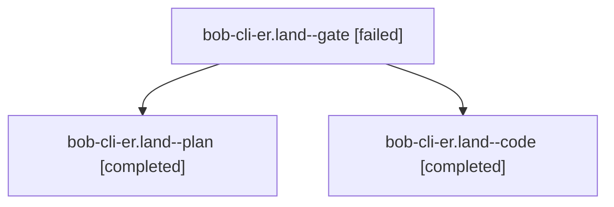

# Session: bob-cli-er.land

[Agent Hoods](../README.md) / [bbugyi200](../users/bbugyi200/README.md) / [athena](../users/bbugyi200/machines/athena/README.md) / [bob-cli-er](../users/bbugyi200/machines/athena/hoods/bob-cli-er/README.md) / bob-cli-er.land

Owner: `bbugyi200.athena` · Hood: `bob-cli-er` · Members: 3 · Bead: [bob-cli-er](https://github.com/bobs-org/bob-cli--beads/blob/main/pages/bob-cli-er/README.md)

## Lineage



The diagram is an optional enhancement; the ordered table below contains the same lineage in accessible text.

| Role | Agent | State | Model / provider | Timing | Commits | Prompt | Chat |
|---|---|---|---|---|---:|---|---|
| <a id="member-gate"></a>gate | bob-cli-er.land--gate | failed | gpt-6-astra / codex | 2026-10-31T00:27:21.810351+00:00 → 2026-10-31T00:29:05.245659+00:00 | 0 | — | [Chat](../agents/bbugyi200.athena.bob-cli-er.land--gate/chat.md) |
| <a id="member-plan"></a>plan | bob-cli-er.land--plan | completed | gpt-6-astra / codex | 2026-10-31T00:13:02.581214+00:00 → 2026-10-31T01:10:00.187665+00:00 | 0 | [Prompt](../agents/bbugyi200.athena.bob-cli-er.land--plan/prompt.md) | [Chat](../agents/bbugyi200.athena.bob-cli-er.land--plan/chat.md) |
| <a id="member-code"></a>code | bob-cli-er.land--code | completed | grok-4.6 / grok | 2026-10-31T00:29:47.221909+00:00 → 2026-10-31T01:10:00.187665+00:00 | [1](../agents/bbugyi200.athena.bob-cli-er.land--code/README.md#commits) | — | [Chat](../agents/bbugyi200.athena.bob-cli-er.land--code/chat.md) |

## Commits

| Role | Repo | Commit | Subject | Committed |
|---|---|---|---|---|
| code | bob-cli | [`d81f778`](https://github.com/bobs-org/bob-cli/commit/d81f778b66f81759fafb7829209ec5da2b99b493) | docs(guides): document sequence chip, summary, and rerun-last | 2026-10-30 21:08:50 EDT |

## Variables

| Role | Variable | Value |
|---|---|---|
| plan | `artifacts` | \[{bead: bob-cli-er, kind: file, label: bob-cli-er land full plugin test baseline: 4544 pass, five unrelated failures, path: /home/bryan/.sase/artifacts/agents/gh\_bobs-org\_\_bob-cli/20261030173212/bob-… |

#### artifacts

**Role:** `plan`

```yaml
- bead: bob-cli-er
  kind: file
  label: bob-cli-er land full plugin test baseline: 4544 pass, five unrelated failures
  path: /home/bryan/.sase/artifacts/agents/gh_bobs-org__bob-cli/20261030173212/bob-cli-er-plugin-tests-8d8b767946e7.log
  ref: file:explicit:e36d5e43c260c84cd22570ce
  source_path: /tmp/bob-cli-er-plugin-tests.log
- bead: bob-cli-er
  kind: file
  label: bob-cli-er land isolated wikilink performance results on unchanged af35d48
  path: /home/bryan/.sase/artifacts/agents/gh_bobs-org__bob-cli/20261030173212/bob-cli-er-perf-isolated-40d71582355b.log
  ref: file:explicit:c74e72c69664b05e05280be8
  source_path: /tmp/bob-cli-er-perf-isolated.log
- bead: bob-cli-er
  kind: markdown
  label: bob-cli-er production DOM and routing landing audit
  path: /home/bryan/.sase/artifacts/agents/gh_bobs-org__bob-cli/20261030173212/bob-cli-er-audit-15409d8cc96b.md
  ref: file:explicit:a0f49d2561ee189f6902ef4a
  source_path: /tmp/bob-cli-er-audit.md
```

Values are truncated for display; see each member's agent meta.json for the full values.

## Neighbors

| Agent | Relation | State |
|---|---|---|
| [bob-cli-er.1](../agents/bbugyi200.athena.bob-cli-er.1/README.md) | bob-cli-er hood | completed |
| [bob-cli-er.2](bbugyi200.athena.bob-cli-er.2.md) (session · 7) | bob-cli-er hood | completed 4, failed 3 |
| [bob-cli-er.3](../agents/bbugyi200.athena.bob-cli-er.3/README.md) | bob-cli-er hood | completed |
| [bob-cli-er.4](bbugyi200.athena.bob-cli-er.4.md) (session · 3) | bob-cli-er hood | completed 2, failed 1 |
