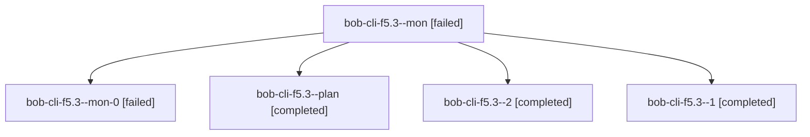

# Session: bob-cli-f5.3

[Agent Hoods](../README.md) / [bbugyi200](../users/bbugyi200/README.md) / [athena](../users/bbugyi200/machines/athena/README.md) / [bob-cli-f5](../users/bbugyi200/machines/athena/hoods/bob-cli-f5/README.md) / bob-cli-f5.3

Owner: `bbugyi200.athena` · Hood: `bob-cli-f5` · Members: 5 · Bead: [bob-cli-f5.3](https://github.com/bobs-org/bob-cli--beads/blob/main/pages/bob-cli-f5/bob-cli-f5.3.md)

## Lineage

The diagram is an optional enhancement; the ordered table below contains the same lineage in accessible text.

| Role | Agent | State | Model / provider | Timing | Commits | Prompt | Chat |
|---|---|---|---|---|---:|---|---|
| mon | bob-cli-f5.3--mon | failed | gpt-6-luna / codex | 2026-11-01T15:27:34.955450+00:00 → 2026-11-01T15:30:21.874653+00:00 | 0 | — | — |
| mon-0 | bob-cli-f5.3--mon-0 | failed | gpt-6-luna / codex | 2026-11-01T15:33:34.634507+00:00 → 2026-11-01T15:36:08.326030+00:00 | 0 | — | [Chat](../agents/bbugyi200.athena.bob-cli-f5.3--mon-0/chat.md) |
| plan | bob-cli-f5.3--plan | completed | gpt-6-luna / codex | 2026-11-01T15:12:08.072618+00:00 → 2026-11-01T15:27:41.208864+00:00 | 0 | [Prompt](../agents/bbugyi200.athena.bob-cli-f5.3--plan/prompt.md) | [Chat](../agents/bbugyi200.athena.bob-cli-f5.3--plan/chat.md) |
| 2 | bob-cli-f5.3--2 | completed | gpt-6-luna / codex | 2026-11-01T15:37:03.733551+00:00 → 2026-11-01T15:42:36.619365+00:00 | 0 | [Prompt](../agents/bbugyi200.athena.bob-cli-f5.3--2/prompt.md) | [Chat](../agents/bbugyi200.athena.bob-cli-f5.3--2/chat.md) |
| 1 | bob-cli-f5.3--1 | completed | gpt-6-luna / codex | 2026-11-01T15:31:15.724775+00:00 → 2026-11-01T15:33:40.988536+00:00 | 0 | [Prompt](../agents/bbugyi200.athena.bob-cli-f5.3--1/prompt.md) | [Chat](../agents/bbugyi200.athena.bob-cli-f5.3--1/chat.md) |

## Neighbors

| Agent | Relation | State |
|---|---|---|
| [bob-cli-f5.1](../agents/bbugyi200.athena.bob-cli-f5.1/README.md) | bob-cli-f5 hood | completed |
| [bob-cli-f5.2](../agents/bbugyi200.athena.bob-cli-f5.2/README.md) | bob-cli-f5 hood | completed |
| [bob-cli-f5.4](../agents/bbugyi200.athena.bob-cli-f5.4/README.md) | bob-cli-f5 hood | completed |
| [bob-cli-f5.land](bbugyi200.athena.bob-cli-f5.land.md) (session · 3) | bob-cli-f5 hood | active 2, failed 1 |
