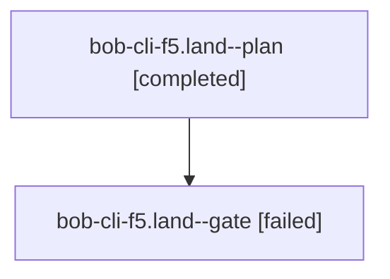

# Session: bob-cli-f5.land

[Agent Hoods](../README.md) / [bbugyi200](../users/bbugyi200/README.md) / [athena](../users/bbugyi200/machines/athena/README.md) / [bob-cli-f5](../users/bbugyi200/machines/athena/hoods/bob-cli-f5/README.md) / bob-cli-f5.land

Owner: `bbugyi200.athena` · Hood: `bob-cli-f5` · Members: 2 · Bead: [bob-cli-f5](https://github.com/bobs-org/bob-cli--beads/blob/main/pages/bob-cli-f5/README.md)

## Lineage



The diagram is an optional enhancement; the ordered table below contains the same lineage in accessible text.

| Role | Agent | State | Model / provider | Timing | Commits | Prompt | Chat |
|---|---|---|---|---|---:|---|---|
| <a id="member-plan"></a>plan | bob-cli-f5.land--plan | completed | gpt-6-astra / codex | 2026-11-01T16:26:35.725396+00:00 → 2026-11-01T17:39:14.216731+00:00 | 0 | [Prompt](../agents/bbugyi200.athena.bob-cli-f5.land--plan/prompt.md) | [Chat](../agents/bbugyi200.athena.bob-cli-f5.land--plan/chat.md) |
| <a id="member-gate"></a>gate | bob-cli-f5.land--gate | failed | gpt-6-astra / codex | 2026-11-01T16:45:50.746435+00:00 → 2026-11-01T16:46:48.219723+00:00 | 0 | — | [Chat](../agents/bbugyi200.athena.bob-cli-f5.land--gate/chat.md) |

## Variables

| Role | Variable | Value |
|---|---|---|
| plan | `artifacts` | \[{bead: bob-cli-f5, kind: file, label: f5 landing focused verification and seven unrelated test failures, path: /home/bryan/.sase/artifacts/agents/gh\_bobs-org\_\_bob-cli/20261101092603/bob-cli-f5-focus… |

#### artifacts

**Role:** `plan`

```yaml
- bead: bob-cli-f5
  kind: file
  label: f5 landing focused verification and seven unrelated test failures
  path: /home/bryan/.sase/artifacts/agents/gh_bobs-org__bob-cli/20261101092603/bob-cli-f5-focused-tests-dcc71c8195f2.log
  ref: file:explicit:3f28f3367c36f04929e7f6a0
  source_path: /tmp/bob-cli-f5-focused-tests.log
- bead: bob-cli-f5
  kind: file
  label: f5 landing isolated wikilink performance reproduction
  path: /home/bryan/.sase/artifacts/agents/gh_bobs-org__bob-cli/20261101092603/bob-cli-f5-perf-rerun-0e06473d0875.log
  ref: file:explicit:e2d6e77a67e959ecb6b61bdb
  source_path: /tmp/bob-cli-f5-perf-rerun.log
- bead: bob-cli-f5
  kind: file
  label: f5 landing repeated wikilink CPU budget failures
  path: /home/bryan/.sase/artifacts/agents/gh_bobs-org__bob-cli/20261101092603/bob-cli-f5-perf-rerun2-1affcc59fb43.log
  ref: file:explicit:59db89a083d8355365b792e0
  source_path: /tmp/bob-cli-f5-perf-rerun2.log
- bead: bob-cli-f5
  kind: file
  label: f5 landing Keep inbox UTC control passes
  path: /home/bryan/.sase/artifacts/agents/gh_bobs-org__bob-cli/20261101092603/bob-cli-f5-keep-utc-95fb0de7dafd.log
  ref: file:explicit:bb831eb0037472bbaee6798e
  source_path: /tmp/bob-cli-f5-keep-utc.log
- bead: bob-cli-f5
  kind: markdown
  label: Task link marks landing audit and reproduced close blockers
  path: /home/bryan/.sase/artifacts/agents/gh_bobs-org__bob-cli/20261101092603/bob-cli-f5-landing-audit-db690797d0cc.md
  ref: file:explicit:be7ba1208ebb2e69d16e7648
  source_path: /tmp/bob-cli-f5-landing-audit.md
```

Values are truncated for display; see each member's agent meta.json for the full values.

## Neighbors

| Agent | Relation | State |
|---|---|---|
| [bob-cli-f5.1](../agents/bbugyi200.athena.bob-cli-f5.1/README.md) | bob-cli-f5 hood | completed |
| [bob-cli-f5.2](../agents/bbugyi200.athena.bob-cli-f5.2/README.md) | bob-cli-f5 hood | completed |
| [bob-cli-f5.3](bbugyi200.athena.bob-cli-f5.3.md) (session · 5) | bob-cli-f5 hood | completed 3, failed 2 |
| [bob-cli-f5.4](../agents/bbugyi200.athena.bob-cli-f5.4/README.md) | bob-cli-f5 hood | completed |
