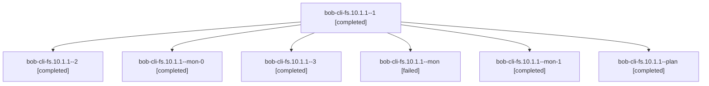

# Session: bob-cli-fs.10.1.1

[Agent Hoods](../README.md) / [bbugyi200](../users/bbugyi200/README.md) / [athena](../users/bbugyi200/machines/athena/README.md) / [bob-cli-fs](../users/bbugyi200/machines/athena/hoods/bob-cli-fs/README.md) / bob-cli-fs.10.1.1

Owner: `bbugyi200.athena` · Hood: `bob-cli-fs` · Members: 7 · Bead: [bob-cli-fs.10.1.1](https://github.com/bobs-org/bob-cli--beads/blob/main/pages/bob-cli-fs/bob-cli-fs.10.1.1.md)

## Lineage

The diagram is an optional enhancement; the ordered table below contains the same lineage in accessible text.

| Role | Agent | State | Model / provider | Timing | Commits | Prompt | Chat |
|---|---|---|---|---|---:|---|---|
| 1 | bob-cli-fs.10.1.1--1 | completed | gpt-6-luna / codex | 2026-11-03T01:00:11.063307+00:00 → 2026-11-03T01:05:07.500513+00:00 | 0 | [Prompt](../agents/bbugyi200.athena.bob-cli-fs.10.1.1--1/prompt.md) | [Chat](../agents/bbugyi200.athena.bob-cli-fs.10.1.1--1/chat.md) |
| 2 | bob-cli-fs.10.1.1--2 | completed | gpt-6-luna / codex | 2026-11-03T01:09:19.317273+00:00 → 2026-11-03T01:11:07.676323+00:00 | 0 | [Prompt](../agents/bbugyi200.athena.bob-cli-fs.10.1.1--2/prompt.md) | [Chat](../agents/bbugyi200.athena.bob-cli-fs.10.1.1--2/chat.md) |
| mon-0 | bob-cli-fs.10.1.1--mon-0 | completed | gpt-6-luna / codex | 2026-11-03T01:05:00.541206+00:00 → 2026-11-03T01:08:43.012575+00:00 | 0 | — | [Chat](../agents/bbugyi200.athena.bob-cli-fs.10.1.1--mon-0/chat.md) |
| 3 | bob-cli-fs.10.1.1--3 | completed | gpt-6-luna / codex | 2026-11-03T01:15:21.788232+00:00 → 2026-11-03T01:17:19.838881+00:00 | 0 | [Prompt](../agents/bbugyi200.athena.bob-cli-fs.10.1.1--3/prompt.md) | [Chat](../agents/bbugyi200.athena.bob-cli-fs.10.1.1--3/chat.md) |
| mon | bob-cli-fs.10.1.1--mon | failed | gpt-6-luna / codex | 2026-11-03T00:55:43.031406+00:00 → 2026-11-03T00:59:25.061924+00:00 | 0 | — | [Chat](../agents/bbugyi200.athena.bob-cli-fs.10.1.1--mon/chat.md) |
| mon-1 | bob-cli-fs.10.1.1--mon-1 | completed | gpt-6-luna / codex | 2026-11-03T01:11:01.024548+00:00 → 2026-11-03T01:14:31.537951+00:00 | 0 | — | [Chat](../agents/bbugyi200.athena.bob-cli-fs.10.1.1--mon-1/chat.md) |
| plan | bob-cli-fs.10.1.1--plan | completed | gpt-6-luna / codex | 2026-11-03T00:48:28.152646+00:00 → 2026-11-03T00:55:50.114490+00:00 | 0 | [Prompt](../agents/bbugyi200.athena.bob-cli-fs.10.1.1--plan/prompt.md) | [Chat](../agents/bbugyi200.athena.bob-cli-fs.10.1.1--plan/chat.md) |

## Neighbors

| Agent | Relation | State |
|---|---|---|
| [bob-cli-fs.10](bbugyi200.athena.bob-cli-fs.10.md) (session · 3) | ancestor | active 1, completed 2 |
| [bob-cli-fs.10.1.2](../agents/bbugyi200.athena.bob-cli-fs.10.1.2/README.md) | bob-cli-fs.10.1 hood | completed |
| [bob-cli-fs.10.1.3](../agents/bbugyi200.athena.bob-cli-fs.10.1.3/README.md) | bob-cli-fs.10.1 hood | completed |
| [bob-cli-fs.10.1.4](bbugyi200.athena.bob-cli-fs.10.1.4.md) (session · 3) | bob-cli-fs.10.1 hood | completed 3 |
| [bob-cli-fs.10.1.land](../agents/bbugyi200.athena.bob-cli-fs.10.1.land/README.md) | bob-cli-fs.10.1 hood | waiting |
| [bob-cli-fs.1](bbugyi200.athena.bob-cli-fs.1.md) (session · 3) | bob-cli-fs hood | completed 3 |
| [bob-cli-fs.11](../agents/bbugyi200.athena.bob-cli-fs.11/README.md) | bob-cli-fs hood | waiting |
| [bob-cli-fs.2](bbugyi200.athena.bob-cli-fs.2.md) (session · 3) | bob-cli-fs hood | active 1, completed 2 |
| [bob-cli-fs.2.1.1](../agents/bbugyi200.athena.bob-cli-fs.2.1.1/README.md) | bob-cli-fs hood | completed |
| [bob-cli-fs.2.1.2](../agents/bbugyi200.athena.bob-cli-fs.2.1.2/README.md) | bob-cli-fs hood | completed |
| [bob-cli-fs.2.1.3](../agents/bbugyi200.athena.bob-cli-fs.2.1.3/README.md) | bob-cli-fs hood | completed |
| [bob-cli-fs.2.1.land](bbugyi200.athena.bob-cli-fs.2.1.land.md) (session · 3) | bob-cli-fs hood | completed 3 |
| [bob-cli-fs.3](bbugyi200.athena.bob-cli-fs.3.md) (session · 5) | bob-cli-fs hood | completed 3, failed 2 |
| [bob-cli-fs.4](bbugyi200.athena.bob-cli-fs.4.md) (session · 3) | bob-cli-fs hood | active 1, completed 2 |
| [bob-cli-fs.4.1.1](bbugyi200.athena.bob-cli-fs.4.1.1.md) (session · 5) | bob-cli-fs hood | completed 4, failed 1 |
| [bob-cli-fs.4.1.2](bbugyi200.athena.bob-cli-fs.4.1.2.md) (session · 5) | bob-cli-fs hood | completed 4, failed 1 |
| [bob-cli-fs.4.1.3](../agents/bbugyi200.athena.bob-cli-fs.4.1.3/README.md) | bob-cli-fs hood | completed |
| [bob-cli-fs.4.1.4](../agents/bbugyi200.athena.bob-cli-fs.4.1.4/README.md) | bob-cli-fs hood | completed |
| [bob-cli-fs.4.1.5](../agents/bbugyi200.athena.bob-cli-fs.4.1.5/README.md) | bob-cli-fs hood | completed |
| [bob-cli-fs.4.1.6](bbugyi200.athena.bob-cli-fs.4.1.6.md) (session · 11) | bob-cli-fs hood | completed 8, failed 3 |
| [bob-cli-fs.4.1.land](bbugyi200.athena.bob-cli-fs.4.1.land.md) (session · 5) | bob-cli-fs hood | completed 5 |
| [bob-cli-fs.5](bbugyi200.athena.bob-cli-fs.5.md) (session · 3) | bob-cli-fs hood | completed 3 |
| [bob-cli-fs.6](../agents/bbugyi200.athena.bob-cli-fs.6/README.md) | bob-cli-fs hood | completed |
| [bob-cli-fs.7](../agents/bbugyi200.athena.bob-cli-fs.7/README.md) | bob-cli-fs hood | completed |
| [bob-cli-fs.8](bbugyi200.athena.bob-cli-fs.8.md) (session · 3) | bob-cli-fs hood | active 1, completed 2 |
| [bob-cli-fs.8.1.1](../agents/bbugyi200.athena.bob-cli-fs.8.1.1/README.md) | bob-cli-fs hood | completed |
| [bob-cli-fs.8.1.2](../agents/bbugyi200.athena.bob-cli-fs.8.1.2/README.md) | bob-cli-fs hood | completed |
| [bob-cli-fs.8.1.3](bbugyi200.athena.bob-cli-fs.8.1.3.md) (session · 5) | bob-cli-fs hood | completed 5 |
| [bob-cli-fs.8.1.4](../agents/bbugyi200.athena.bob-cli-fs.8.1.4/README.md) | bob-cli-fs hood | completed |
| [bob-cli-fs.8.1.land](bbugyi200.athena.bob-cli-fs.8.1.land.md) (session · 3) | bob-cli-fs hood | completed 1, failed 2 |
| [bob-cli-fs.8.1.land](../agents/bbugyi200.athena.bob-cli-fs.8.1.land/README.md) | bob-cli-fs hood | completed |
| [bob-cli-fs.9](../agents/bbugyi200.athena.bob-cli-fs.9/README.md) | bob-cli-fs hood | completed |
| [bob-cli-fs.land](../agents/bbugyi200.athena.bob-cli-fs.land/README.md) | bob-cli-fs hood | waiting |
