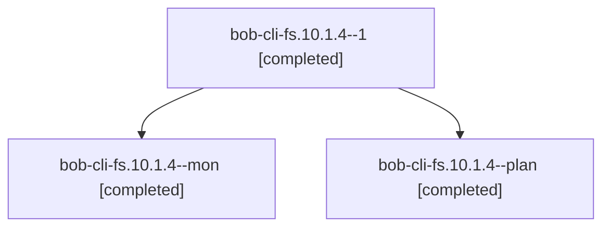

# Session: bob-cli-fs.10.1.4

[Agent Hoods](../README.md) / [bbugyi200](../users/bbugyi200/README.md) / [athena](../users/bbugyi200/machines/athena/README.md) / [bob-cli-fs](../users/bbugyi200/machines/athena/hoods/bob-cli-fs/README.md) / bob-cli-fs.10.1.4

Owner: `bbugyi200.athena` · Hood: `bob-cli-fs` · Members: 3 · Bead: [bob-cli-fs.10.1.4](https://github.com/bobs-org/bob-cli--beads/blob/main/pages/bob-cli-fs/bob-cli-fs.10.1.4.md)

## Lineage

The diagram is an optional enhancement; the ordered table below contains the same lineage in accessible text.

| Role | Agent | State | Model / provider | Timing | Commits | Prompt | Chat |
|---|---|---|---|---|---:|---|---|
| 1 | bob-cli-fs.10.1.4--1 | completed | gpt-6-luna / codex | 2026-11-03T02:18:09.945422+00:00 → 2026-11-03T02:21:39.325299+00:00 | 0 | [Prompt](../agents/bbugyi200.athena.bob-cli-fs.10.1.4--1/prompt.md) | [Chat](../agents/bbugyi200.athena.bob-cli-fs.10.1.4--1/chat.md) |
| mon | bob-cli-fs.10.1.4--mon | completed | gpt-6-luna / codex | 2026-11-03T02:12:51.937864+00:00 → 2026-11-03T02:17:05.173507+00:00 | 0 | — | [Chat](../agents/bbugyi200.athena.bob-cli-fs.10.1.4--mon/chat.md) |
| plan | bob-cli-fs.10.1.4--plan | completed | gpt-6-luna / codex | 2026-11-03T01:57:13.273556+00:00 → 2026-11-03T02:12:59.109203+00:00 | 0 | [Prompt](../agents/bbugyi200.athena.bob-cli-fs.10.1.4--plan/prompt.md) | [Chat](../agents/bbugyi200.athena.bob-cli-fs.10.1.4--plan/chat.md) |

## Neighbors

| Agent | Relation | State |
|---|---|---|
| [bob-cli-fs.10](bbugyi200.athena.bob-cli-fs.10.md) (session · 3) | ancestor | active 1, completed 2 |
| [bob-cli-fs.10.1.1](bbugyi200.athena.bob-cli-fs.10.1.1.md) (session · 7) | bob-cli-fs.10.1 hood | completed 6, failed 1 |
| [bob-cli-fs.10.1.2](../agents/bbugyi200.athena.bob-cli-fs.10.1.2/README.md) | bob-cli-fs.10.1 hood | completed |
| [bob-cli-fs.10.1.3](../agents/bbugyi200.athena.bob-cli-fs.10.1.3/README.md) | bob-cli-fs.10.1 hood | completed |
| [bob-cli-fs.10.1.land](bbugyi200.athena.bob-cli-fs.10.1.land.md) (session · 3) | bob-cli-fs.10.1 hood | completed 3 |
| [bob-cli-fs.1](bbugyi200.athena.bob-cli-fs.1.md) (session · 3) | bob-cli-fs hood | completed 3 |
| [bob-cli-fs.11](../agents/bbugyi200.athena.bob-cli-fs.11/README.md) | bob-cli-fs hood | completed |
| [bob-cli-fs.2](bbugyi200.athena.bob-cli-fs.2.md) (session · 3) | bob-cli-fs hood | active 1, completed 2 |
| [bob-cli-fs.2.1.1](../agents/bbugyi200.athena.bob-cli-fs.2.1.1/README.md) | bob-cli-fs hood | completed |
| [bob-cli-fs.2.1.2](../agents/bbugyi200.athena.bob-cli-fs.2.1.2/README.md) | bob-cli-fs hood | completed |
| [bob-cli-fs.2.1.3](../agents/bbugyi200.athena.bob-cli-fs.2.1.3/README.md) | bob-cli-fs hood | completed |
| [bob-cli-fs.2.1.land](bbugyi200.athena.bob-cli-fs.2.1.land.md) (session · 3) | bob-cli-fs hood | completed 3 |
| [bob-cli-fs.3](bbugyi200.athena.bob-cli-fs.3.md) (session · 5) | bob-cli-fs hood | completed 3, failed 2 |
| [bob-cli-fs.4](bbugyi200.athena.bob-cli-fs.4.md) (session · 3) | bob-cli-fs hood | active 1, completed 2 |
| [bob-cli-fs.4.1.1](bbugyi200.athena.bob-cli-fs.4.1.1.md) (session · 5) | bob-cli-fs hood | completed 4, failed 1 |
| [bob-cli-fs.4.1.2](bbugyi200.athena.bob-cli-fs.4.1.2.md) (session · 5) | bob-cli-fs hood | completed 4, failed 1 |
| [bob-cli-fs.4.1.3](../agents/bbugyi200.athena.bob-cli-fs.4.1.3/README.md) | bob-cli-fs hood | completed |
| [bob-cli-fs.4.1.4](../agents/bbugyi200.athena.bob-cli-fs.4.1.4/README.md) | bob-cli-fs hood | completed |
| [bob-cli-fs.4.1.5](../agents/bbugyi200.athena.bob-cli-fs.4.1.5/README.md) | bob-cli-fs hood | completed |
| [bob-cli-fs.4.1.6](bbugyi200.athena.bob-cli-fs.4.1.6.md) (session · 11) | bob-cli-fs hood | completed 8, failed 3 |
| [bob-cli-fs.4.1.land](bbugyi200.athena.bob-cli-fs.4.1.land.md) (session · 5) | bob-cli-fs hood | completed 5 |
| [bob-cli-fs.5](bbugyi200.athena.bob-cli-fs.5.md) (session · 3) | bob-cli-fs hood | completed 3 |
| [bob-cli-fs.6](../agents/bbugyi200.athena.bob-cli-fs.6/README.md) | bob-cli-fs hood | completed |
| [bob-cli-fs.7](../agents/bbugyi200.athena.bob-cli-fs.7/README.md) | bob-cli-fs hood | completed |
| [bob-cli-fs.8](bbugyi200.athena.bob-cli-fs.8.md) (session · 3) | bob-cli-fs hood | active 1, completed 2 |
| [bob-cli-fs.8.1.1](../agents/bbugyi200.athena.bob-cli-fs.8.1.1/README.md) | bob-cli-fs hood | completed |
| [bob-cli-fs.8.1.2](../agents/bbugyi200.athena.bob-cli-fs.8.1.2/README.md) | bob-cli-fs hood | completed |
| [bob-cli-fs.8.1.3](bbugyi200.athena.bob-cli-fs.8.1.3.md) (session · 5) | bob-cli-fs hood | completed 5 |
| [bob-cli-fs.8.1.4](../agents/bbugyi200.athena.bob-cli-fs.8.1.4/README.md) | bob-cli-fs hood | completed |
| [bob-cli-fs.8.1.land](bbugyi200.athena.bob-cli-fs.8.1.land.md) (session · 3) | bob-cli-fs hood | completed 1, failed 2 |
| [bob-cli-fs.8.1.land](../agents/bbugyi200.athena.bob-cli-fs.8.1.land/README.md) | bob-cli-fs hood | completed |
| [bob-cli-fs.9](../agents/bbugyi200.athena.bob-cli-fs.9/README.md) | bob-cli-fs hood | completed |
| [bob-cli-fs.land](bbugyi200.athena.bob-cli-fs.land.md) (session · 10) | bob-cli-fs hood | active 1, completed 8, failed 1 |
