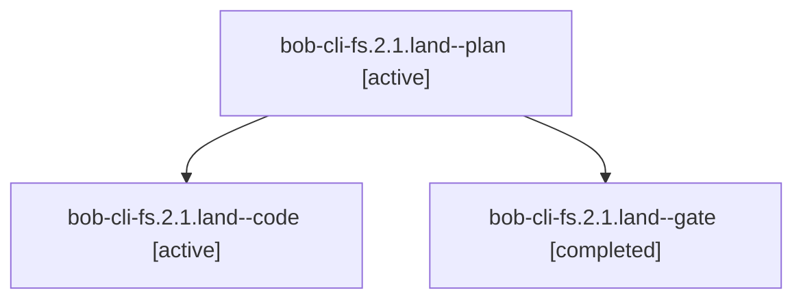

# Session: bob-cli-fs.2.1.land

[Agent Hoods](../README.md) / [bbugyi200](../users/bbugyi200/README.md) / [athena](../users/bbugyi200/machines/athena/README.md) / [bob-cli-fs](../users/bbugyi200/machines/athena/hoods/bob-cli-fs/README.md) / bob-cli-fs.2.1.land

Owner: `bbugyi200.athena` · Hood: `bob-cli-fs` · Members: 3 · Bead: [bob-cli-fs.2.1](https://github.com/bobs-org/bob-cli--beads/blob/main/pages/bob-cli-fs/bob-cli-fs.2.1.md)

## Lineage



The diagram is an optional enhancement; the ordered table below contains the same lineage in accessible text.

| Role | Agent | State | Model / provider | Timing | Commits | Prompt | Chat |
|---|---|---|---|---|---:|---|---|
| <a id="member-plan"></a>plan | bob-cli-fs.2.1.land--plan | active | gpt-6-astra / codex | 2026-11-02T13:50:16.990672+00:00 | 0 | [Prompt](../agents/bbugyi200.athena.bob-cli-fs.2.1.land--plan/prompt.md) | [Chat](../agents/bbugyi200.athena.bob-cli-fs.2.1.land--plan/chat.md) |
| <a id="member-code"></a>code | bob-cli-fs.2.1.land--code | active | muse-spark-1.3-contributor / muse | 2026-11-02T14:10:36.950191+00:00 | [1](../agents/bbugyi200.athena.bob-cli-fs.2.1.land--code/README.md#commits) | — | — |
| <a id="member-gate"></a>gate | bob-cli-fs.2.1.land--gate | completed | gpt-6-astra / codex | 2026-11-02T14:09:51.818211+00:00 → 2026-11-02T14:10:16.422122+00:00 | 0 | — | [Chat](../agents/bbugyi200.athena.bob-cli-fs.2.1.land--gate/chat.md) |

## Commits

| Role | Repo | Commit | Subject | Committed |
|---|---|---|---|---|
| code | bob-cli | [`98bfec6`](https://github.com/bobs-org/bob-cli/commit/98bfec6aca2a877b9bceccb2ce5c9dbd6aa39267) | feat(task-relations): repair relation-successor ordering, identity, and recovery regressions | 2026-11-02 09:28:30 EST |

## Variables

| Role | Variable | Value |
|---|---|---|
| plan | `artifacts` | \[{bead: bob-cli-fs.2.1, kind: file, label: Relation core landing regression probes at cb729a76, path: /home/bryan/.sase/artifacts/agents/gh\_bobs-org\_\_bob-cli/20261102063249/land\_audit\_relation\_probes… |

#### artifacts

**Role:** `plan`

```yaml
- bead: bob-cli-fs.2.1
  kind: file
  label: Relation core landing regression probes at cb729a76
  path: /home/bryan/.sase/artifacts/agents/gh_bobs-org__bob-cli/20261102063249/land_audit_relation_probes-698a50e9a49f.rs
  ref: file:explicit:02f513efcf6d714094b172c0
  source_path: /home/bryan/.local/state/sase/workspaces/bobs-org/bob-cli/bob-cli_12/land_audit_relation_probes.rs
- bead: bob-cli-fs.2.1
  kind: file
  label: Four confirmed relation core landing failures at cb729a76
  path: /home/bryan/.sase/artifacts/agents/gh_bobs-org__bob-cli/20261102063249/land_audit_relation_probes-61be22d4fa97.log
  ref: file:explicit:ed01e90996e17bd9acfc75b6
  source_path: /home/bryan/.local/state/sase/workspaces/bobs-org/bob-cli/bob-cli_12/land_audit_relation_probes.log
```

Values are truncated for display; see each member's agent meta.json for the full values.

## Neighbors

| Agent | Relation | State |
|---|---|---|
| [bob-cli-fs.2](bbugyi200.athena.bob-cli-fs.2.md) (session · 3) | ancestor | active 1, completed 2 |
| [bob-cli-fs.2.1.1](../agents/bbugyi200.athena.bob-cli-fs.2.1.1/README.md) | bob-cli-fs.2.1 hood | completed |
| [bob-cli-fs.2.1.2](../agents/bbugyi200.athena.bob-cli-fs.2.1.2/README.md) | bob-cli-fs.2.1 hood | completed |
| [bob-cli-fs.2.1.3](../agents/bbugyi200.athena.bob-cli-fs.2.1.3/README.md) | bob-cli-fs.2.1 hood | completed |
| [bob-cli-fs.1](bbugyi200.athena.bob-cli-fs.1.md) (session · 3) | bob-cli-fs hood | completed 3 |
| [bob-cli-fs.10](../agents/bbugyi200.athena.bob-cli-fs.10/README.md) | bob-cli-fs hood | waiting |
| [bob-cli-fs.11](../agents/bbugyi200.athena.bob-cli-fs.11/README.md) | bob-cli-fs hood | waiting |
| [bob-cli-fs.3](../agents/bbugyi200.athena.bob-cli-fs.3/README.md) | bob-cli-fs hood | waiting |
| [bob-cli-fs.4](../agents/bbugyi200.athena.bob-cli-fs.4/README.md) | bob-cli-fs hood | waiting |
| [bob-cli-fs.5](../agents/bbugyi200.athena.bob-cli-fs.5/README.md) | bob-cli-fs hood | waiting |
| [bob-cli-fs.6](../agents/bbugyi200.athena.bob-cli-fs.6/README.md) | bob-cli-fs hood | completed |
| [bob-cli-fs.7](../agents/bbugyi200.athena.bob-cli-fs.7/README.md) | bob-cli-fs hood | completed |
| [bob-cli-fs.8](bbugyi200.athena.bob-cli-fs.8.md) (session · 3) | bob-cli-fs hood | active 1, completed 2 |
| [bob-cli-fs.8.1.1](../agents/bbugyi200.athena.bob-cli-fs.8.1.1/README.md) | bob-cli-fs hood | completed |
| [bob-cli-fs.8.1.2](../agents/bbugyi200.athena.bob-cli-fs.8.1.2/README.md) | bob-cli-fs hood | completed |
| [bob-cli-fs.8.1.3](bbugyi200.athena.bob-cli-fs.8.1.3.md) (session · 5) | bob-cli-fs hood | completed 5 |
| [bob-cli-fs.8.1.4](../agents/bbugyi200.athena.bob-cli-fs.8.1.4/README.md) | bob-cli-fs hood | completed |
| [bob-cli-fs.8.1.land](bbugyi200.athena.bob-cli-fs.8.1.land.md) (session · 3) | bob-cli-fs hood | active 2, completed 1 |
| [bob-cli-fs.9](../agents/bbugyi200.athena.bob-cli-fs.9/README.md) | bob-cli-fs hood | waiting |
| [bob-cli-fs.land](../agents/bbugyi200.athena.bob-cli-fs.land/README.md) | bob-cli-fs hood | waiting |
