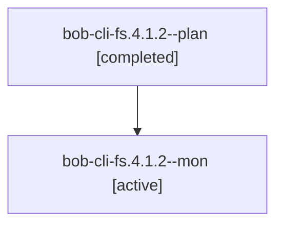

# Session: bob-cli-fs.4.1.2

[Agent Hoods](../README.md) / [bbugyi200](../users/bbugyi200/README.md) / [athena](../users/bbugyi200/machines/athena/README.md) / [bob-cli-fs](../users/bbugyi200/machines/athena/hoods/bob-cli-fs/README.md) / bob-cli-fs.4.1.2

Owner: `bbugyi200.athena` · Hood: `bob-cli-fs` · Members: 2 · Bead: [bob-cli-fs.4.1.2](https://github.com/bobs-org/bob-cli--beads/blob/main/pages/bob-cli-fs/bob-cli-fs.4.1.2.md)

## Lineage

The diagram is an optional enhancement; the ordered table below contains the same lineage in accessible text.

| Role | Agent | State | Model / provider | Timing | Commits | Prompt | Chat |
|---|---|---|---|---|---:|---|---|
| plan | bob-cli-fs.4.1.2--plan | completed | grok-4.6 / grok | 2026-11-02T18:18:19.219237+00:00 → 2026-11-02T18:54:14.295387+00:00 | 0 | [Prompt](../agents/bbugyi200.athena.bob-cli-fs.4.1.2--plan/prompt.md) | [Chat](../agents/bbugyi200.athena.bob-cli-fs.4.1.2--plan/chat.md) |
| mon | bob-cli-fs.4.1.2--mon | active | grok-4.6 / grok | 2026-11-02T18:54:08.666155+00:00 | 0 | — | — |

## Neighbors

| Agent | Relation | State |
|---|---|---|
| [bob-cli-fs.4](bbugyi200.athena.bob-cli-fs.4.md) (session · 3) | ancestor | active 1, completed 2 |
| [bob-cli-fs.4.1.1](bbugyi200.athena.bob-cli-fs.4.1.1.md) (session · 5) | bob-cli-fs.4.1 hood | completed 4, failed 1 |
| [bob-cli-fs.4.1.3](../agents/bbugyi200.athena.bob-cli-fs.4.1.3/README.md) | bob-cli-fs.4.1 hood | waiting |
| [bob-cli-fs.4.1.4](../agents/bbugyi200.athena.bob-cli-fs.4.1.4/README.md) | bob-cli-fs.4.1 hood | active |
| [bob-cli-fs.4.1.5](../agents/bbugyi200.athena.bob-cli-fs.4.1.5/README.md) | bob-cli-fs.4.1 hood | active |
| [bob-cli-fs.4.1.6](../agents/bbugyi200.athena.bob-cli-fs.4.1.6/README.md) | bob-cli-fs.4.1 hood | active |
| [bob-cli-fs.4.1.land](../agents/bbugyi200.athena.bob-cli-fs.4.1.land/README.md) | bob-cli-fs.4.1 hood | waiting |
| [bob-cli-fs.1](bbugyi200.athena.bob-cli-fs.1.md) (session · 3) | bob-cli-fs hood | completed 3 |
| [bob-cli-fs.10](../agents/bbugyi200.athena.bob-cli-fs.10/README.md) | bob-cli-fs hood | waiting |
| [bob-cli-fs.11](../agents/bbugyi200.athena.bob-cli-fs.11/README.md) | bob-cli-fs hood | waiting |
| [bob-cli-fs.2](bbugyi200.athena.bob-cli-fs.2.md) (session · 3) | bob-cli-fs hood | active 1, completed 2 |
| [bob-cli-fs.2.1.1](../agents/bbugyi200.athena.bob-cli-fs.2.1.1/README.md) | bob-cli-fs hood | completed |
| [bob-cli-fs.2.1.2](../agents/bbugyi200.athena.bob-cli-fs.2.1.2/README.md) | bob-cli-fs hood | completed |
| [bob-cli-fs.2.1.3](../agents/bbugyi200.athena.bob-cli-fs.2.1.3/README.md) | bob-cli-fs hood | completed |
| [bob-cli-fs.2.1.land](bbugyi200.athena.bob-cli-fs.2.1.land.md) (session · 3) | bob-cli-fs hood | completed 3 |
| [bob-cli-fs.3](bbugyi200.athena.bob-cli-fs.3.md) (session · 5) | bob-cli-fs hood | completed 3, failed 2 |
| [bob-cli-fs.5](../agents/bbugyi200.athena.bob-cli-fs.5/README.md) | bob-cli-fs hood | waiting |
| [bob-cli-fs.6](../agents/bbugyi200.athena.bob-cli-fs.6/README.md) | bob-cli-fs hood | completed |
| [bob-cli-fs.7](../agents/bbugyi200.athena.bob-cli-fs.7/README.md) | bob-cli-fs hood | completed |
| [bob-cli-fs.8](bbugyi200.athena.bob-cli-fs.8.md) (session · 3) | bob-cli-fs hood | active 1, completed 2 |
| [bob-cli-fs.8.1.1](../agents/bbugyi200.athena.bob-cli-fs.8.1.1/README.md) | bob-cli-fs hood | completed |
| [bob-cli-fs.8.1.2](../agents/bbugyi200.athena.bob-cli-fs.8.1.2/README.md) | bob-cli-fs hood | completed |
| [bob-cli-fs.8.1.3](bbugyi200.athena.bob-cli-fs.8.1.3.md) (session · 5) | bob-cli-fs hood | completed 5 |
| [bob-cli-fs.8.1.4](../agents/bbugyi200.athena.bob-cli-fs.8.1.4/README.md) | bob-cli-fs hood | completed |
| [bob-cli-fs.8.1.land](bbugyi200.athena.bob-cli-fs.8.1.land.md) (session · 3) | bob-cli-fs hood | completed 1, failed 2 |
| [bob-cli-fs.8.1.land](../agents/bbugyi200.athena.bob-cli-fs.8.1.land/README.md) | bob-cli-fs hood | completed |
| [bob-cli-fs.9](../agents/bbugyi200.athena.bob-cli-fs.9/README.md) | bob-cli-fs hood | completed |
| [bob-cli-fs.land](../agents/bbugyi200.athena.bob-cli-fs.land/README.md) | bob-cli-fs hood | waiting |
