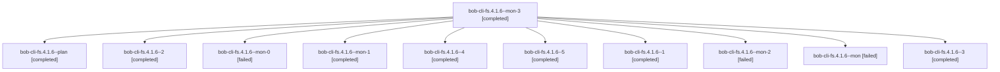

# Session: bob-cli-fs.4.1.6

[Agent Hoods](../README.md) / [bbugyi200](../users/bbugyi200/README.md) / [athena](../users/bbugyi200/machines/athena/README.md) / [bob-cli-fs](../users/bbugyi200/machines/athena/hoods/bob-cli-fs/README.md) / bob-cli-fs.4.1.6

Owner: `bbugyi200.athena` · Hood: `bob-cli-fs` · Members: 11 · Bead: [bob-cli-fs.4.1.6](https://github.com/bobs-org/bob-cli--beads/blob/main/pages/bob-cli-fs/bob-cli-fs.4.1.6.md)

## Lineage

The diagram is an optional enhancement; the ordered table below contains the same lineage in accessible text.

| Role | Agent | State | Model / provider | Timing | Commits | Prompt | Chat |
|---|---|---|---|---|---:|---|---|
| mon-3 | bob-cli-fs.4.1.6--mon-3 | completed | grok-4.6 / grok | 2026-11-02T22:31:41.254461+00:00 → 2026-11-02T22:38:32.904532+00:00 | 0 | — | [Chat](../agents/bbugyi200.athena.bob-cli-fs.4.1.6--mon-3/chat.md) |
| plan | bob-cli-fs.4.1.6--plan | completed | gpt-6-luna / codex | 2026-11-02T21:19:19.847748+00:00 → 2026-11-02T21:28:32.712519+00:00 | 0 | [Prompt](../agents/bbugyi200.athena.bob-cli-fs.4.1.6--plan/prompt.md) | [Chat](../agents/bbugyi200.athena.bob-cli-fs.4.1.6--plan/chat.md) |
| 2 | bob-cli-fs.4.1.6--2 | completed | gpt-6-luna / codex | 2026-11-02T21:50:15.061938+00:00 → 2026-11-02T21:52:46.098948+00:00 | 0 | [Prompt](../agents/bbugyi200.athena.bob-cli-fs.4.1.6--2/prompt.md) | [Chat](../agents/bbugyi200.athena.bob-cli-fs.4.1.6--2/chat.md) |
| mon-0 | bob-cli-fs.4.1.6--mon-0 | failed | gpt-6-luna / codex | 2026-11-02T21:44:00.848923+00:00 → 2026-11-02T21:49:21.251986+00:00 | 0 | — | [Chat](../agents/bbugyi200.athena.bob-cli-fs.4.1.6--mon-0/chat.md) |
| mon-1 | bob-cli-fs.4.1.6--mon-1 | completed | gpt-6-luna / codex | 2026-11-02T21:52:38.333497+00:00 → 2026-11-02T21:56:25.650593+00:00 | 0 | — | [Chat](../agents/bbugyi200.athena.bob-cli-fs.4.1.6--mon-1/chat.md) |
| 4 | bob-cli-fs.4.1.6--4 | completed | grok-4.6 / grok | 2026-11-02T22:08:12.768724+00:00 → 2026-11-02T22:31:50.305965+00:00 | 0 | [Prompt](../agents/bbugyi200.athena.bob-cli-fs.4.1.6--4/prompt.md) | [Chat](../agents/bbugyi200.athena.bob-cli-fs.4.1.6--4/chat.md) |
| 5 | bob-cli-fs.4.1.6--5 | completed | grok-4.6 / grok | 2026-11-02T22:39:17.043499+00:00 → 2026-11-02T22:52:13.395500+00:00 | [1](../agents/bbugyi200.athena.bob-cli-fs.4.1.6--5/README.md#commits) | [Prompt](../agents/bbugyi200.athena.bob-cli-fs.4.1.6--5/prompt.md) | [Chat](../agents/bbugyi200.athena.bob-cli-fs.4.1.6--5/chat.md) |
| 1 | bob-cli-fs.4.1.6--1 | completed | gpt-6-luna / codex | 2026-11-02T21:33:15.873002+00:00 → 2026-11-02T21:44:08.447023+00:00 | 0 | [Prompt](../agents/bbugyi200.athena.bob-cli-fs.4.1.6--1/prompt.md) | [Chat](../agents/bbugyi200.athena.bob-cli-fs.4.1.6--1/chat.md) |
| mon-2 | bob-cli-fs.4.1.6--mon-2 | failed | grok-4.6 / grok | 2026-11-02T22:03:23.697314+00:00 → 2026-11-02T22:07:24.406847+00:00 | 0 | — | [Chat](../agents/bbugyi200.athena.bob-cli-fs.4.1.6--mon-2/chat.md) |
| mon | bob-cli-fs.4.1.6--mon | failed | gpt-6-luna / codex | 2026-11-02T21:28:25.072558+00:00 → 2026-11-02T21:31:48.232597+00:00 | 0 | — | [Chat](../agents/bbugyi200.athena.bob-cli-fs.4.1.6--mon/chat.md) |
| 3 | bob-cli-fs.4.1.6--3 | completed | grok-4.6 / grok | 2026-11-02T21:57:27.298548+00:00 → 2026-11-02T22:03:30.101417+00:00 | 0 | [Prompt](../agents/bbugyi200.athena.bob-cli-fs.4.1.6--3/prompt.md) | [Chat](../agents/bbugyi200.athena.bob-cli-fs.4.1.6--3/chat.md) |

## Commits

| Role | Repo | Commit | Subject | Committed |
|---|---|---|---|---|
| 5 | bob-cli | [`c20263c`](https://github.com/bobs-org/bob-cli/commit/c20263c6f0f3b4f2a720641a1ae579c5c9b68489) | fix(capture): skip previous-daily relation sources by relative path | 2026-11-02 17:51:45 EST |

## Neighbors

| Agent | Relation | State |
|---|---|---|
| [bob-cli-fs.4](bbugyi200.athena.bob-cli-fs.4.md) (session · 3) | ancestor | active 1, completed 2 |
| [bob-cli-fs.4.1.1](bbugyi200.athena.bob-cli-fs.4.1.1.md) (session · 5) | bob-cli-fs.4.1 hood | completed 4, failed 1 |
| [bob-cli-fs.4.1.2](bbugyi200.athena.bob-cli-fs.4.1.2.md) (session · 5) | bob-cli-fs.4.1 hood | completed 4, failed 1 |
| [bob-cli-fs.4.1.3](../agents/bbugyi200.athena.bob-cli-fs.4.1.3/README.md) | bob-cli-fs.4.1 hood | completed |
| [bob-cli-fs.4.1.4](../agents/bbugyi200.athena.bob-cli-fs.4.1.4/README.md) | bob-cli-fs.4.1 hood | completed |
| [bob-cli-fs.4.1.5](../agents/bbugyi200.athena.bob-cli-fs.4.1.5/README.md) | bob-cli-fs.4.1 hood | completed |
| [bob-cli-fs.4.1.land](bbugyi200.athena.bob-cli-fs.4.1.land.md) (session · 5) | bob-cli-fs.4.1 hood | completed 5 |
| [bob-cli-fs.1](bbugyi200.athena.bob-cli-fs.1.md) (session · 3) | bob-cli-fs hood | completed 3 |
| [bob-cli-fs.10](../agents/bbugyi200.athena.bob-cli-fs.10/README.md) | bob-cli-fs hood | waiting |
| [bob-cli-fs.11](../agents/bbugyi200.athena.bob-cli-fs.11/README.md) | bob-cli-fs hood | waiting |
| [bob-cli-fs.2](bbugyi200.athena.bob-cli-fs.2.md) (session · 3) | bob-cli-fs hood | active 1, completed 2 |
| [bob-cli-fs.2.1.1](../agents/bbugyi200.athena.bob-cli-fs.2.1.1/README.md) | bob-cli-fs hood | completed |
| [bob-cli-fs.2.1.2](../agents/bbugyi200.athena.bob-cli-fs.2.1.2/README.md) | bob-cli-fs hood | completed |
| [bob-cli-fs.2.1.3](../agents/bbugyi200.athena.bob-cli-fs.2.1.3/README.md) | bob-cli-fs hood | completed |
| [bob-cli-fs.2.1.land](bbugyi200.athena.bob-cli-fs.2.1.land.md) (session · 3) | bob-cli-fs hood | completed 3 |
| [bob-cli-fs.3](bbugyi200.athena.bob-cli-fs.3.md) (session · 5) | bob-cli-fs hood | completed 3, failed 2 |
| [bob-cli-fs.5](bbugyi200.athena.bob-cli-fs.5.md) (session · 2) | bob-cli-fs hood | active 1, completed 1 |
| [bob-cli-fs.6](../agents/bbugyi200.athena.bob-cli-fs.6/README.md) | bob-cli-fs hood | completed |
| [bob-cli-fs.7](../agents/bbugyi200.athena.bob-cli-fs.7/README.md) | bob-cli-fs hood | completed |
| [bob-cli-fs.8](bbugyi200.athena.bob-cli-fs.8.md) (session · 3) | bob-cli-fs hood | active 1, completed 2 |
| [bob-cli-fs.8.1.1](../agents/bbugyi200.athena.bob-cli-fs.8.1.1/README.md) | bob-cli-fs hood | completed |
| [bob-cli-fs.8.1.2](../agents/bbugyi200.athena.bob-cli-fs.8.1.2/README.md) | bob-cli-fs hood | completed |
| [bob-cli-fs.8.1.3](bbugyi200.athena.bob-cli-fs.8.1.3.md) (session · 5) | bob-cli-fs hood | completed 5 |
| [bob-cli-fs.8.1.4](../agents/bbugyi200.athena.bob-cli-fs.8.1.4/README.md) | bob-cli-fs hood | completed |
| [bob-cli-fs.8.1.land](bbugyi200.athena.bob-cli-fs.8.1.land.md) (session · 3) | bob-cli-fs hood | completed 1, failed 2 |
| [bob-cli-fs.8.1.land](../agents/bbugyi200.athena.bob-cli-fs.8.1.land/README.md) | bob-cli-fs hood | completed |
| [bob-cli-fs.9](../agents/bbugyi200.athena.bob-cli-fs.9/README.md) | bob-cli-fs hood | completed |
| [bob-cli-fs.land](../agents/bbugyi200.athena.bob-cli-fs.land/README.md) | bob-cli-fs hood | waiting |
