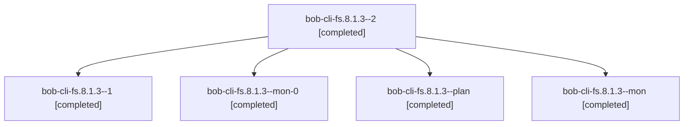

# Session: bob-cli-fs.8.1.3

[Agent Hoods](../README.md) / [bbugyi200](../users/bbugyi200/README.md) / [athena](../users/bbugyi200/machines/athena/README.md) / [bob-cli-fs](../users/bbugyi200/machines/athena/hoods/bob-cli-fs/README.md) / bob-cli-fs.8.1.3

Owner: `bbugyi200.athena` · Hood: `bob-cli-fs` · Members: 5 · Bead: [bob-cli-fs.8.1.3](https://github.com/bobs-org/bob-cli--beads/blob/main/pages/bob-cli-fs/bob-cli-fs.8.1.3.md)

## Lineage

The diagram is an optional enhancement; the ordered table below contains the same lineage in accessible text.

| Role | Agent | State | Model / provider | Timing | Commits | Prompt | Chat |
|---|---|---|---|---|---:|---|---|
| 2 | bob-cli-fs.8.1.3--2 | completed | gpt-6-luna / codex | 2026-11-02T13:44:30.277764+00:00 → 2026-11-02T13:47:24.509160+00:00 | 0 | — | — |
| 1 | bob-cli-fs.8.1.3--1 | completed | gpt-6-luna / codex | 2026-11-02T13:39:03.300728+00:00 → 2026-11-02T13:41:25.503166+00:00 | 0 | [Prompt](../agents/bbugyi200.athena.bob-cli-fs.8.1.3--1/prompt.md) | — |
| mon-0 | bob-cli-fs.8.1.3--mon-0 | completed | gpt-6-luna / codex | 2026-11-02T13:41:12.681318+00:00 → 2026-11-02T13:43:01.875414+00:00 | 0 | — | — |
| plan | bob-cli-fs.8.1.3--plan | completed | gpt-6-luna / codex | 2026-11-02T13:17:52.615436+00:00 → 2026-11-02T13:35:54.128400+00:00 | 0 | [Prompt](../agents/bbugyi200.athena.bob-cli-fs.8.1.3--plan/prompt.md) | [Chat](../agents/bbugyi200.athena.bob-cli-fs.8.1.3--plan/chat.md) |
| mon | bob-cli-fs.8.1.3--mon | completed | gpt-6-luna / codex | 2026-11-02T13:35:41.092295+00:00 → 2026-11-02T13:38:08.816343+00:00 | 0 | — | [Chat](../agents/bbugyi200.athena.bob-cli-fs.8.1.3--mon/chat.md) |

## Neighbors

| Agent | Relation | State |
|---|---|---|
| [bob-cli-fs.8](bbugyi200.athena.bob-cli-fs.8.md) (session · 3) | ancestor | active 1, completed 2 |
| [bob-cli-fs.8.1.1](../agents/bbugyi200.athena.bob-cli-fs.8.1.1/README.md) | bob-cli-fs.8.1 hood | completed |
| [bob-cli-fs.8.1.2](../agents/bbugyi200.athena.bob-cli-fs.8.1.2/README.md) | bob-cli-fs.8.1 hood | completed |
| [bob-cli-fs.8.1.4](../agents/bbugyi200.athena.bob-cli-fs.8.1.4/README.md) | bob-cli-fs.8.1 hood | completed |
| [bob-cli-fs.8.1.land](bbugyi200.athena.bob-cli-fs.8.1.land.md) (session · 3) | bob-cli-fs.8.1 hood | completed 1, failed 2 |
| [bob-cli-fs.8.1.land](../agents/bbugyi200.athena.bob-cli-fs.8.1.land/README.md) | bob-cli-fs.8.1 hood | completed |
| [bob-cli-fs.1](bbugyi200.athena.bob-cli-fs.1.md) (session · 3) | bob-cli-fs hood | completed 3 |
| [bob-cli-fs.10](../agents/bbugyi200.athena.bob-cli-fs.10/README.md) | bob-cli-fs hood | waiting |
| [bob-cli-fs.11](../agents/bbugyi200.athena.bob-cli-fs.11/README.md) | bob-cli-fs hood | waiting |
| [bob-cli-fs.2](bbugyi200.athena.bob-cli-fs.2.md) (session · 3) | bob-cli-fs hood | active 1, completed 2 |
| [bob-cli-fs.2.1.1](../agents/bbugyi200.athena.bob-cli-fs.2.1.1/README.md) | bob-cli-fs hood | completed |
| [bob-cli-fs.2.1.2](../agents/bbugyi200.athena.bob-cli-fs.2.1.2/README.md) | bob-cli-fs hood | completed |
| [bob-cli-fs.2.1.3](../agents/bbugyi200.athena.bob-cli-fs.2.1.3/README.md) | bob-cli-fs hood | completed |
| [bob-cli-fs.2.1.land](bbugyi200.athena.bob-cli-fs.2.1.land.md) (session · 3) | bob-cli-fs hood | completed 3 |
| [bob-cli-fs.3](bbugyi200.athena.bob-cli-fs.3.md) (session · 5) | bob-cli-fs hood | completed 3, failed 2 |
| [bob-cli-fs.4](bbugyi200.athena.bob-cli-fs.4.md) (session · 3) | bob-cli-fs hood | active 1, completed 2 |
| [bob-cli-fs.4.1.1](bbugyi200.athena.bob-cli-fs.4.1.1.md) (session · 4) | bob-cli-fs hood | completed 3, failed 1 |
| [bob-cli-fs.4.1.2](../agents/bbugyi200.athena.bob-cli-fs.4.1.2/README.md) | bob-cli-fs hood | active |
| [bob-cli-fs.4.1.3](../agents/bbugyi200.athena.bob-cli-fs.4.1.3/README.md) | bob-cli-fs hood | waiting |
| [bob-cli-fs.4.1.4](../agents/bbugyi200.athena.bob-cli-fs.4.1.4/README.md) | bob-cli-fs hood | active |
| [bob-cli-fs.4.1.5](../agents/bbugyi200.athena.bob-cli-fs.4.1.5/README.md) | bob-cli-fs hood | active |
| [bob-cli-fs.4.1.6](../agents/bbugyi200.athena.bob-cli-fs.4.1.6/README.md) | bob-cli-fs hood | active |
| [bob-cli-fs.4.1.land](../agents/bbugyi200.athena.bob-cli-fs.4.1.land/README.md) | bob-cli-fs hood | waiting |
| [bob-cli-fs.5](../agents/bbugyi200.athena.bob-cli-fs.5/README.md) | bob-cli-fs hood | waiting |
| [bob-cli-fs.6](../agents/bbugyi200.athena.bob-cli-fs.6/README.md) | bob-cli-fs hood | completed |
| [bob-cli-fs.7](../agents/bbugyi200.athena.bob-cli-fs.7/README.md) | bob-cli-fs hood | completed |
| [bob-cli-fs.9](../agents/bbugyi200.athena.bob-cli-fs.9/README.md) | bob-cli-fs hood | completed |
| [bob-cli-fs.land](../agents/bbugyi200.athena.bob-cli-fs.land/README.md) | bob-cli-fs hood | waiting |
